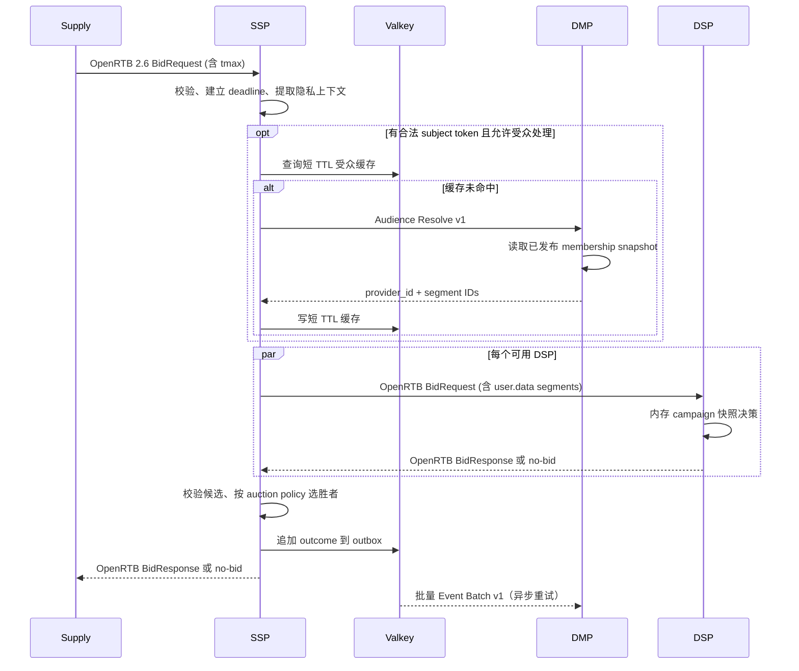

# Open Ads 高层设计（HLD）

## 1. 系统上下文

三个服务独立部署、独立故障域、独立数据所有权。服务发现、TLS、密钥分发和部署平台暂不绑定特定云或编排系统。内网 API 必须鉴权并加密；公网 SSP 入口另有流量清洗、限流和请求体上限。

| 调用方 | 被调用方 | 契约 | 同步性 | 超时/失败行为 |
|---|---|---|---|---|
| Supply | SSP | OpenRTB 2.6 BidRequest/BidResponse | 同步 | 总预算受 `tmax` 和供给方约定约束 |
| SSP | DSP | OpenRTB 2.6 BidRequest/BidResponse | 同步、并发 fan-out | 单 DSP 超时视为 no-bid；其余 DSP 继续 |
| SSP | DMP | 内部 `Audience Resolve v1` | 同步，可短 TTL 缓存 | 超时不阻塞整个拍卖；按 Placement 策略无受众继续或 no-bid |
| SSP | DMP | 内部 `Event Batch v1` | 异步重试，经 SSP outbox | DMP 暂不可用时保留并重试；设置最大积压和告警 |
| SSP | DSP | OpenRTB Win Notice URL | 异步回调 | DSP 用事件幂等键结算；重复通知不重复扣账 |

OpenRTB 的 no-bid 语义和 HTTP 表达按 2.6 契约实现；不得把内部 DMP API 包装成 OpenRTB endpoint。

## 2. 核心时序

实际实现可让 DMP 查询与 DSP fan-out 并行；只有需要受众数据的 DSP 请求必须等待解析，未配置受众依赖的 DSP 可以先并发发起。实现不得越过总 deadline。

## 3. 服务与领域边界

### SSP

- OpenRTB ingress/egress 适配器只负责协议验证、映射和响应序列化。
- Auction application service 协调 Placement 策略、DMP 解析、DSP 并发调用、响应校验、拍卖和 outbox。
- SSP domain 拥有供给库存和 auction policy；不持有 DSP campaign/creative/budget 或 DMP profile 对象。
- Valkey adapter 实现 SSP 自己的配置仓储、受众缓存和 outbox port。

### DSP

- OpenRTB bidder adapter 校验版本、request ID、impression 和预算 deadline。
- Bid application service 使用 DSP 自己的 campaign/line item/creative/targeting/budget 领域快照生成候选。
- MariaDB 是配置、预算账本、win settlement 的权威数据源；热路径内存快照有版本号及最大允许陈旧时间。
- 不调用 SSP/DMP 数据库。赢标结算以 OpenRTB Win Notice 和内部唯一事件 ID 幂等处理。

### DMP

- DMP API adapter 实现受众解析、快照发布和批量事件接入；只暴露 provider/segment 公开标识，不暴露 ClickHouse 行结构。
- Audience application service 负责授权检查、快照选择和结果限制。
- ClickHouse 保存不可变的 segment definition、membership snapshot、snapshot publication 及分析事件。
- DMP 不读取 SSP Valkey 或 DSP MariaDB；SSP/DSP 也不直接查 ClickHouse。

## 4. 数据与一致性

- **SSP / Valkey**：RDB+AOF 策略需根据恢复点目标确认。Valkey 的原子性只在命令/脚本覆盖的 key 范围内成立；集群下多 key 操作必须落在同一 hash slot。索引视为可重建数据，聚合根快照是配置事实。
- **DSP / MariaDB**：InnoDB 事务保证预算账本和赢标结算的一致性。Campaign 发布通过版本号驱动内存快照更新；实例报告已加载版本，发布控制面等待或告警未跟上的实例。
- **DMP / ClickHouse**：事件至少一次送达，报表和导出按 `event_id` 去重/唯一计数；不承诺恰好一次。受众快照全量装载、校验后再发布，查询固定 `snapshot_id`，避免读到半成品。
- 不做跨服务分布式事务。每个动作采用幂等键、重试和可观测的补偿/重放机制。

## 5. 容错、隐私与安全

- SSP 对 DSP 使用每目标独立连接池/并发限制；失败、熔断或超过 deadline 均视为 no-bid，不能拖住其他 DSP。
- DMP 查询必须有 SSP 端短 TTL 缓存、最大结果数、独立 timeout 和熔断。对无同意/无合法标识的请求不进行解析，也不将可识别原值作为缓存 key。
- SSP outbox 需有最大容量、老化策略、重试退避和积压告警；达到容量上限时记录明确丢弃计数，不影响响应 deadline。
- DSP 预算租约有额度、实例 owner、过期时间和回收规则；租约暂不可用时停止对相关 line item 出价，不得绕过预算限制。
- DMP 的快照/API 响应只返回最小 segment 标识；事件和身份 token 的保留期、删除流程以及 ClickHouse 分区 TTL 需按法规与合同确定。
- 内部 API 使用 mTLS 或等效服务身份、请求签名/重放保护、每租户限流；错误响应不回显原始身份或完整请求体。

## 6. 可观测性和部署

每个服务拥有独立配置、健康检查、版本、指标和发布回滚。标准库 `net/http` 配合轻量中间件函数实现 request ID、deadline、结构化日志和 metrics/tracing 接口，不要求采用 Web 框架。

最低指标：入口 QPS/错误率/延迟分位数；SSP 各 DSP 响应时延、no-bid、超时和清算差异；DMP cache hit、ClickHouse lookup 延迟、快照版本/新鲜度；DSP 活跃快照版本、预算租约余量、settlement 重复率；Valkey 内存、持久化延迟和 outbox 积压；MariaDB 事务冲突/慢查询；ClickHouse insert/query 延迟及 parts/磁盘水位。

## 7. 尚未定案的容量参数

目前没有足够业务输入设置数值型 SLA。进入实现前确定：峰值/突发 QPS、DSP 数量及并发、`tmax` 分布、目标 P95/P99、可用性、DMP membership 行数和更新频率、缓存命中目标、预算超支容忍度、恢复点/恢复时长、数据保留期限、部署地域及法规范围。