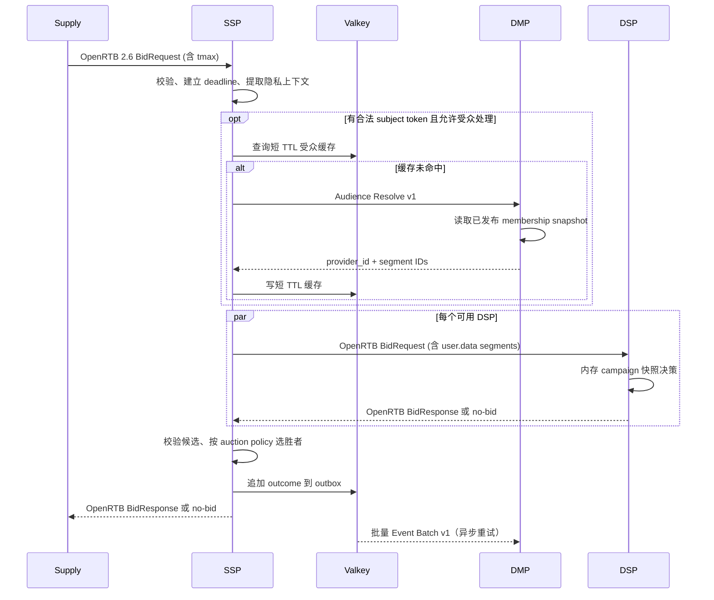
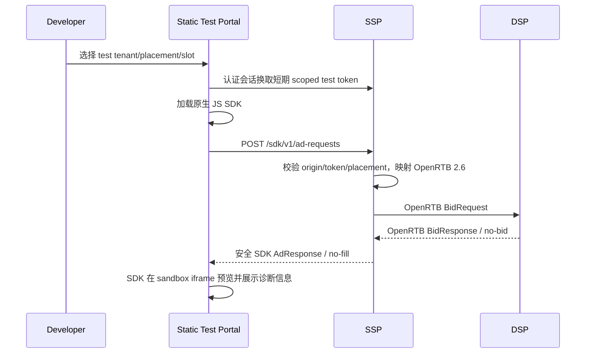
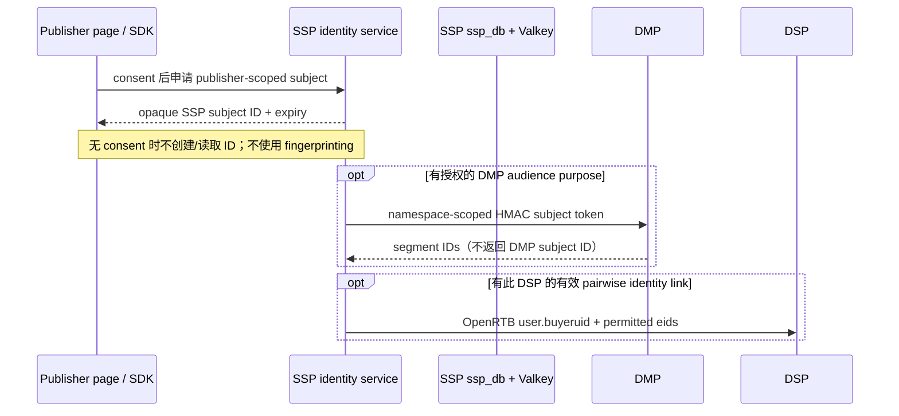
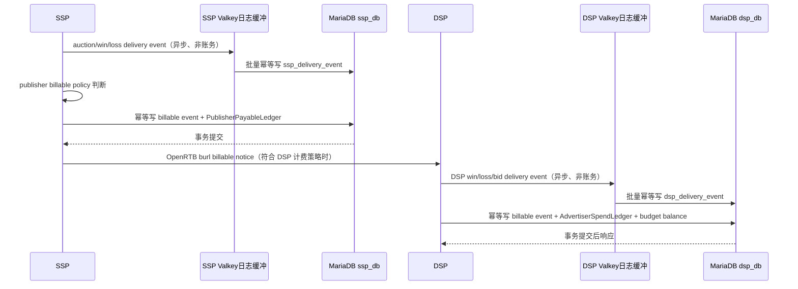

# Open Ads 高层设计（HLD）

## 1. 系统上下文

三个服务独立部署、独立故障域、独立数据所有权。服务发现、TLS、密钥分发和部署平台暂不绑定特定云或编排系统。内网 API 必须鉴权并加密；公网 SSP 入口另有流量清洗、限流和请求体上限。

SSP 与 DSP 的业务事实分别存放在 MariaDB 的 `ssp_db`、`dsp_db`，使用独立数据库账号、授权、迁移和连接池；可先共用 MariaDB 集群，但应用没有跨库查询权限。Valkey 是两应用热缓存，不是事实源；缓存使用应用前缀和独立 ACL 身份。RTB 竞价路径不得因缓存 miss 同步回源 MariaDB。

Test Portal 是独立静态测试客户端，不增加第四个广告业务域或数据库。原生 JS SDK 调用 SSP Client API；SSP 将 client request 映射成 OpenRTB 2.6 BidRequest，DSP 仍只接收标准 OpenRTB。Portal 仅连接 sandbox/test 环境。

| 调用方 | 被调用方 | 契约 | 同步性 | 超时/失败行为 |
|---|---|---|---|---|
| Supply | SSP | OpenRTB 2.6 BidRequest/BidResponse | 同步 | 总预算受 `tmax` 和供给方约定约束 |
| Test Portal / JS SDK | SSP | SSP Client API v1 (`/sdk/v1/ad-requests`) | 同步 | 短期测试 token、tenant/placement scope、精确 CORS allowlist 与 rate limit；返回安全渲染 DTO |
| SSP | DSP | OpenRTB 2.6 BidRequest/BidResponse | 同步、并发 fan-out | 单 DSP 超时视为 no-bid；其余 DSP 继续 |
| SSP | DMP | 内部 `Audience Resolve v1` | 同步，可短 TTL 缓存 | 超时不阻塞整个拍卖；按 Placement 策略无受众继续或 no-bid |
| SSP | DMP | 内部 `Event Batch v1` | 异步重试，经 SSP outbox | DMP 暂不可用时保留并重试；设置最大积压和告警 |
| SSP | DSP | OpenRTB `nurl`/`lurl`/`burl` 回调 URL | 异步回调 | win/loss 只记状态；仅 billable event 按合同触发 DSP spend，重复通知幂等 |

OpenRTB 的 no-bid 语义和 HTTP 表达按 2.6 契约实现；不得把内部 DMP API 包装成 OpenRTB endpoint。

## 2. 核心时序

实际实现可让 DMP 查询与 DSP fan-out 并行；只有需要受众数据的 DSP 请求必须等待解析，未配置受众依赖的 DSP 可以先并发发起。实现不得越过总 deadline。

### Test Portal 与 JS SDK 请求流

测试 token 只授权指定 test tenant、placement、origin 和短时间窗；不包含 MariaDB/Valkey/DSP 凭证。Portal 的诊断视图默认去敏，不显示完整 OpenRTB 用户对象、身份 token 或 bidder secrets。通过权限控制可显示 request/response 的结构化脱敏摘要及各阶段 latency。

### User ID sync 时序

SSP `user.id` 是 exchange-scoped；对每个 DSP 生成/保存独立 pairwise `buyeruid`。DMP 使用按 tenant/publisher namespace 派生的伪名 token，不保存或回传 DSP buyer ID。没有 mapping 时省略 `buyeruid`；是否发送 exchange ID/EID 由 consent、provider agreement 和 DSP profile 决定。不得为弥补第三方 cookie 限制而 fingerprint 用户。

## 3. 配信日志与结算时序

竞价/投放 delivery event 通过各自有界 Valkey Stream 缓冲，以 at-least-once 消费者批量写入对应 MariaDB 的 `ssp_delivery_event`/`dsp_delivery_event`；仅在 DB 提交后 ack，使用稳定 source event key 去重。缓冲积压、重试、淘汰和丢弃必须告警；Valkey 不替代 MariaDB 日志事实。账务事件不得只存在缓存队列：publisher payable 触发事件在 `ssp_db` 原子落账，DSP 的 billable notice 在 `dsp_db` 原子落账。账务 endpoint 是独立回调，不阻塞原始 RTB BidRequest 的响应时限。

OpenRTB `nurl` 只表示赢标，不能单独产生 advertiser spend；`burl` 是 exchange 按约定 billable policy 调用的账单通知。publisher 应付金额按 SSP 与 publisher 的合同策略计算，可能基于有效展示或其他约定事件，不直接等同 DSP 的 bid price 或 advertiser spend。SSP gross revenue、publisher payable 和 SSP margin 是不同指标；本设计的 PublisherPayableLedger 只记录应付负债。

## 4. 服务与领域边界

### SSP

- OpenRTB ingress/egress 适配器只负责协议验证、映射和响应序列化。
- Auction application service 协调 Placement 策略、DMP 解析、DSP 并发调用、响应校验、拍卖和 outbox。
- SSP domain 拥有供给库存和 auction policy；不持有 DSP campaign/creative/budget 或 DMP profile 对象。
- MariaDB adapter 实现 SSP 配置/供给领域的持久仓储；Valkey adapter 只实现版本化热配置缓存、短期受众缓存和短期事件缓冲。
- 配置控制面事务提交后，由后台刷新器消费配置变更并更新 Valkey/进程快照。auction handler 只读进程内快照或 Valkey，不在 RTB 路径回源 `ssp_db`。
- SSP 自己定义 `DeliveryLog` 与 `PublisherPayableLedger`；publisher 账务依据 publisher contract policy 和有效 billable event，在 `ssp_db` 原子记录。
- SSP 拥有 publisher-scoped subject 和 partner-specific identity link；pairwise mapping 在 `ssp_db` 持久化、Valkey/进程快照缓存。每个 OpenRTB outbound request 只取目标 DSP 对应 link。

### DSP

- OpenRTB bidder adapter 校验版本、request ID、impression 和预算 deadline。
- Bid application service 使用 DSP 自己的 campaign/line item/creative/targeting/budget 领域快照生成候选。
- DSP 使用独立的 `dsp_db` 存配置、预算账本、预算租约和 win settlement；Valkey/进程内保存版本化候选与投放快照。
- 热路径只读已预热的本地快照（可由 Valkey 分发/恢复），不在每个 bid request 上读取 MariaDB。后台刷新器消费配置版本变更；预算租约在后台预分配，热路径仅扣减本地租约额度。
- DSP 自己定义 `DeliveryLog` 与 `AdvertiserSpendLedger`；只对验证通过且符合计费策略的 billable event 入账。`nurl` win notice 只更新竞价状态，不自动扣 advertiser budget。
- DSP 只接收其自己的 OpenRTB `buyeruid`/获准 `eids`，不读取 SSP identity link 或 DMP 身份映射；DSP 不因竞价要求反向索取全局 user ID。
- 不调用 SSP/DMP 数据库。OpenRTB Win Notice 记为非计费赢标事件；DSP 只在 billable notice 到达后按内部唯一事件 ID 幂等扣减 advertiser spend。

### DMP

- DMP API adapter 实现受众解析、快照发布和批量事件接入；只暴露 provider/segment 公开标识，不暴露 ClickHouse 行结构。
- Audience application service 负责授权检查、快照选择和结果限制。
- ClickHouse 保存不可变的 segment definition、membership snapshot、snapshot publication 及分析事件。
- DMP 不读取 SSP Valkey 或 DSP MariaDB；SSP/DSP 也不直接查 ClickHouse。

## 5. 数据与一致性

- **SSP / MariaDB + Valkey**：`ssp_db` 是 SSP 配置/供给数据事实源，InnoDB 事务提交后由后台刷新器更新版本化 Valkey 缓存和进程内快照。Valkey 丢失可重建；RTB 缓存 miss 不允许直接读 DB，实例需使用仍在有效期的本地快照，否则对受影响 placement no-bid/不就绪。
- **DSP / MariaDB + Valkey**：`dsp_db` 是 DSP 配置、预算和 advertiser spend 结算事实源；独立事务保证预算账本和 billable settlement 一致性。Campaign 发布以版本号刷新 Valkey/内存快照；预算租约由后台预分配，实例报告已加载版本，发布控制面等待或告警未跟上的实例。
- **SSP 财务事件**：同一 MariaDB 事务插入去重后的 billable delivery event、追加 PublisherPayableLedger 分录并更新可重建的余额/日报汇总。应付分录不可覆盖；冲正以带原分录引用的新负分录表达。
- **DSP 财务事件**：同一 MariaDB 事务插入去重后的 billable delivery event、追加 AdvertiserSpendLedger 分录并扣减 BudgetAccount；重复 `burl` 按唯一 source event key 返回幂等成功，冲正使用新分录。
- **日志语义**：delivery event 是追加式事件，至少一次投递，以稳定 event ID 去重；财务账本是可审计权威记录。运营报表可由日志/账本生成，汇总表可重建，不得反向覆盖账本。
- **跨系统对账**：SSP 与 DSP 通过 exchange/auction/bid/imp 标识和双方确认的计费事件做定期文件/API 对账；各服务只读写自己的库，不执行跨库 join。SSP publisher payable 与 DSP advertiser spend 金额允许按合同不同，差额应拆解为 fee/revenue share/tax/rounding 等显式项目。
- **身份映射**：身份 link 只由 SSP 持有且按 publisher/partner 隔离；DMP 收到 HMAC namespace token，DSP 收到自己的 buyeruid。不是三边复制同一个 user ID，也不创建跨库 user table。
- **数据库隔离**：`ssp_db` 与 `dsp_db` 分离账号、grant、连接池、schema migration 和备份恢复策略；同一 MariaDB 集群不等于共享领域数据库。任何服务禁止跨库读取另一个 bounded context 的表。
- **DMP / ClickHouse**：事件至少一次送达，报表和导出按 `event_id` 去重/唯一计数；不承诺恰好一次。受众快照全量装载、校验后再发布，查询固定 `snapshot_id`，避免读到半成品。
- 不做跨服务分布式事务。每个动作采用幂等键、重试和可观测的补偿/重放机制。

## 6. 容错、隐私与安全

- SSP 对 DSP 使用每目标独立连接池/并发限制；失败、熔断或超过 deadline 均视为 no-bid，不能拖住其他 DSP。
- DMP 查询必须有 SSP 端 Valkey 短 TTL 缓存、最大结果数、独立 timeout 和熔断。对无同意/无合法标识的请求不进行解析，也不将可识别原值作为缓存 key。
- SSP outbox 需有最大容量、老化策略、重试退避和积压告警；达到容量上限时记录明确丢弃计数，不影响响应 deadline。
- DSP 预算租约有额度、实例 owner、过期时间和回收规则；租约暂不可用时停止对相关 line item 出价，不得绕过预算限制。
- 账务通知先验证服务身份、签名/来源、auction/bid/imp 关联和币种/金额范围，再执行幂等落账；无法验证的 notice 隔离并告警，不计入 publisher payable 或 advertiser spend。
- 日志采集与财务入账使用不同队列/限流池，防止高流量诊断事件挤占账务写入容量；ledger 写失败必须重试/告警，不可静默丢弃。
- identity sync 必须有可审计的 consent purpose/version、partner allowlist、link TTL 与撤回/删除流程；原始 ID 使用 envelope encryption，仅用 keyed hash 做匹配索引。撤回即停止下发并清理缓存，不记录原始 ID/完整 consent。
- DMP 的快照/API 响应只返回最小 segment 标识；事件和身份 token 的保留期、删除流程以及 ClickHouse 分区 TTL 需按法规与合同确定。
- 内部 API 使用 mTLS 或等效服务身份、请求签名/重放保护、每租户限流；错误响应不回显原始身份或完整请求体。

## 7. 可观测性和部署

每个服务拥有独立配置、健康检查、版本、指标和发布回滚。标准库 `net/http` 配合轻量中间件函数实现 request ID、deadline、结构化日志和 metrics/tracing 接口，不要求采用 Web 框架。

最低指标：入口 QPS/错误率/延迟分位数；SSP 各 DSP 响应时延、no-bid、超时和清算差异；SSP/DSP delivery event 接收/积压/去重数；publisher payable 与 DSP spend 入账金额、冲正金额、ledger 写入失败/延迟、DSP budget ledger reconciliation 差异；SSP/DSP Valkey 命中率、缓存版本与陈旧度；DMP cache hit、ClickHouse lookup 延迟、快照版本/新鲜度；DSP 预算租约余量和 settlement 重复率；Valkey 内存/淘汰率；分别按 `ssp_db`、`dsp_db` 观测 MariaDB 连接池、事务冲突和慢查询；ClickHouse insert/query 延迟及 parts/磁盘水位。

## 8. 尚未定案的容量参数

目前没有足够业务输入设置数值型 SLA。进入实现前确定：峰值/突发 QPS、DSP 数量及并发、`tmax` 分布、目标 P95/P99、可用性、DMP membership 行数和更新频率、缓存命中目标、预算超支容忍度、delivery log 与财务账本保留期限/归档策略、日志缓冲可接受积压时间、恢复点/恢复时长、部署地域及法规范围。

按服务划分的完整 API 路由、请求/响应和认证矩阵见 [API 设计](API.md)。