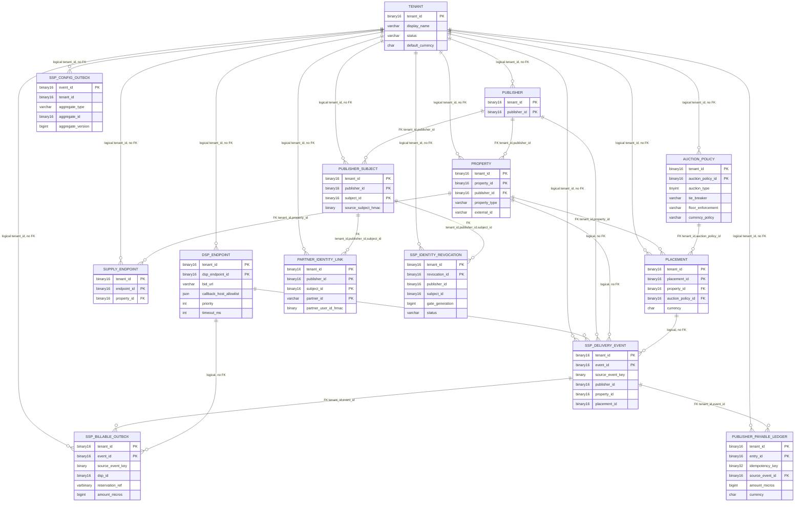
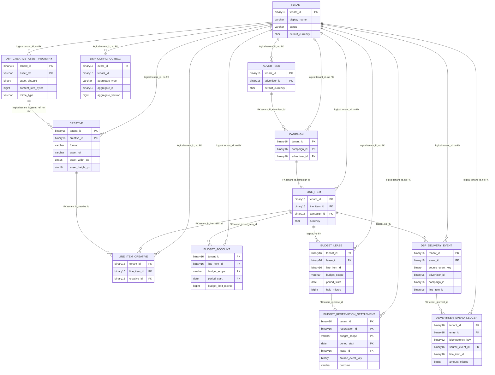
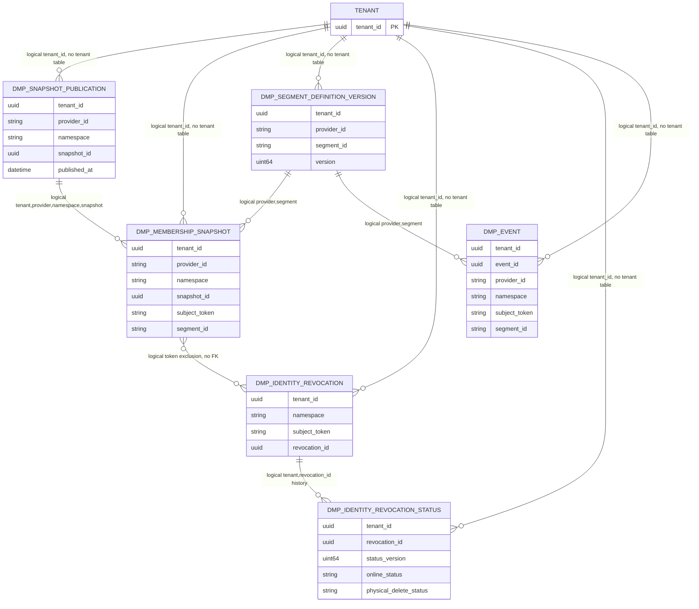

# Open Ads 低层设计（LLD）

状态：提交版实现设计，供工程实施、代码评审和测试门槛使用。本文档与 [README.md](README.md) 和 [HLD.md](HLD.md) 使用统一术语、统一边界和统一验收口径，确保从架构总览到实现细节是一套一致的设计提交物。

本文定义实现级约束、领域结构、数据布局、状态机和失败语义，适用于工程落地和代码设计评审。本文不重复阐述系统目标，而是补充“如何组织代码、如何存储数据、如何保证状态一致性”。按服务整理的 API 路由、请求/响应与失败语义见 [API 设计](API.md)。数据库版本、驱动、部署拓扑和规模指标待评审后锁定。

## 0. 术语与文档定位

共享术语以 [README.md](README.md) §0.2 为准。LLD 仅定义实现级字段、状态和约束；如需增加实现专用术语，必须保持与总览定义一致。

## 1. 设计目标与落地边界

本章节面向开发人员，明确以下关键问题：

- 代码如何按应用拆分：SSP、DSP、DMP 各自的模块职责
- 数据如何落库：MariaDB/ClickHouse/Valkey 的事实源与缓存职责划分
- 关键状态如何保证一致性：budget reservation、deny gate、outbox 和 revocation
- 实现中必须遵守的边界：领域隔离、幂等、可恢复性和审计要求

以下内容是后续模块设计和代码实现的底线，不得在实现阶段被绕开。

### 1.1 Go 应用结构

三个应用分别位于独立仓库或独立 Go module；以下目录在各自仓库内，不建立共享领域包：

```text
cmd/<app>/main.go
internal/<app>/domain/          # 聚合、值对象、领域规则
internal/<app>/application/     # 用例、事务/并发编排
internal/<app>/ports/           # 仅本服务的存储和外部 API 接口
internal/<app>/adapter/http/    # net/http handler、wire DTO、映射
internal/<app>/adapter/store/   # 本服务数据库实现
internal/<app>/config/
internal/<app>/observability/
```

wire DTO 和 OpenRTB 类型留在对应服务 adapter 内。领域层不导入 `net/http`、Valkey 客户端、SQL 驱动或 ClickHouse 客户端。应用层依赖本应用定义的窄接口，依赖方向指向 domain/application。

### 1.2 实施门槛

进入实现阶段的统一门槛和验收场景见 [README.md](README.md) §7。本文件后续章节给出这些门槛对应的实现约束与数据结构，不重复维护另一份门槛清单。

### 1.3 数据类型、金额与标识符约束

货币字段统一以整数微单位存储，`1 currency unit = 1,000,000 micros`；`*_micros` 表示主币单位的百万分之一，`*_cpm_micros` 表示每 1,000 次展示的 CPM 主币微单位。OpenRTB wire `price` 仍按协议以十进制 CPM 传输。对 CPM 计价的 billable event，单次金额按 `round_half_even(cpm_micros * quantity / 1000)` 计算为主币微单位；未提供 `qty.multiplier` 时 quantity 为 1。非 CPM 计价须在交易 profile 定义等价转换。计算使用十进制定点/有理数并检查溢出，不得使用 binary float 累计。对外付款/报表按 ISO-4217 币种最小单位和合同约定的舍入时点转换。

**`*_micros` 数据库类型统一约定（覆盖本节后续所有 CREATE TABLE 的 `_micros` 列）：**

所有金额/报价/预算微单位列在 MariaDB 中统一声明为 `BIGINT SIGNED`（有符号 64 位整数），禁止使用 `BIGINT UNSIGNED`。原因：
1. `ledger.amount_micros`（账单分录）必须允许负数（冲正/退款/对账差异），如果同一 `_micros` 语义的字段在不同表混用 UNSIGNED/SIGNED，会导致比较运算、SUM 聚合、外键类型不一致等隐式 bug。
2. UNSIGNED BIGINT 在 Go/SQL driver 层映射到 `uint64`，但财务计算（保留中间结果、临时负数）几乎全部走 `int64` 定点，混用两种类型会造成大量的显式类型转换和溢出风险。
3. 理论上限：`2^63 - 1 ≈ 9.22 × 10^18 micros = 9.22 × 10^12` 主币单位（如 USD 9.22 万亿），远超任何单笔 campaign、任何账本分录的可想象上限，Signed 范围完全足够。

**非负约束（CHECK）按字段语义分层：**

| 语义（列名示例） | 取值约束（CHECK，所有 DDL 的对应列必须带，除非下方另有说明） |
|---|---|
| 上限/报价类：`budget_limit_micros`、`floor_cpm_micros`、`bid_cpm_micros` | `CHECK (col >= 0)`；预算 0 合法（代表暂停投放），floor 0 合法（代表不设 floor） |
| 累计类：`spent_micros`、`leased_micros`、`held_micros` | `CHECK (col >= 0)`；永远非负 |
| 预留/实际类：`reserved_max_micros`、`actual_amount_micros`、`available_micros` | `CHECK (col >= 0)`；永远非负 |
| 事件分录类：`delivery_event.amount_micros` | 允许 `NULL`（未结算 / 非 billable event）；非 NULL 时 `CHECK (amount_micros IS NULL OR amount_micros >= 0)`。首期 Sandbox 印象/点击/渲染事件中非 billable 的 click/render_error 一律存 `NULL`，禁止存 0（0 会在统计中被误当 0 元 billable 事件） |
| 账本分录类：`publisher_payable_ledger.amount_micros`、`advertiser_spend_ledger.amount_micros` | 允许负数（冲正）；`CHECK (amount_micros != 0)`（零值分录无意义，禁止入库）。冲正必须写一条与原分录金额绝对值相等、符号相反的新分录（附带关联原分录 ID），绝不 UPDATE 历史分录的 `amount_micros`。 |

所有 CREATE TABLE 必须显式使用 `BIGINT SIGNED` 并按字段语义声明 CHECK；禁止将 UNSIGNED 简写为有符号约束。可空事件金额与可负账本分录遵循上表各自语义，迁移 review 必须逐列核验类型和约束。

建议端口形态（每个应用自行定义，不跨 module 共享）：

```go
type Clock interface { Now() time.Time }
type IDGenerator interface { NewID() ID }
// ID 是 128-bit 抽象 ID；内部以 [16]byte 存储，对外提供 hex/UUID 文本的 parse/format。
// 禁止把 ID 当作"字符串主键"，禁止在代码里手动拼接 hex。
type ID interface {
    Bytes() [16]byte
    String() string // 32 hex chars（无连字符）；wire DTO、HTTP JSON、URL path 均使用此格式
    IsZero() bool
}
```

**ID 生成统一方案：RFC 9562 UUID v7（时间有序）+ big-endian 字节序。** 禁止使用 UUID v1（MAC 泄漏）、v4（无序导致 B 树索引写放大）或自增 INT（枚举风险 & 跨库合并困难）。

- UUID v7 结构：前 48 bits 为毫秒级 Unix 时间戳（UTC，单调时钟防回拨），中间 12 bits 随机（版本 0x7），后 62 bits 随机（variant RFC 4122 Leach-Salz = `10`）。
- **MariaDB 存储**：始终使用 `BINARY(16)` + 大端字节序（把 UUID v7 原始 128 bits 按网络字节序写入；不使用 MySQL `UUID_TO_BIN(,1)` 的"时间高位翻转"格式，避免迁移到其他 DB/programming language 时产生 byte order bug）。
- **ClickHouse 存储**：使用原生 `UUID` 列类型（ClickHouse UUID 是 RFC 4122 大端 16-byte，与 MariaDB BINARY(16) big-endian 逐字节等价；`toString(uuid_col)` 输出的是带 `-` 的 UUID 文本，跨系统传输时统一用 `replaceRegexpAll(toString(uuid), '-', '')` 产出 32-hex 无连字符版本，保证所有服务 wire 格式一致）。
- **字符串化约定**：所有对外 JSON DTO、HTTP path/query 参数、日志关联 ID、测试输出一律输出 **32 hex 字符、无连字符、全小写**（例如 `018f7a3b2c9d7e1fa3b4c5d6e7f89012`）。解析时同时兼容带连字符（8-4-4-4-12）的 UUID 文本与 32-hex 无连字符两种，但输出永远是无连字符 32-hex。
- **零值**：全零 16 字节 = `00000000000000000000000000000000`，语义等同于 `NULL`；业务表主键不允许零值，外键允许零值表示"无关联"。
- **单调性保证**：同一实例、同一毫秒内若产生多 ID，使用每 ID 递增的 counter 填充后 62 bits 的最低若干位，保证同一毫秒生成的 ID 在实例内严格单调；跨实例不要求全局有序。

每个服务的 repository/client 接口使用自己的 domain 类型；不创建通用 `Repository[T]` 或 `common.Entity`。

### 1.4 数据库 ER 图

以下图依据本节后续的表定义绘制。MariaDB 图中标为 `FK` 的关系对应 DDL 外键；标为 `logical, no FK` 的关系仅表示字段关联，数据库不强制完整性。`ssp_db`、`dsp_db` 与 ClickHouse 相互独立，不存在跨库关系。

SSP 与 DSP 图中的 `TENANT` 对应各自 MariaDB 内独立的 `tenant` 表；DMP 图中的 `TENANT` 是逻辑分区根，ClickHouse 不建 tenant 表。图中所有租户边均表示 `tenant_id` 作用域关系，不代表数据库外键。

#### SSP (`ssp_db`)



`ssp_config_outbox.aggregate_type`/`aggregate_id` 是多态聚合引用，不是外键；delivery event 中的 publisher/property/placement/endpoint ID 和 billable outbox 中的 endpoint ID 也未在 DDL 声明外键。`ssp_billable_outbox.event_id` 与 `ssp_identity_revocation` 到 subject 的关系有 DDL 外键。DDL 的唯一约束均为复合键，例如 property 的 `(tenant_id, property_type, external_id)`、subject 的来源 HMAC、partner identity 和 event/ledger 幂等键；图中不把它们误表示为单列唯一。

#### DSP (`dsp_db`)



`dsp_config_outbox.aggregate_type`/`aggregate_id` 是多态聚合引用，不是外键。`dsp_creative_asset_registry` 通过 `(tenant_id, asset_ref)` 与 creative 逻辑关联，DDL 不声明外键。`budget_lease` 的 line item/scope/period 和 `budget_reservation_settlement` 的预算范围、delivery event 的 advertiser/campaign/line item ID 是逻辑引用；表定义没有对应外键。settlement 的 source event key 也没有直接指向 delivery event 的外键。DDL 中 source event 和幂等唯一键均包含 tenant/scope 等列，图中只列键字段，不表示其为单列唯一。

#### DMP (ClickHouse)



ClickHouse 表不声明主键或外键；图中的 DMP 连线都是查询/版本关联，不提供数据库级 referential integrity。各表的 `ORDER BY` 是 MergeTree 排序键，不等同于唯一键。

### 1.5 租户（Tenant）模型

`tenant_id` 是所有业务表的主键前缀，代表一个数据隔离域。首期 MVP 中：
- SSP 的 `ssp_db` 中存在一个 `tenant` 表，描述 SSP 侧的租户元数据；管理 API 请求必须明确提供 `tenant_id`，Publisher、Property、Placement、DSP Endpoint 等资源查询均将其作为行级过滤条件。
- DSP 的 `dsp_db` 中同样存在一个独立的 `tenant` 表；管理 API 请求必须明确提供 `tenant_id`，Advertiser、Campaign、LineItem、Creative 等资源查询均将其作为行级过滤条件。
- DMP 使用 ClickHouse 的 `tenant_id` 列做逻辑分区过滤，不单独建租户表。
- 跨服务调用时，SSP 将自身解析出的 `tenant_id` 放入内部服务请求 DTO（如 `audience:resolve` 的 `tenant_id` 字段）。SSP 发往 DSP 的 OpenRTB BidRequest 不携带 SSP `tenant_id`；DSP 的 `tenant_id` 来自其自身 bidder 接入 profile 中预先配置的 SSP partner→DSP tenant 映射。首期 MVP 两个 DB 中的 sandbox tenant 使用相同的 fixture UUID，便于本地联调。

两个 `tenant` 表结构相同但互相独立（不同数据库、不同迁移周期、不同连接池、最小权限授权）：

```sql
-- ssp_db 与 dsp_db 分别独立建表，不共享数据、不做跨库同步
CREATE TABLE tenant (
  tenant_id BINARY(16) NOT NULL,
  display_name VARCHAR(128) NOT NULL,
  status VARCHAR(16) NOT NULL,
  default_currency CHAR(3) NULL,
  created_at DATETIME(6) NOT NULL,
  updated_at DATETIME(6) NOT NULL,
  version BIGINT UNSIGNED NOT NULL,
  PRIMARY KEY (tenant_id)
) ENGINE=InnoDB;
```

首期 sandbox 预置一条 fixture 租户，由数据库迁移脚本插入：
- `tenant_id = 018f7a3b2c9d7e1fa3b4c5d6e7f89012`（符合本文无连字符 UUID v7 线格式的固定 sandbox fixture，不得用于生产）
- `display_name = 'Sandbox Demo Tenant'`
- `default_currency = 'USD'`
- `status = 'active'`

管理操作应记录审计事件，并对敏感字段脱敏。写操作使用 body 中的 `version` 字段进行乐观锁校验，不使用 HTTP `ETag` / `If-Match`。

## 2. SSP LLD

### 2.1 聚合与不变量

| 聚合根 | 主要内容 | 关键不变量 |
|---|---|---|
| Publisher | publisher 状态、允许的供给身份 | 暂停状态不得创建新 auction |
| PublisherScopedSubject | 单 publisher 范围的 SSP opaque subject ID 与 consent 生命周期 | 随机不可推导；不跨 publisher/tenant 复用；无授权时不建立/读取 |
| PartnerIdentityLink | 某 SSP subject 对某一个 DSP 的 pairwise buyer ID link | partner 唯一、consent 有效、过期/撤回立即停止下发 |
| Property | site/app 元数据、所属 publisher | 外部引用 publisher ID，不复制 Publisher 聚合 |
| Placement | 格式/尺寸、floor、currency、deal 和隐私/降级策略 | 格式约束合法；隐私策略不能被请求参数覆盖 |
| SupplyEndpoint | 入口身份、限流和协议配置 | 仅接受明确支持的 OpenRTB 版本/profile |
| AuctionPolicy | `at`、币种、出价校验、floor 和 tie-break 规则 | 结果必须符合 request 和 placement policy |
| Auction | 单次 request 的 deadline、有效候选和 auction outcome | request/imp/bid 关联正确；过期候选不参与选择；财务分录由独立结算用例创建 |
| PublisherPayableLedger | publisher 应付的不可变分录 | 只由有效 publisher-billable event 入账；同一 source event 不重复记账 |

Auction 是短生命周期对象，默认只存在于请求上下文中；竞价日志异步写去敏 delivery event，不持久化完整用户请求。Publisher payable ledger 是 SSP 自有的财务事实，不能与 DSP advertiser spend 共用模型。

### 2.2 OpenRTB 2.6 入口与 DSP 出站

- Supply 入口建议 `POST /openrtb2/auction`；对外名称可按供给方接入 profile 配置。
- DSP adapter 建议对每个 DSP 配置 `POST /openrtb2/bid` endpoint。发送/接收标准 OpenRTB 2.6 JSON，并按对端 profile 设置 `Content-Type`、`Accept` 和版本标记。
- 验证 `BidRequest.id` 非空、`imp` 非空且各 `imp.id` 唯一；只处理已声明支持的 impression 格式。校验响应 `BidResponse.id` 与 request id 相等，`seatbid[].bid[].impid` 必须指向原始 imp，出价币种、floor、尺寸/格式及 deadline 必须满足约定。
- 首期 bidder profile 只接受 image banner；DSP 的 `seatbid[].bid[].ext.openads` 提供 `asset_ref`、`asset_sha256`、`asset_width_px`、`asset_height_px`、`landing_url`。SSP 校验 DSP 身份、hash 和尺寸与不可变 creative/asset metadata 一致后绑定至 render token。首期不执行 `adm` 中的任意 HTML/JavaScript；Supply OpenRTB 返回字段仍按 exchange profile 序列化。
- 处理 no-bid 按 OpenRTB 2.x 语义实现，可包含 `seatbid: []`/`nbr` 等适用形式；DSP 错误、超时或无有效 bid 均不构成候选。
- 拍卖的 `at`、币种、price macro 展开和 notice 规则按 OpenRTB 2.6 与供给方约定实现。`nurl` 表示 win，`lurl` 表示 loss，`burl` 表示符合 exchange 计费策略的 billable event；不得将 win 自动等同于展示或计费。
- PublisherPayable 由 SSP 的 publisher 合同策略计算，可基于有效展示或合同定义的其他 billable event；金额以主币微单位表达，币种独立记录，并记录策略版本和最终货币最小单位舍入结果。
- 不支持的 `ext` 忽略或按 profile 拒绝；不把私有字段放入标准字段。

#### SSP 拍卖编排：Bid 候选校验 + 胜者选择（AuctionPolicy）+ Loss Notice 触发时序

本节补充：从并发的 N 个 DSP 返回的 M 个 Bid 中，如何**先做合法性/一致性校验**，再**按 AuctionPolicy 规则选出唯一胜者**，以及**对落选者与胜者的 loss/win notice 何时、以什么失败语义触发**。热路径不读 MariaDB，只读写预热到进程/Valkey 的 Placement、AuctionPolicy、DSP Endpoint 快照。

##### 2.2.0.1 Bid 合法性校验（每个 Bid 独立执行；已收到的 bid 均形成可通知的 outcome）

对每个 DSP endpoint 返回的 OpenRTB BidResponse（不区分成功/超时）做以下 8 步：

| # | 校验项 | 失败语义 |
|---|---|---|
| 1 | `BidResponse.id == BidRequest.id`（精确 byte-wise 匹配） | 整个 BidResponse 丢弃 |
| 2 | `seatbid[].bid[].impid` 存在且精确等于请求中某个 imp.id（首期 MVP 只 1 imp，因此必须 == 该 imp.id） | 该 bid 丢弃 |
| 3 | **币种**：`BidResponse.cur == placement.currency`（首期 MVP 不做汇率换算；请求时 SSP 已把 `BidRequest.cur[] = [placement.currency]` 发给 DSP；仍需防御性校验） | 该 bid 丢弃；若该 DSP 所有 bid 币种不符，记一次 `dsp_currency_mismatch` 指标，并尽力按 profile 调用受信 callback host 上的 bid `lurl`，loss code `101`（exchange filtered） |
| 4 | **Floor**：把 wire `bid.price`（十进制 CPM）以定点/有理数转换为有符号整数微单位 `bid_cpm_micros = round_half_even_to_int64(bid.price * 1_000_000)`，并检查溢出；校验 `bid_cpm_micros >= placement.floor_cpm_micros`（floor 为 placement 域的权威值）；低于 floor → 该 bid 丢弃 | 记 `below_floor_discarded` 指标；对已登记 host 的该 bid `lurl` 发 loss code `100`，按 callback profile 异步重试 |
| 5 | **尺寸/格式**：bid.w/h == placement 的实际 imp 尺寸（请求里的 banner 宽高）；若 bid 未带 w/h 则从 DSP 的 `ext.openads.asset_width_px/asset_height_px` 读取，仍缺失则丢弃 | 该 bid 丢弃；已登记 host 的 bid `lurl` 收到 loss code `101` |
| 6 | **Creative 元数据一致性**：标准字段 `bid.crid` 必须匹配白名单中的 `creative_id`；`bid.ext.openads` 必须含 `asset_ref`、`asset_sha256`、`asset_width_px`、`asset_height_px`、`landing_url`，并与该 endpoint 下对应 creative 记录完全一致。`mime_type` 由 SSP 白名单记录提供，不接受 bidder 覆盖；`landing_url` 的 host 必须等于白名单 `landing_url_host`。首期 MVP 采用 DSP 注册后同步 creative 元数据到 SSP 的显式白名单模型；缺少记录或任一字段不匹配则丢弃该 bid。 | 该 bid 丢弃，记 `creative_not_whitelisted`；仅向已登记、校验通过的 callback host 发送 loss code `101`，不调用 bid 自报的任意 URL |
| 7 | **Win/Loss/Bill notice URL host**：bid 返回的 `nurl` / `lurl` / `burl` 的 host 必须精确命中 DSP endpoint profile 的 `callback_host_allowlist`，未命中则用该 DSP 默认回调模板覆盖或（默认策略）**丢弃该 bid**，防止 SSP 被利用为 SSRF 代理。 | 该 bid 丢弃 |
| 8 | **Deadline 剩余时间**：距 `tmax` 剩余 < `config.min_render_token_sanity_ms`（默认 1ms）时，该 bid 不进入候选；winner 选择必须有足够时间构造 render token、写可重建 telemetry 缓冲、序列化响应。 | 该 bid 丢弃；已登记 host 的 bid `lurl` 收到 loss code `2` |

每个已收到且含 bid 级 `lurl` 的 bid 均须产生终态通知；按具体拒绝原因使用 OpenRTB loss reason code：100=Bid was below the auction floor；102=Lost to a higher bid；2=Impression opportunity expired。若 BidResponse/request 无法关联、回调 host 无法认证或 URL 违反安全策略，不访问该 URL；reservation 由签名 TTL/grace 到期回收并计入卡住额度指标。不得因本地校验失败而默默丢弃可安全通知的 reservation。

##### 2.2.0.2 胜者选择算法（AuctionPolicy，first-price CPM + tie-break + AuctionPolicy 全局规则）

对所有通过上节校验的 bids，按 **AuctionPolicy** 选出 1 个胜者（首期 MVP 每个 imp 只选出 1 个胜者；Deal/多 winner 后续再扩展）。AuctionPolicy 在 Placement 上关联，publish 时编译进 SSP 配置快照。

输入：通过校验的 valid_bids[]、placement_snap、auction_policy_snap、placement.floor_cpm_micros。

Go 风格伪代码（简化核心逻辑）：

```go
// AuctionPolicy.at = 1 首期 MVP，first-price；字段存在 ext 中但不支持 at=2，直接拒绝 publish。
if auction_policy.at != 1 || auctionPolicy.TieBreaker != "dsp_priority_then_ssp_hash" {
    return NO_FILL // publish 已拒绝；运行时快照损坏时 fail closed
}

if len(valid_bids) == 0 {
    // —— 全落选：触发所有「实际提交了 BidResponse 且 seatbid 非空」 DSP 的 loss notice（见下节）——
    return NO_FILL
}

// 排序：先按 bid_cpm_micros DESC（first-price，谁出价高谁赢）；同分后严格按配置执行：
//   "dsp_priority_then_ssp_hash"：先按 SSP 配置的 DSP endpoint priority INT ASC，再按
//       HMAC/哈希(auction_id, dsp_endpoint_id) 的字节序 ASC。
//
// 所有 tie-break 仅在价格相同时生效，保证结果稳定且可重复。
sort.SliceStable(valid_bids, func(i, j int) bool {
    a, b := valid_bids[i], valid_bids[j]
    if a.BidCpmMicros != b.BidCpmMicros { return a.BidCpmMicros > b.BidCpmMicros }
    switch auctionPolicy.TieBreaker {
    case "dsp_priority_then_ssp_hash":
      if a.DSPPriority != b.DSPPriority { return a.DSPPriority < b.DSPPriority }
      hashOrder := bytes.Compare(SSPTieHash(auctionID, a.DSPEndpointID), SSPTieHash(auctionID, b.DSPEndpointID))
      if hashOrder != 0 { return hashOrder < 0 }
      return bytes.Compare(a.DSPEndpointID[:], b.DSPEndpointID[:]) < 0
    }
    return false // 仅在上方已验证的 tie-breaker 分支之外可达
})
winner := valid_bids[0]
losers := valid_bids[1:]

// 注：first-price 的成交价 = 胜者自报 bid price，不做「二价 + 0.01$」之类的让步。
// 这是 README §2 中明确的 MVP at=1 first-price CPM。
settle_price_cpm_micros := winner.BidCpmMicros

// 后续：
//  - 对 winner 调用 bid.nurl（Win Notice）
//  - 对所有 losers（含「提交了 BidResponse 且 seatbid 非空但最终没赢的 DSP 全部 bids 集合」中的每个 Bid）调用其 bid.lurl（Loss Notice）
//  - 构造 OpenRTB BidResponse 给 Supply / SDK，并绑定 render_token / click_token / event_token
```

AuctionPolicy 快照字段（首期 MVP 只暴露少量可配置字段；其余按默认）：

| 字段 | 类型 | 默认值 | 说明 |
|---|---|---|---|
| `at` | INT | `1` | 仅允许 `1`（first-price）；publish 时拒绝 `2`（second-price）及其他 |
| `tie_breaker` | STRING | `"dsp_priority_then_ssp_hash"` | SSP endpoint priority 后按 SSP 生成的 `hash(auction_id, dsp_endpoint_id)`；DSP 自选 bid ID 不参与 tie-break；非法 → publish 返回 `422` |
| `floor_enforcement` | STRING | `"strict"` | 仅 `"strict"`（低于 floor 的 Bid 丢弃，不进入候选）；后续可加 `"soft"` 但 MVP 不支持 |
| `currency_policy` | STRING | `"exact_match"` | 仅 `"exact_match"`；不支持汇率换算 |

##### 2.2.0.3 Loss Notice 触发时序、并发与失败语义

**触发范围：** 每个合法提交的 Bid（即该 DSP endpoint 成功返回了 HTTP 200 且 seatbid 数组非空）都分配一个最终状态：
- 被 §2.2.0.1 校验阶段丢弃、但可关联到受信 DSP 且 `lurl` host 通过 profile 校验的 Bid → **触发 loss**（`lurl`），按原因码报告：低于 floor `100`，impression opportunity expired `2`，其他 exchange-side filter `101`；不得将 higher-bid code `102` 用于非竞价落败原因，也不得调用未验证 URL
- 通过校验进入了 valid_bids[] 但不是 winner 的 Bid → **触发 loss**（`lurl`），`loss_code = 102`（Lost to a higher bid）
- valid_bids[] 为空但某 DSP 实际提交了非空 seatbid → 每个可安全关联的 bid 仍按拒绝原因触发 bid 级 loss；首期不处理 BidResponse 根 lurl
- Winner → **触发 win**（`nurl`）；不触发 loss。

**触发时机：** 不阻塞 OpenRTB 响应的 HTTP 返回。**先把 Supply/SDK 的 BidResponse 发出去**，再在独立的 goroutine 池里异步触发 win/loss notice（以及后续 billable outbox 流程）。原因：调用 DSP notice 的网络延迟会拖慢 Supply 的 tmax deadline，违反 HLD §2.1 中 SSP 总 tmax 截止的不变量。

```
时序摘要：
  并发 fan-out DSP bid → 收集响应 → valid_bids 校验/排序 → 选中 winner
    → （立即）构造 SSP → Supply BidResponse（包含 winner 的 adm / nurl / price）并发送 HTTP 响应
    → （异步、独立 worker pool）对 winner 调 nurl；对每个 loser bid 调对应 lurl；
    → （异步、Valkey telemetry 缓冲）记录诊断数据；impression tracker 的金额/currency/reservation/burl 从 AEAD event token 解封还原，不依赖该缓冲
```

**Win/Loss Notice 的失败语义：**
- 方法、宏展开（如 `${AUCTION_PRICE}` 精确替换为 `settle_price_cpm_micros / 1_000_000.0` 的十进制字符串，half-even 舍入到 micro 精度）按双方接入 profile 执行。
- 超时、5xx、429（含 Retry-After）：**最多重试 `max_notice_retries`（默认 3）次，带抖动指数退避，最长重试窗口不超过该 DSP notice grace window；超过仍失败的条目写入 `ssp_delivery_event` 中一条 `notice_delivery_failed` 审计事件，不无限阻塞也不重复到账务层**。notice 投递状态与 reservation 结算状态分离；`nurl` 不记账、不扣预算，reservation 只由 `lurl` loss 或 `burl` billable 终态结算（见 LLD §3.3），因此 win notice 失败不改变账务结果。
- `lurl` 失败：该 bid 对应 reservation 在 DSP 侧将按 `settlement_grace_until` 到期由 lease 回收逻辑自动释放（见 LLD §3.3），因此 SSP 侧 `lurl` 失败不做告警级 P0，只做指标 `lost_loss_notice_delivery_failed`；连续失败率超阈值时升级告警。

**去重保证：** 每个 `nurl`/`lurl` 调用带稳定 `notice_id = SHA256("openads.notice.v1" || LP(tenant_id) || LP(dsp_endpoint_id) || LP(auction_id) || LP(bid_id) || LP(outcome))`，其中 `LP(x)` 是长度前缀编码；不得用未定界分隔符拼接。通过 `X-Notice-ID` header 去重 notice 投递/记录；该 ID 不用于账务幂等。账务使用 reservation reference 中的 `reservation_id` 及 billable `source_event_key` 独立校验，按 README §7.1 处理。

### 2.2.1 SSP Client API 与 JavaScript SDK

Client API 是 SSP 面向测试门户/浏览器 SDK 的独立版本化契约，不是 OpenRTB；SDK 不直接请求 DSP、DMP 或任何数据库。API adapter 将请求映射为 SSP 自己的 placement/auction 命令，再由 SSP 生成合法 OpenRTB 2.6 BidRequest。第一阶段仅开放 sandbox/test 环境。

接口草案：

```http
POST /sdk/v1/ad-requests
Content-Type: application/json
Origin: https://portal.test.example
```

```json
{
  "request_id": "018f7a3b2c9d7e1fa3b4c5d6e7f89015",
  "placement_id": "018f7a3b2c9d7e1fa3b4c5d6e7f89012",
  "slot": { "id": "leaderboard", "width": 728, "height": 90 },
  "page": { "origin": "https://publisher.test", "path": "/demo" },
  "consent": { "source": "test-fixture", "value": null }
}
```

`request_id` 每次广告请求唯一；`page.path` 必须去除 query/fragment，禁止传原始 user/device ID。可选 `identity` 只含 SSP 签发的 opaque subject ID 或经 publisher 授权的 publisher-scoped pseudonymous ID。Consent 来自配置的测试 fixture 或正式 CMP adapter；SSP 校验 purpose 与 placement policy 后才可能查询 DMP/下发 buyer ID。SDK 传入的 consent 字符串本身不是可信授权证明，SSP 不在普通日志记录 consent value。

```json
{
  "request_id": "018f7a3b2c9d7e1fa3b4c5d6e7f89015",
  "status": "filled",
  "ad": {
    "creative_id": "018f7a3b2c9d7e1fa3b4c5d6e7f89013",
    "format": "image",
    "render_url": "https://render.test.example/render/v1/signed/short-lived-token",
    "click_url": "https://ssp.test.example/click/v1/opaque-token",
    "event_token": "short-lived-opaque-token",
    "expires_at": "2026-10-01T12:00:30Z"
  },
  "diagnostics": {
    "auction_id": "018f7a3b2c9d7e1fa3b4c5d6e7f89016",
    "outcome": "bid",
    "duration_ms": 42
  }
}
```

无广告返回 `200` 和 `status: "no_fill"`，不把 no-fill 当成 transport error。可选 `diagnostics` 内容需去敏，不包含完整 OpenRTB payload、用户标识、DSP 密钥或不应展示的竞价数据。响应设置 `Cache-Control: no-store`；`render_url` 必须短时有效且指向受控 render host。

首期 renderer 返回 SSP 托管 HTML 壳与独立静态 image byte endpoint，不执行 DSP HTML/JavaScript。`render_url` token 绑定 tenant、placement、auction、bid、imp、creative 和 expiry；`click_url` 绑定已保存的 landing URL，不接受调用方 redirect 参数。HTML 壳内 nonce script 在图片加载成功后向 `POST /sdk/v1/impressions` 发送 event token、稳定 event ID 和 occurred_at。AEAD event token 自包含加密的金额、currency、reservation reference、目标 `burl` 和账务绑定，不从 Valkey best-effort 缓冲恢复；SSP 解封并校验 token、有效期、绑定关系和一次性约束，客户端不得提交这些财务字段。Sandbox profile 可将通过校验的首个 impression 记作演示 billable event，并在同一 MariaDB 事务写唯一 delivery event、PublisherPayableLedger 和含 `target_url` 的 DSP billable outbox。该 tracker signal 不提供生产级 IVT/可见性保证。

Supply 直连使用相同账务 claims 与 event key，但必须签发 audience 绑定 Supply callback 的独立 AEAD token；不得把 SDK tracker audience 的 token 复用到内部 Supply endpoint，或反向复用。两种 token 进入同一 source-event 幂等约束，确保同一展示无论从哪个入口到达都只入账一次。

**Bearer token 保密与认证格式：** `render_token`、`click_token`、`event_token` 和 `reservation_ref` 均使用版本化 AEAD 封装，不使用仅签名的明文 claims。首期套件固定为 AES-256-GCM、96-bit 随机 nonce；每个 token 使用 CSPRNG 新 nonce，密钥按用途和 `key_version` 分离管理。封装至少包含格式版本、key version、nonce、密文和认证标签；AAD 使用固定的产品域、token 类型、schema version 与服务 audience 做 domain separation。Claims 包括必要的 tenant/resource/event 绑定、expiry 与一次性标识；只有 event token 携带入账所需的金额、币种、reservation reference、已登记 `burl` 目标等财务上下文。不得携带用户标识、原始 consent 或不必要的身份数据。接收方必须先 AEAD 解封并验证 audience、用途、绑定和期限，再执行业务处理；无效、未知 key version 或 tag 不匹配必须 fail closed。

这些 token 是 bearer credentials：HTTP access log、trace、错误、指标标签和普通应用日志不得记录 token 或解封后的财务 claims；`render_url`/`click_url` 路径参数需在代理与应用访问日志中脱敏。密钥轮换保留旧解密密钥至少至该 key version 下最长 token TTL、reservation settlement grace 和最大 notice retry window 全部结束；退役前须确认无仍有效的 token。加密不能取代 TLS、一次性 event key、幂等约束或 callback endpoint 授权。

`POST /sdk/v1/identity` 在 consent/purpose 校验通过后创建或返回 publisher-scoped opaque subject ID；响应含 `subject_id`、`expires_at` 和 `scope`，不得回传原始 ID。仅凭 SDK 自报的 consent 不足以授权，生产接入需绑定经过验证的 CMP/publisher policy。用户撤回时 SDK/Publisher 调用删除流程，SSP 立即撤销 subject/link 与缓存。

原生 JS SDK 不强依赖 UI 框架或广告 vendor SDK，首版以 ES module 发布，Portal 加载同一版本构建产物。建议调用面：

```js
const sdk = new OpenAdsSDK({
  baseUrl: "https://ssp.test.example",
  placementId: "018f7a3b2c9d7e1fa3b4c5d6e7f89012"
});

const result = await sdk.requestAd({
  slot: { id: "leaderboard", width: 728, height: 90 },
  consent: testConsentFixture
});

if (result.status === "filled") {
  await sdk.render(document.querySelector("#ad-slot"), result.ad);
}
```

SDK 最小能力：request/timeout/abort、no-fill/error 状态、请求 ID、一次性 render/destroy、事件回调和可选 test diagnostics。禁止默默重试广告请求导致重复 auction；调用方需显式发起新请求。渲染通过受控 HTTPS `render_url` 的 sandboxed iframe 完成；不对 SSP 返回的 markup 使用裸 `innerHTML`，iframe 不授予 `allow-same-origin`，设置 `referrerpolicy="no-referrer"`。

`POST /sdk/v1/events` 和 click redirect 仅记录 click/render_error 等非账务测量事件；click 永不计费。Impression 是不可信客户端输入，只有首期 sandbox profile 中通过 token、绑定和幂等校验的 SSP tracker impression 才可记演示账本；DSP spend 只能由持久 outbox 发出的双方约定 billable notice 触发。生产财务入账前必须批准 IVT/可见性、争议处理和对账规则。

#### 2.2.1.1 OpenRTB identity mapping

- `user.id` 使用 SSP exchange-scoped opaque ID；除非 buyer/seller 另有明确约定，不放 publisher 原始账号 ID。
- 每个 DSP 的 `user.buyeruid` 从 SSP `PartnerIdentityLink` 独立查出；DSP A 的 buyer ID 不得发送给 DSP B。无有效 link 时省略 `buyeruid`。
- `user.eids` 仅传已登记 provider/source 的 EID，且须有相应授权和业务协议；EID 不用于绕过缺失的 buyeruid consent。
- 对 DMP 的 `subject_token` 为 HMAC-SHA256(tenant, publisher namespace, SSP subject ID)，密钥由 SSP identity service 按 `key_version` 管理；DMP 和导入方均不持有密钥。数据导入经受信 tokenization adapter：provider 提交有合同授权且能映射到 SSP subject 的 pseudonym，adapter 通过受控 identity mapping 将其转换为每个有效 key version 的 token，再把 `{token, key_version, segment_ids}` 交给 DMP 导入。无法关联到合法 subject 的输入拒绝导入，不允许 DMP 根据原始身份自行猜算 token。
- key rotation 撤回必须覆盖该 namespace 所有仍被 membership snapshot 或在线查询使用的 token key versions；deny/tombstone key 是 `(tenant, namespace, key_version, token)`。`completed` 仅当所有版本的 tombstone 持久、deny gate 生效、相关 admission 全部 drain 且 tokenization key version 清理状态已登记后返回；历史 snapshot 物理删除另行报告。
- OpenRTB request 的 consent 字段按适用协议传递；原始 consent string 不写普通日志。没有有效身份或 consent 时删除 `user.id`/`buyeruid`/相关 EID 后继续 no-ID auction，或按 placement policy no-bid。
- 跨 SSP 实例使用共享 identity gate 对 subject admission 加锁。含 subject 的 auction 原子取得有界 lease，并持有到 DMP 结果已使用/丢弃且所有 DSP fan-out 已完成或取消；撤回先阻止新 lease，再等待旧 lease drain，持久标记 subject revoked 并完成 DMP 屏障后才返回 `completed`。lease/gate 不可用时不做 identity lookup 或 identity-bearing bid；placement 允许时只能继续 no-ID auction。所有节点在发送受众/身份前复核 gate，pending 期间保持 deny。

### 2.2.2 Test Portal

Portal 是独立静态页面/文件包，不增加 Go 业务服务、数据库或领域模型；在测试环境由静态站点托管，仅调用 SSP Client API 的 sandbox endpoint。

测试页面提供：选择 placement/slot 尺寸、加载 consent fixture、请求/重试一次广告、渲染或清空广告位、显示 request ID/状态/耗时/去敏诊断摘要、展示 no-fill/error。首期只使用预置 sandbox tenant；默认不自动向正式 DSP 或财务链路制造 billable event，需要演示埋点时使用明确标注的 sandbox test event。

安全边界：SSP 对 Portal origin 做精确 CORS allowlist；Client API 根据 placement 记录解析其所属 `tenant_id`，不接受客户端指定或覆盖租户，并实施 payload 上限、QPS 配额和滥用防护。Portal 和 renderer 使用 CSP；跨域 iframe sandbox 禁止访问 SSP origin/cookie。测试环境与生产环境 endpoint、数据库隔离。

### 2.2.3 生产供给授权与透明度

生产流量接入须验证 publisher 对对应 seller/account 的授权。SSP 维护 ads.txt/app-ads.txt 抓取、解析、缓存和过期策略，并将 seller account 与 sellers.json 中的 seller 身份关联；解析失败、未授权或 seller 信息冲突时，按供给 profile 隔离或拒绝库存，不能静默当作已授权。

SSP 生成发往 DSP 的 OpenRTB `source.schain`，遵循 SupplyChain Object 的节点顺序和 `asi`/`sid`/`hp` 语义；保留可验证的上游节点与 complete 标志，不得伪造缺失链路为 complete。每个 supply profile 定义缺失/无效 schain 的处理策略、seller ID 映射及授权文件刷新 SLA。Sandbox 可以用固定 fixture，不能据此推断生产授权。

### 2.3 DMP 受众解析契约（内部 API，不是 OpenRTB）

```http
POST /internal/v1/audience:resolve
Content-Type: application/json
```

请求字段：`request_id`、`tenant_id`、`provider_id`（可选）、`namespace`、`subject_token`、`consent_context`、`purposes`、`max_segments`。`subject_token` 是按 namespace 生成的伪名化标识，不传原始邮箱、电话或原始设备 ID。无合法处理依据时 SSP 不调用此 API。

响应字段：`request_id`、`snapshot_id`、`provider_id`、`segments: [{id}]`、`resolved_at`。返回值按 `max_segments` 截断，segments 的 `id`/`name` 可映射到 OpenRTB `user.data[].segment[]`。DMP 不向 SSP 暴露 profile 细节、分数或 ClickHouse 字段。

错误语义：400 表示契约无效；429 表示限流；503 表示暂不可用；超时由调用方截止时间控制。合法请求但无匹配受众返回空 segments，不返回 404。

### 2.4 SSP MariaDB 持久化

SSP 的领域事实写入独立的 MariaDB 数据库 `ssp_db`。管理/控制面读写 MariaDB；RTB 热路径读预热到进程和 Valkey 的版本化快照，不在缓存 miss 时回源数据库。

```sql
CREATE TABLE publisher (
  tenant_id BINARY(16) NOT NULL,
  publisher_id BINARY(16) NOT NULL,
  status VARCHAR(16) NOT NULL,
  version BIGINT UNSIGNED NOT NULL,
  created_at DATETIME(6) NOT NULL,
  updated_at DATETIME(6) NOT NULL,
  PRIMARY KEY (tenant_id, publisher_id)
) ENGINE=InnoDB;

CREATE TABLE property (
  tenant_id BINARY(16) NOT NULL,
  property_id BINARY(16) NOT NULL,
  publisher_id BINARY(16) NOT NULL,
  property_type VARCHAR(16) NOT NULL,
  external_id VARCHAR(128) NOT NULL,
  status VARCHAR(16) NOT NULL,
  version BIGINT UNSIGNED NOT NULL,
  updated_at DATETIME(6) NOT NULL,
  PRIMARY KEY (tenant_id, property_id),
  UNIQUE KEY uq_property_external (tenant_id, property_type, external_id),
  KEY idx_property_publisher (tenant_id, publisher_id, status),
  CONSTRAINT fk_property_publisher FOREIGN KEY (tenant_id, publisher_id)
    REFERENCES publisher (tenant_id, publisher_id)
) ENGINE=InnoDB;

CREATE TABLE auction_policy (
  tenant_id BINARY(16) NOT NULL,
  auction_policy_id BINARY(16) NOT NULL,
  auction_type TINYINT UNSIGNED NOT NULL,
  tie_breaker VARCHAR(32) NOT NULL,
  floor_enforcement VARCHAR(16) NOT NULL,
  currency_policy VARCHAR(24) NOT NULL,
  version BIGINT UNSIGNED NOT NULL,
  updated_at DATETIME(6) NOT NULL,
  PRIMARY KEY (tenant_id, auction_policy_id)
) ENGINE=InnoDB;

-- 数据库列 auction_type 映射到领域字段 AuctionPolicy.at；其余策略字段与配置快照同名。

CREATE TABLE placement (
  tenant_id BINARY(16) NOT NULL,
  placement_id BINARY(16) NOT NULL,
  property_id BINARY(16) NOT NULL,
  auction_policy_id BINARY(16) NOT NULL,
  media_type VARCHAR(24) NOT NULL,
  floor_cpm_micros BIGINT SIGNED NOT NULL CHECK (floor_cpm_micros >= 0),
  currency CHAR(3) NOT NULL,
  privacy_policy VARCHAR(24) NOT NULL,
  status VARCHAR(16) NOT NULL,
  version BIGINT UNSIGNED NOT NULL,
  updated_at DATETIME(6) NOT NULL,
  PRIMARY KEY (tenant_id, placement_id),
  KEY idx_placement_property (tenant_id, property_id, status),
  CONSTRAINT fk_placement_property FOREIGN KEY (tenant_id, property_id)
    REFERENCES property (tenant_id, property_id),
  CONSTRAINT fk_placement_auction_policy FOREIGN KEY (tenant_id, auction_policy_id)
    REFERENCES auction_policy (tenant_id, auction_policy_id)
) ENGINE=InnoDB;

CREATE TABLE supply_endpoint (
  tenant_id BINARY(16) NOT NULL,
  endpoint_id BINARY(16) NOT NULL,
  property_id BINARY(16) NOT NULL,
  protocol_version VARCHAR(16) NOT NULL,
  status VARCHAR(16) NOT NULL,
  version BIGINT UNSIGNED NOT NULL,
  PRIMARY KEY (tenant_id, endpoint_id),
  KEY idx_endpoint_property (tenant_id, property_id, status),
  CONSTRAINT fk_endpoint_property FOREIGN KEY (tenant_id, property_id)
    REFERENCES property (tenant_id, property_id)
) ENGINE=InnoDB;

CREATE TABLE dsp_endpoint (
  tenant_id BINARY(16) NOT NULL,
  dsp_endpoint_id BINARY(16) NOT NULL,
  bid_url VARCHAR(2048) NOT NULL,
  openrtb_profile VARCHAR(32) NOT NULL,
  callback_host_allowlist JSON NOT NULL,
  priority INT SIGNED NOT NULL DEFAULT 0,
  timeout_ms INT UNSIGNED NOT NULL,
  status VARCHAR(16) NOT NULL,
  version BIGINT UNSIGNED NOT NULL,
  updated_at DATETIME(6) NOT NULL,
  PRIMARY KEY (tenant_id, dsp_endpoint_id),
  KEY idx_dsp_endpoint_status_priority (tenant_id, status, priority)
) ENGINE=InnoDB;

CREATE TABLE ssp_config_outbox (
  event_id BINARY(16) NOT NULL,
  tenant_id BINARY(16) NOT NULL,
  aggregate_type VARCHAR(32) NOT NULL,
  aggregate_id BINARY(16) NOT NULL,
  aggregate_version BIGINT UNSIGNED NOT NULL,
  created_at DATETIME(6) NOT NULL,
  published_at DATETIME(6) NULL,
  failed_attempts SMALLINT UNSIGNED NOT NULL DEFAULT 0,
  last_failed_at DATETIME(6) NULL,
  last_error_sanitized VARCHAR(512) NULL,
  PRIMARY KEY (event_id),
  KEY idx_ssp_outbox_pending (published_at, created_at)
) ENGINE=InnoDB;

CREATE TABLE publisher_subject (
  tenant_id BINARY(16) NOT NULL,
  publisher_id BINARY(16) NOT NULL,
  subject_id BINARY(16) NOT NULL,
  source_namespace VARCHAR(128) NULL,
  source_subject_hmac BINARY(32) NULL,
  hmac_key_version SMALLINT UNSIGNED NULL,
  status VARCHAR(16) NOT NULL,
  consent_version VARCHAR(64) NOT NULL,
  consent_purpose_mask BIGINT UNSIGNED NOT NULL,
  issued_at DATETIME(6) NOT NULL,
  expires_at DATETIME(6) NOT NULL,
  revoked_at DATETIME(6) NULL,
  PRIMARY KEY (tenant_id, publisher_id, subject_id),
  UNIQUE KEY uq_publisher_subject_source (tenant_id, publisher_id, source_namespace, source_subject_hmac),
  KEY idx_subject_expiry (tenant_id, expires_at),
  CONSTRAINT fk_subject_publisher FOREIGN KEY (tenant_id, publisher_id)
    REFERENCES publisher (tenant_id, publisher_id)
) ENGINE=InnoDB;

CREATE TABLE ssp_identity_revocation (
  tenant_id BINARY(16) NOT NULL,
  publisher_id BINARY(16) NOT NULL,
  subject_id BINARY(16) NOT NULL,
  revocation_id BINARY(16) NOT NULL,
  gate_generation BIGINT UNSIGNED NOT NULL,
  status VARCHAR(16) NOT NULL,
  requested_at DATETIME(6) NOT NULL,
  completed_at DATETIME(6) NULL,
  PRIMARY KEY (tenant_id, revocation_id),
  UNIQUE KEY uq_subject_revocation_generation (tenant_id, publisher_id, subject_id, gate_generation),
  CONSTRAINT fk_revocation_subject FOREIGN KEY (tenant_id, publisher_id, subject_id)
    REFERENCES publisher_subject (tenant_id, publisher_id, subject_id)
) ENGINE=InnoDB;

CREATE TABLE partner_identity_link (
  tenant_id BINARY(16) NOT NULL,
  publisher_id BINARY(16) NOT NULL,
  subject_id BINARY(16) NOT NULL,
  partner_id VARCHAR(128) NOT NULL,
  partner_user_id_ciphertext VARBINARY(1024) NOT NULL,
  partner_user_id_hmac BINARY(32) NOT NULL,
  encryption_key_version SMALLINT UNSIGNED NOT NULL,
  match_method VARCHAR(24) NOT NULL,
  consent_version VARCHAR(64) NOT NULL,
  consent_purpose_mask BIGINT UNSIGNED NOT NULL,
  linked_at DATETIME(6) NOT NULL,
  expires_at DATETIME(6) NOT NULL,
  revoked_at DATETIME(6) NULL,
  PRIMARY KEY (tenant_id, publisher_id, subject_id, partner_id),
  UNIQUE KEY uq_partner_identity (tenant_id, publisher_id, partner_id, partner_user_id_hmac),
  KEY idx_partner_link_expiry (tenant_id, partner_id, expires_at),
  CONSTRAINT fk_link_subject FOREIGN KEY (tenant_id, publisher_id, subject_id)
    REFERENCES publisher_subject (tenant_id, publisher_id, subject_id)
) ENGINE=InnoDB;
```

控制面在一个 MariaDB 事务内提交聚合变更和 `ssp_config_outbox` 记录。publisher subject 的外部 pseudonym 仅存 HMAC 索引，不存明文。identity link 中 partner ID 只以应用层 envelope encryption 密文保存，并带 encryption key version；HMAC 索引使用独立密钥，不能从 HMAC 反推出原值。只允许 SSP identity service 解密，不写日志。`dsp_endpoint` 与 `auction_policy` 为首期持久化模型；Deal 等非首期配置表和软删除策略后续按管理查询模型细化。

#### 2.4.1 SSP 配置刷新器（Config Refresher）默认策略

`*_config_outbox` 的消费者只负责将权威 MariaDB 配置发布到 Valkey，不直接更新某一个实例的内存快照。实例使用 manifest 版本轮询/订阅来扇出加载；订阅只作低延迟提示，轮询是可靠补偿。MariaDB `SKIP LOCKED` 最低要求 10.6。流程：

1. **唯一发布职责**：每个应用部署一个逻辑 outbox worker group（可有多个并发 worker），所有 worker 共享同一 `*_config_outbox`；每轮以 `READ COMMITTED` 短事务执行 `SELECT ... WHERE published_at IS NULL ... FOR UPDATE SKIP LOCKED LIMIT 64`。`SKIP LOCKED` 只分派 outbox 行给 publisher worker，不用于挑选实例；行在 Valkey 快照与 manifest 成功写入前不得标记已发布。
2. **按聚合合并**：同一 `(aggregate_type, aggregate_id)` 只构建最高 `aggregate_version`，旧版本可标记为 superseded，但不得绕过新版本发布失败。序列化完整关联快照，计算 `payload_hash`，通过版本比较 Lua 原子写 `ssp:cache:v1:{tenant}:<type>:<id>` 或对应 DSP key。
3. **全局 manifest**：每个 tenant/resource group 有单调递增 `manifest_version`。快照写入成功后原子更新 manifest 中的 `(type, id, snapshot_version, payload_hash)` 和版本；通知频道只提示新版本，不能作为唯一消息传递机制。配置快照、manifest 均**不设 TTL**；使用 no-eviction 专用 ACL/内存策略，删除只通过带版本的显式 tombstone 事件并更新 manifest，禁止“7 天无人访问清理”造成 key/manifest 分离。
4. **outbox 完成语义**：仅当快照和 manifest 均成功持久到 Valkey 后，才写 `published_at`；写入幂等、旧版本不能覆盖新版本。失败写入递增 `failed_attempts`、`last_failed_at`、`last_error_sanitized` 并重试；达到 5 次触发告警和人工 retry，不得将失败伪装为成功或删除 outbox。
5. **每实例同步**：每个 SSP/DSP 实例以 `config_refresh_poll_interval = 1s`（±10% 抖动，最低 200ms）读取本地 `manifest_version` 与 Valkey manifest。发现版本差异后批量读取所有变更引用的快照，验证 schema/hash/版本后 copy-on-write 原子替换本地 map，再提交已加载版本；旧消息或版本不得回退快照。运行时 bid handler 只读本地 map，不同步回源 DB/Valkey。
6. **冷启动与恢复**：实例启动时从 manifest 批量加载完整快照后才 ready。manifest 或其中快照缺失/哈希不匹配时，实例不得自行标记就绪；publisher worker 从 MariaDB 聚合重建 Valkey 快照/manifest，实例待其完成再加载。Valkey 故障期间已有内存快照可在陈旧窗口内继续服务；进程重启而无法恢复时 fail closed。
7. **实例版本上报**：每个实例定期向内部 runtime status endpoint 上报 instance incarnation、manifest version、所加载的最高/逐聚合版本、心跳时间和 readiness，同时暴露同名低基数 metrics。控制面只保留有 TTL 的运行时心跳状态；DSP 必须能按实例观察“已加载版本”，不能从 outbox 的 published 状态推断所有实例都已同步。
8. **陈旧门槛**：相对当前 manifest 落后超过 `snapshot_max_staleness = 10s` 时，实例 `readyz` 失败并从 bid 流量摘除，但持续轮询追赶；恢复到当前版本且完整性校验成功后再 ready。版本报告丢失/过期视作实例未就绪并告警。

`publisher_subject.source_subject_hmac` 用于将重复 publisher-scoped pseudonym 稳定映射到 SSP subject；无外部 ID 时由 SSP 生成随机 `subject_id`，consent 允许后由 SDK 保存在 publisher origin 的 first-party storage。optional redirect sync 的 single-use state 只存在有 TTL 的 Valkey entry，与 subject、partner、consent version 绑定，DSP callback 成功后立即删除。

### 2.5 Valkey 热缓存布局

Valkey 不是 SSP/DSP 业务事实源。热配置快照和 manifest 不设 TTL、不因闲置淘汰；更新和删除均由版本化 outbox/tombstone 发布。受众结果、redirect state 和 telemetry 等短期缓存/缓冲按各自 TTL/trim 策略回收。配置值包含 `schema_version`、聚合/快照版本、manifest version 和生成时间，可版本比较并从 MariaDB 全量重建；专用 ACL/keyspace 启用 no-eviction 并配置足够内存和水位告警。

```text
ssp:cache:v1:{tenant}:publisher:<publisher_id>       -> versioned publisher snapshot
ssp:cache:v1:{tenant}:property:<property_id>          -> versioned property snapshot
ssp:cache:v1:{tenant}:placement:<placement_id>        -> versioned placement snapshot
ssp:cache:v1:{tenant}:idx:property-placements        -> rebuildable placement IDs
ssp:cache:v1:{tenant}:aud:<namespace>:<key-version>:<token-hash> -> segment IDs + snapshot_id, short TTL
ssp:cache:v1:{tenant}:identity:<publisher>:<subject>:<partner> -> encrypted buyeruid + consent/version/expiry
ssp:identity:v1:{tenant:publisher:subject}:gate       -> generation + active/revoking/revoked state
ssp:identity:v1:{tenant:publisher:subject}:lease:<auction_id> -> generation + instance incarnation + deadline
dmp:identity:v1:{tenant:namespace:key-version:token-hash}:gate -> deny/revocation epoch
dmp:identity:v1:{tenant:namespace:key-version:token-hash}:lease:<request_id> -> in-flight lookup + deadline
dsp:cache:v1:{tenant}:campaign:<campaign_id>          -> versioned compiled campaign snapshot
dsp:cache:v1:{tenant}:lineitem:<line_item_id>          -> versioned compiled targeting/budget snapshot
dsp:cache:v1:{tenant}:idx:active-lineitems:<version>  -> rebuildable candidate index
```

- SSP/DSP 使用不同 ACL 身份和 key prefix；若共享 Valkey 集群，不依赖 `SELECT` 数据库编号实现隔离。集群多 key 原子操作需满足同 slot 要求。
- SSP/DSP 控制面 publisher 从各自 MariaDB 构建 Valkey 快照并更新 manifest；每个运行实例（而非单一 outbox 消费者）独立轮询/订阅 manifest、加载变更快照并报告已加载版本。服务启动从 Valkey manifest 批量加载；manifest/快照不一致时由 publisher 从 MariaDB 重建，实例未完成校验前 readiness 失败。
- 控制面事务通过数据库 outbox 驱动缓存刷新。缓存写入使用版本比较，旧事件不能覆盖新版本；周期性 reconciliation 可从 MariaDB 修复丢失/过期缓存。
- RTB handler 只使用进程内不可变快照，不读 Valkey、不读 MariaDB。若缺少有效本地快照，则对受影响 placement/line item no-bid 或将实例置为 not-ready，并告警。
- DSP 预算 lease 在后台以事务分配并缓存剩余额度；bid 热路径只原子扣减本地租约额度，lease 不足时停止该 line item 出价并异步申请补充。
- 受众缓存只存最小 segment ID、snapshot ID 和短 TTL；缓存 key 使用 HMAC/token hash，不保存可识别原值。
- identity link cache 使用 publisher/subject/partner 组合键；value 中的 buyeruid 仍保持密文，只有 SSP 在构建对应 DSP 请求时解密。subject/link 撤回或过期时先写拒绝使用状态并删缓存，再异步清理 MariaDB/下游映射，避免传播延迟期间继续发送。
- SSP identity admission 与撤回使用专用 Valkey ACL/keyspace，gate/lease keys 的 `{tenant:publisher:subject}` hash tag 保证 Lua 多 key 原子性；gate key 禁止 eviction，并启用 AOF `appendfsync always` 与同步副本确认。Auction ingress 原子确认 gate 为 active 后创建带 generation 的 lease，TTL 为 auction deadline 加配置的取消宽限；所有下发身份/受众前再次校验 generation。撤回原子切换为 revoking 并递增 generation，阻止新 lease 和旧 lease 后续身份发送；同一 MariaDB 事务将 `publisher_subject` 标记 revoked 并插入 `ssp_identity_revocation`。工作器等待 lease drain/到期、完成 DMP 撤回后写 completed。失败保留 deny 并返回 pending；Valkey 不可用、epoch 异常或 gate 重建中时身份路径 fail closed，服务启动从 MariaDB revoked subjects 重建 gate 后才允许身份流量。
- DMP identity deny/admission key 按 `(tenant, namespace, key_version, token-hash)` 建 gate；key rotation revoke 在所有有效版本上原子 deny 并逐版登记 tombstone，只有全版本 gate/tombstone/drain 确认才完成。deny/gate 与 admission lease 属于安全协调状态，不设 TTL、不允许 eviction；仅 in-flight lease 有 deadline/有界 TTL，以崩溃恢复。Valkey epoch 异常时从 ClickHouse tombstone 重建所有版本 gate。
- SSP 竞价 outcome Stream 若启用，只是短期写缓冲而非业务事实源；事件持久化/允许丢失比例需单独定案。配置 outbox 的权威记录仍在 `ssp_db`。

### 2.6 SSP 配信日志与 PublisherPayableLedger

SSP delivery log 记录 auction、bid、win/loss、impression、click、billable、invalid/reversal 等追加事件。竞价诊断事件走有界异步批量写入，不延迟 RTB response；billable event 在独立的 tracker/notice handler 中验证并与 publisher payable 分录同事务写入 `ssp_db`。财务入账失败必须重试或进入可告警隔离队列，不能静默丢弃。

每个外部回调/展示事件生成稳定 `source_event_key`：优先使用来源方不可变 event ID；没有 event ID 时，以 `SHA256("openads.event.v1" || LP(partner_id) || LP(auction_id) || LP(bid_id) || LP(imp_id) || LP(event_type) || LP(billable_sequence))` 形成规范键，`LP(x)` 为长度前缀编码。不得用未定界 `:` 拼接，避免字段本身含分隔符时碰撞。重试必须复用同一键；人工冲正使用新键并引用原始 event。禁止用接收时间或随机 UUID 作为唯一幂等依据。

```sql
CREATE TABLE ssp_delivery_event (
  tenant_id BINARY(16) NOT NULL,
  event_id BINARY(16) NOT NULL,
  source_event_key BINARY(32) NOT NULL,
  event_type VARCHAR(24) NOT NULL,
  auction_id VARCHAR(128) NOT NULL,
  bid_id VARCHAR(128) NOT NULL,
  imp_id VARCHAR(128) NOT NULL,
  publisher_id BINARY(16) NOT NULL,
  property_id BINARY(16) NOT NULL,
  placement_id BINARY(16) NOT NULL,
  dsp_id BINARY(16) NULL,
  creative_id BINARY(16) NULL,
  currency CHAR(3) NULL,
  amount_micros BIGINT SIGNED NULL CHECK (amount_micros IS NULL OR amount_micros >= 0),
  occurred_at DATETIME(6) NOT NULL,
  received_at DATETIME(6) NOT NULL,
  schema_version SMALLINT UNSIGNED NOT NULL,
  PRIMARY KEY (tenant_id, event_id),
  UNIQUE KEY uq_ssp_event_source (tenant_id, source_event_key),
  KEY idx_ssp_event_auction (tenant_id, auction_id, bid_id, imp_id, occurred_at),
  KEY idx_ssp_event_publisher_time (tenant_id, publisher_id, occurred_at)
) ENGINE=InnoDB;

CREATE TABLE ssp_billable_outbox (
  tenant_id BINARY(16) NOT NULL,
  event_id BINARY(16) NOT NULL,
  source_event_key BINARY(32) NOT NULL,
  dsp_id BINARY(16) NOT NULL,
  auction_id VARCHAR(128) NOT NULL,
  bid_id VARCHAR(128) NOT NULL,
  imp_id VARCHAR(128) NOT NULL,
  reservation_ref VARBINARY(2048) NOT NULL,
  burl_target_url VARCHAR(2048) NOT NULL,
  amount_micros BIGINT SIGNED NOT NULL CHECK (amount_micros >= 0),
  currency CHAR(3) NOT NULL,
  occurred_at DATETIME(6) NOT NULL,
  attempt_count INT UNSIGNED NOT NULL DEFAULT 0,
  next_attempt_at DATETIME(6) NOT NULL,
  status VARCHAR(16) NOT NULL CHECK (status IN ('pending', 'sending', 'delivered', 'quarantined')),
  published_at DATETIME(6) NULL,
  last_http_status SMALLINT UNSIGNED NULL,
  last_error_sanitized VARCHAR(512) NULL,
  PRIMARY KEY (tenant_id, event_id),
  UNIQUE KEY uq_ssp_billable_outbox_source (tenant_id, source_event_key),
  KEY idx_ssp_billable_outbox_pending (published_at, next_attempt_at),
  CONSTRAINT fk_ssp_billable_outbox_event FOREIGN KEY (tenant_id, event_id)
    REFERENCES ssp_delivery_event (tenant_id, event_id)
) ENGINE=InnoDB;

CREATE TABLE publisher_payable_ledger (
  tenant_id BINARY(16) NOT NULL,
  entry_id BINARY(16) NOT NULL,
  idempotency_key BINARY(32) NOT NULL,
  source_event_id BINARY(16) NOT NULL,
  publisher_id BINARY(16) NOT NULL,
  auction_id VARCHAR(128) NOT NULL,
  imp_id VARCHAR(128) NOT NULL,
  entry_type VARCHAR(16) NOT NULL,
  amount_micros BIGINT SIGNED NOT NULL CHECK (amount_micros <> 0),
  reverses_entry_id BINARY(16) NULL,
  currency CHAR(3) NOT NULL,
  publisher_policy_version BIGINT UNSIGNED NOT NULL,
  occurred_at DATETIME(6) NOT NULL,
  recorded_at DATETIME(6) NOT NULL,
  PRIMARY KEY (tenant_id, entry_id),
  UNIQUE KEY uq_publisher_payable_idempotency (tenant_id, idempotency_key),
  KEY idx_publisher_payable_period (tenant_id, publisher_id, occurred_at),
  KEY idx_publisher_payable_reversal (tenant_id, reverses_entry_id),
  CONSTRAINT chk_publisher_payable_type CHECK (entry_type IN ('billable', 'reversal', 'adjustment')),
  CONSTRAINT chk_publisher_payable_reversal CHECK ((entry_type = 'reversal') = (reverses_entry_id IS NOT NULL)),
  CONSTRAINT fk_publisher_payable_reversal FOREIGN KEY (tenant_id, reverses_entry_id)
    REFERENCES publisher_payable_ledger (tenant_id, entry_id),
  CONSTRAINT fk_publisher_payable_event FOREIGN KEY (tenant_id, source_event_id)
    REFERENCES ssp_delivery_event (tenant_id, event_id)
) ENGINE=InnoDB;
```

一个事务中先插入唯一的 billable `ssp_delivery_event`，再追加正向 payable 分录并更新可重建的 publisher-period summary。重复 source event 命中唯一键后返回幂等成功，不再次增加应付。`entry_type` 限于 `billable`、`reversal`、`adjustment`；首期 reversal 只允许引用原始 billable 分录，不允许冲正 reversal 或 adjustment，避免形成链式冲正。部分冲正允许存在，但按原分录行锁定后校验同币种累计冲正绝对值不得超过原金额绝对值，且冲正金额方向必须与原金额相反；完整冲正金额为原分录的精确相反数。数据库 CHECK 保证 reversal 必须且只能带 `reverses_entry_id`，应用事务还必须验证原分录存在、同 tenant/币种、类型符合规则、冲正方向相反及累计金额上限；并发冲正通过锁定原分录串行化。DSP spend ledger 执行相同约束。不能修改或删除历史账本。对外结算按货币最小单位舍入规则导出。实际 publisher payout/remittance 及付款状态属于后续独立用例，不等同于本账本中的应付金额。

delivery event 是高写入量数据，需批量落库、定义保留/归档周期和按租户/日期查询索引；账本保留期限由财务审计要求决定。MariaDB 分区策略需另外验证唯一键约束，不应为分区而破坏全局幂等性。

`ssp_billable_outbox` 在写入 publisher payable 的同一事务中保存固定 `burl_target_url`、账务 payload 和投递状态。网络错误、429 与 5xx 按有界退避重试，记录 `last_http_status`、脱敏错误和下一次尝试时间；reservation grace 截止仍未确认时保留并告警/对账。验证失败或 4xx 不得无限重试，转为 `quarantined` 并由 finance-operator 处置；成功仅在 DSP 已提交账务事务并返回约定确认码后置为 `delivered`。目标 URL 的 host 必须在创建 outbox 前通过已登记 callback allowlist 校验，禁止重定向至未验证目标。

## 3. DSP LLD

### 3.1 聚合与领域规则

| 聚合根 | 主要内容 | 关键不变量 |
|---|---|---|
| Advertiser | 广告主状态、允许币种 | 暂停广告主下 line item 不出价 |
| Campaign | 活动状态、投放周期、投放目标 | 活动时间窗有效；第一期不支持独立 Campaign 总预算，预算限制在 LineItem 层 |
| LineItem | 预算、bid strategy、targeting、频次/日限额 | 只有有效且预算租约充足时可候选 |
| Creative | 素材格式、落地页、审核状态 | 素材须匹配 impression 格式和审核规则 |
| BudgetAccount | 按 line item、预算范围/周期和币种维护限额、已花费、已租出金额 | 每个适用预算范围都满足 `spent + leased <= limit`；重复 billable event 不重复扣减 |
| DeliveryEvent | bid/win/loss/billable/impression 等 DSP 本地事件 | 每个 source event 唯一；win event 本身不扣预算 |
| AdvertiserSpendLedger | advertiser/campaign/line item 的不可变 spend 分录 | 仅对有效 billable event 记账；source event 幂等 |

首期 targeting 使用版本化 JSON：可选 `site_domains`（规范化 host 精确匹配，不含隐式子域匹配）、`page_path_prefixes`（路径段边界前缀匹配）和 `banner_sizes`（宽高精确匹配）。同维度列表 OR，不同维度 AND；省略维度表示不限。发布时拒绝未知字段、无效域名/路径和不支持的媒体尺寸，编译进只读快照；只读取 OpenRTB `site.domain`、`site.page` 和 banner `w`/`h`。DMP segment targeting、任意表达式和用户级 targeting 不在首期范围。
金额/预算模型属于 DSP bounded context；不读取 SSP 的 PublisherPayableLedger，也不将 publisher 应付金额当作 advertiser spend。

频次上限和 pacing 是 LineItem 的投放策略，不是 budget lease 的同义词。进入实现前必须定义频控主体/维度、滚动或自然时间窗口、时区、跨节点计数一致性，以及 pacing 目标、反馈周期和无状态快照过期时的行为；这些规则未定前不得将 LineItem 标记为可发布。

### 3.1.1 Targeting 精确匹配规则（规范化 + 匹配算法）

Targeting 的 JSON DTO 见 [API.md](API.md) §3.2 的 line-items DTO 示例。所有字符串在进入只读编译快照前**先规范化**，再以规范化形式做匹配；匹配失败的 line item 不进入候选集。

#### 3.1.1.1 规范化步骤（publish 编译时执行一次，不是每个 bid request 都做）

| 维度 | 规范化规则 | 匹配语义（bid request 字段 vs 规范化后的 targeting 列表） |
|---|---|---|
| `site_domains` | 1) 取 host（去掉 scheme、port、userinfo、path、query、fragment）<br>2) 转为 US-ASCII 小写（非 ASCII 域名执行 Punycode/IDNA ToASCII）<br>3) 去掉末尾 `.`（FQDN 尾点）<br>4) publish 时校验 host 非空且不含 `/`、`?`、`#`、空白字符；非法 → publish 返回 `422` | **精确匹配（集合 OR）**：从 OpenRTB `BidRequest.site.domain` 取字段后执行同一份规范化 → 在 `site_domains[]` 中查找；有**任何一个命中**即该维度通过。targeting 省略该字段（或为 `null`/`[]`）→ 该维度不限。 |
| `page_path_prefixes` | 1) 若 OpenRTB `site.page` 是完整 URL，先 RFC 3986 解析取 `path` 再处理；若已是 path 则直接用<br>2) 执行 `%XX` 解码为 UTF-8 字节，再对 path 段做 percent-encode（unreserved 字符保留，其余按字节编码大写 `%HH`），连续 `/` 折叠为 `/`，空 path 归一化为 `/`，`.`/`..` 段按 RFC 3986 §5.2.4 Remove Dot Segments 处理<br>3) publish 时校验每条 path 以 `/` 开头、非空、无 `?`/`#`/控制字符；非法 → `422` | **路径段边界前缀匹配（列表 OR）**：规范化后的 request `path` 与 targeting 中 `p` 任一前缀满足以下条件即通过：`path == p` **或** `strings.HasPrefix(path, p + "/")`。即 `/sports` 匹配 `/sports`、`/sports/football`，**不匹配** `/sports2`、`/foo/sports`。大小写：默认**区分大小写**；若后续要改，必须在 `placement`/`line_item` 里加显式布尔开关，**不得默认 case-insensitive 否则与 URL RFC 不一致**。 |
| `banner_sizes` | publish 时校验 `w`/`h` 均为 ≥ 1 的正整数、对 ≤ `10000`（防止异常大位图）；非法 → `422` | **精确宽高匹配（列表 OR）**：OpenRTB `imp[i].banner.w` 和 `imp[i].banner.h`（取 `banner.format[].w/h` 或 `banner.w/h`，请求里若两者冲突以 `banner.w/h` 优先，都没有则跳过该 imp 的 banner 候选），任一 size 命中该列表则维度通过。省略、`null` 或空列表表示该维度不限；同一 line item targeting 列表内重复 size 在 publish 编译阶段去重。 |

**请求侧字段提取规则（保留 OpenRTB 标准字段语义）：**
- SSP 不把 path 写进 OpenRTB `site.page`。对于 SDK request，SSP 使用 `page.origin + page.path` 构造完整 URL；对 Supply 直连请求，保留经安全净化后的完整 URL（scheme/host/port/path/query，删除 userinfo 与 fragment，不擅自改成 path）。SSP 另将规范化 path 写入约定扩展 `site.ext.openads.normalized_page_path`，供 DSP targeting 使用；DSP 不支持该扩展时可从完整 `site.page` 解析 path。
- SSP 从 `page.origin`/完整 `site.page` URL 提取 host，以统一 IDNA ToASCII、小写、去尾点规则填充缺失的 `site.domain`；如果原 `site.domain` 存在则只规范化该字段自身，不改变 page URL 的语义。URL port 不进入 `site.domain`。
- `site.page` 不存在或 URL 无效时不合成虚构 URL；若 domain/path 上下文无法得到，默认继续 contextual auction，但所有配置了对应维度 targeting 的 line item 不匹配。

**维度组合：**
- 不同维度之间是 **AND**：`site_domains 命中 AND page_path_prefixes 命中 AND banner_sizes 命中`
- 同一维度列表内是 **OR**（上面表格已说明）
- 三个维度中任何一个维度列表非空且无任何命中 → 该 line item 不候选

### 3.1.2 Bid Selection 算法（候选生成 + 胜者选择伪代码）

输入：一个 OpenRTB 2.6 BidRequest（1 个 imp，首期 MVP 不支持多 imp）、DSP 进程内版本化快照（所有 active line item + creative + targeting 编译结果 + 可用预算租约）。

输出：0 或 1 个 OpenRTB 2.6 Bid（首期 MVP 对 1 imp 最多返回 1 bid；返回多个不违法但无额外收益，后续 Deal/多 creative rotation 再扩展）。

Go 风格伪代码：

```go
// —— 步骤 0：基础校验（LLD §3.4 校验之后进入本流程）——
// 已有前置保证：request.id 非空、imp 非空、imp.id 唯一、bidder 支持的 media type==image banner、
// 请求 deadline 剩余 > config.min_bid_deadline（否则立即 no-bid）。

imp := request.Imp[0]
tenant := dsp_bidder_profile.ResolveTenant(ssp_partner_id) // 见 LLD §1.5 租户模型中的跨服务映射

// —— 步骤 1：从 OpenRTB 取请求上下文（SSP 已规范化，不再重复规范化）——
normSiteDomain := ""
if request.Site != nil { normSiteDomain = request.Site.Domain } // SSP 已 Punycode+lowercase+strip tail dot
normPagePath   := "/"
if request.Site != nil && request.Site.Ext.OpenAds.NormalizedPagePath != "" {
    normPagePath = request.Site.Ext.OpenAds.NormalizedPagePath
} else if request.Site != nil && request.Site.Page != "" {
    normPagePath = NormalizeURLPath(ParseURL(request.Site.Page).Path)
} // site.page 保持完整 OpenRTB URL；ext 中只传供 targeting 使用的规范化 path
bannerW := uint16(0)
bannerH := uint16(0)
if imp.Banner != nil {
    if imp.Banner.W != 0 && imp.Banner.H != 0 {
        bannerW, bannerH = uint16(imp.Banner.W), uint16(imp.Banner.H)
    } else if len(imp.Banner.Format) > 0 {
        bannerW, bannerH = uint16(imp.Banner.Format[0].W), uint16(imp.Banner.Format[0].H)
    }
}
if len(request.Cur) != 1 || !bidderProfile.AllowedCurrencies.Contains(request.Cur[0]) {
  return NoBid("unsupported_currency")
}
currency := request.Cur[0] // 不硬编码币种；必须属于 profile allowlist 并与候选 LineItem 精确一致
now := clock.Now().UTC()
if bannerW == 0 || bannerH == 0 { return NoBid("banner_size_missing") }

// —— 步骤 2：编译后的 active line item 过滤 ——
// candidateIndex 是 publish 时编译好的只读有序数组；lineItemSnap 含 targeting、creative IDs、
// bid_cpm_micros、关联 campaign 时间窗、归属 advertiser.status、已加载的 lease 状态。
var candidates []*CompiledLineItem
for _, li := range candidateIndex[tenant] {
    // 2a. 基础状态
    if li.Status != "active" { continue }
    if li.AdvertiserStatus != "active" { continue }
    camp := li.CampaignSnap
    if camp.Status != "active" { continue }
    if now.Before(camp.StartsAt) { continue }
    if camp.EndsAt != nil && now.After(*camp.EndsAt) { continue }
    if li.Currency != currency { continue } // 首期不做汇率换算，币种不一致直接 no-bid 该 li

    // 2b. Targeting（按 §3.1.1.1 语义，AND 语义，缺省维度不限）
    ok_domain := true
    if len(li.Targeting.NormSiteDomains) > 0 {
        _, ok_domain = li.Targeting.NormSiteDomainsSet[normSiteDomain]
    }
    if !ok_domain { continue }
    ok_path := true
    if len(li.Targeting.NormPagePathPrefixes) > 0 {
        ok_path = false
        for _, p := range li.Targeting.NormPagePathPrefixes {
            if normPagePath == p || strings.HasPrefix(normPagePath, p+"/") { ok_path = true; break }
        }
    }
    if !ok_path { continue }
    ok_size := true
    if len(li.Targeting.BannerSizes) > 0 {
      ok_size = false
      for _, sz := range li.Targeting.BannerSizes {
        if sz.W == bannerW && sz.H == bannerH { ok_size = true; break }
      }
    }
    if !ok_size { continue }

    // 2c. 预算租约可用性（每个 budget scope 同时满足「本地 lease 可用额 ≥ 本次最大计费风险」）
    //    最大计费风险 = round_half_even(li.BidCpmMicros * 1 / 1000) 即单次展示金额 micros
    oneImpMicros := RoundedMicrosFromCpm(li.BidCpmMicros, 1)
    leaseOK := true
    for _, scope := range li.BudgetScopes { // daily + lifetime，首期两者都必填
        localLease := li.LoadedLeaseByScope[scope]
        if localLease == nil || localLease.Status != "active" ||
            localLease.ExpiresAt.Before(now.Add(config.ReservationMinValidity)) ||
            localLease.AvailableMicros.Load() < oneImpMicros {
            leaseOK = false
            break
        }
    }
    if !leaseOK { continue }

    candidates = append(candidates, li)
}

// —— 步骤 3：从 candidates 中选中 1 个 line item + 1 个 creative ——
// 排序规则：按 bid_cpm_micros DESC（first-price，出价高者胜）；
// tie-break（bid_cpm_micros 完全相同时）按以下比较链直到分出胜负：
//   ① lifetime_budget_remaining_micros DESC（大预算优先，避免小预算先耗尽造成大盘后续缺货）
//   ② line_item_id BYTEWISE ASC（确定、可重复）
// 选中 creative：从 li.CreativeSnapIDs[] 取 publish 时编译好的 round-robin cursor % len(creatives)；
//   cursor 按进程内原子 counter 每成功选中 1 次 +1（无跨实例一致性需求，MVP 只求近似轮转）。
if len(candidates) == 0 { return NoBid("no_matching_line_item") }

sort.SliceStable(candidates, func(i, j int) bool {
    a, b := candidates[i], candidates[j]
    if a.BidCpmMicros != b.BidCpmMicros { return a.BidCpmMicros > b.BidCpmMicros }
    if a.RemainingLifetimeBudgetMicros() != b.RemainingLifetimeBudgetMicros() {
        return a.RemainingLifetimeBudgetMicros() > b.RemainingLifetimeBudgetMicros()
    }
    return bytes.Compare(a.LineItemID[:], b.LineItemID[:]) < 0
})
winner := candidates[0]
creative := winner.PickNextCreativeRR(now) // round-robin；creative.status 已在 publish 时保证 active

// —— 步骤 4：所有 scope 原子扣留 + 生成 reservation_ref + notice URL ——
//    *热路径不写 MariaDB*。按稳定 (scope, lease_id) 顺序一次性锁住所有 lease；
//    先检查所有 lease 均 active、未过期且 available >= oneImpMicros，再统一扣留。
//    若不能取得全部 lease 锁/任一检查失败，不修改任何 scope，返回 NoBid。
reservation := BuildSignedReservationRef(
    tenant, winner, creative, request, imp, bannerW, bannerH, currency,
    oneImpMicros, clock.Now().UTC().Add(config.ReservationTtl),
) // 输出 opaque binary token：绑定 tenant/li/budget_scope/period_start/auction/bid/imp/
  // max_micros/currency/expires_at/key_version，不含用户标识，HMAC-SHA256 key 只在 DSP 进程。

if !TryHoldAll(winner.LoadedLeaseByScope, winner.BudgetScopes, oneImpMicros) {
   // helper 只有在所有范围可扣留时才一起递减 available 并递增 held；
   // 失败保证零变更，不降级到候选#2。
   return NoBid("lease_race_lost")
}

// —— 步骤 5：构造 OpenRTB 2.6 BidResponse ——
// price 按 OpenRTB wire 格式：十进制 float CPM = float64(winner.BidCpmMicros) / 1_000_000.0
// nurl / lurl / burl 由 bidder profile 展开宏；reservation_ref 放在双方约定的 ext 字段里（burl POST body 的 reservation_ref）。
bid := &Bid{
    ID:    NewID().String(), // SSP 不依赖 DSP 可控的 bid ID 进行 tie-break
    ImpID: imp.ID,
    Price: float64(winner.BidCpmMicros) / 1_000_000.0,
    CID:   EncodeHex(campaign.CampaignID),
    Crid:  EncodeHex(creative.CreativeID),
    W:     bannerW,
    H:     bannerH,
    NURL:  ExpandMacro(bidderProfile.WinTpl, reservation, bid),
    LURL:  ExpandMacro(bidderProfile.LossTpl, reservation, bid),
    BURL:  ExpandMacro(bidderProfile.BillableTpl, reservation, bid),
    Ext: json.RawMessage(fmt.Sprintf(`{"openads":%s}`, json(map[string]any{ // SSP 校验并绑定 render token
        "asset_ref":       creative.AssetRef,
        "asset_sha256":    fmt.Sprintf("%x", creative.AssetSHA256),
        "asset_width_px":  creative.AssetWidthPx,
        "asset_height_px": creative.AssetHeightPx,
        "landing_url":     creative.LandingURL,
    }))),
}
return BidResponse{ID: request.ID, Cur: currency, SeatBid: []SeatBid{{Seat: bidderProfile.DSPSeat, Bid: []Bid{*bid}}}}
```

#### Bid Selection 不变量与失败语义（保证实现者行为一致）

1. **`nurl` win notice 绝不直接扣预算或释放 held 额度**；只有 `lurl` loss 或 `burl` billable notice 可成为 reservation 的互斥终态。见 HLD §3.2 预算风险生命周期。
2. **floor 校验在哪侧执行：** DSP 不知道 Placement floor（placement 属于 SSP），因此 floor 检查放在 **SSP 收到 BidResponse 后执行**（见下一节 SSP Winner Selection）。DSP 自己只保证 `bid_cpm_micros` ≥ 管理员在 line_item 上配置的 `min_bid_cpm_micros`（如后续添加；首期 MVP 不设 line_item min bid，等效 min=0 micros，floor 全由 SSP placement 负责）。
3. **候选集到 #1 的穿透不回退到 #2**：一旦 sort 选中 #1 但在 lease 扣留发生竞争失败，直接返回 NoBid，不降级用 #2。降级会让排序靠前的 line item 的「高 bid 优先」契约失效；下一次 bid request 会重新评估，行为稳定。
4. **币种强制统一**：首期 MVP 不做汇率换算。SSP Placement、DSP LineItem、Creative 关联、OpenRTB BidRequest.cur 与 BidResponse.cur 必须完全一致；否则：
   - DSP BidRequest.cur 与 line_item currency 不匹配 → 该 li 不候选。
   - SSP 收到 DSP BidResponse.cur 与 placement.currency 不匹配 → 该 bid 视为非法丢弃（不进入拍卖）。
5. **请求的 site/page 缺失**：不导致整个 auction 失败，只让带 site_domains / page_path_prefixes 的 li 不命中；完全 contextual 无 targeting 的 li（比如「全站通投」）仍可候选，保证 no-fill 率可接受。

### 3.2 MariaDB 表草案

DSP 使用独立 MariaDB 数据库 `dsp_db`，与 SSP 的 `ssp_db` 分开授权、连接池、迁移和备份。全部业务表使用 InnoDB、明确主键、UTC 时间和外键/唯一约束；tenant 条件需进入唯一键与查询索引。

```sql
CREATE TABLE dsp_config_outbox (
  event_id BINARY(16) NOT NULL,
  tenant_id BINARY(16) NOT NULL,
  aggregate_type VARCHAR(32) NOT NULL,
  aggregate_id BINARY(16) NOT NULL,
  aggregate_version BIGINT UNSIGNED NOT NULL,
  created_at DATETIME(6) NOT NULL,
  published_at DATETIME(6) NULL,
  failed_attempts SMALLINT UNSIGNED NOT NULL DEFAULT 0,
  last_failed_at DATETIME(6) NULL,
  last_error_sanitized VARCHAR(512) NULL,
  PRIMARY KEY (event_id),
  KEY idx_dsp_outbox_pending (published_at, created_at)
) ENGINE=InnoDB;

CREATE TABLE advertiser (
  tenant_id BINARY(16) NOT NULL,
  advertiser_id BINARY(16) NOT NULL,
  status VARCHAR(16) NOT NULL,
  default_currency CHAR(3) NOT NULL,
  version BIGINT UNSIGNED NOT NULL,
  updated_at DATETIME(6) NOT NULL,
  PRIMARY KEY (tenant_id, advertiser_id)
) ENGINE=InnoDB;

CREATE TABLE campaign (
  tenant_id BINARY(16) NOT NULL,
  campaign_id BINARY(16) NOT NULL,
  advertiser_id BINARY(16) NOT NULL,
  status VARCHAR(16) NOT NULL,
  starts_at DATETIME(6) NOT NULL,
  ends_at DATETIME(6) NULL,
  version BIGINT UNSIGNED NOT NULL,
  updated_at DATETIME(6) NOT NULL,
  PRIMARY KEY (tenant_id, campaign_id),
  KEY idx_campaign_advertiser (tenant_id, advertiser_id, status),
  CONSTRAINT fk_campaign_advertiser FOREIGN KEY (tenant_id, advertiser_id)
    REFERENCES advertiser (tenant_id, advertiser_id)
) ENGINE=InnoDB;

CREATE TABLE line_item (
  tenant_id BINARY(16) NOT NULL,
  line_item_id BINARY(16) NOT NULL,
  campaign_id BINARY(16) NOT NULL,
  status VARCHAR(16) NOT NULL,
  starts_at DATETIME(6) NULL,
  ends_at DATETIME(6) NULL,
  currency CHAR(3) NOT NULL,
  bid_cpm_micros BIGINT SIGNED NOT NULL CHECK (bid_cpm_micros >= 0),
  daily_budget_micros BIGINT SIGNED NOT NULL CHECK (daily_budget_micros >= 0),
  lifetime_budget_micros BIGINT SIGNED NOT NULL CHECK (lifetime_budget_micros >= 0),
  targeting_version BIGINT UNSIGNED NOT NULL,
  version BIGINT UNSIGNED NOT NULL,
  updated_at DATETIME(6) NOT NULL,
  PRIMARY KEY (tenant_id, line_item_id),
  KEY idx_line_campaign (tenant_id, campaign_id, status),
  CONSTRAINT fk_line_campaign FOREIGN KEY (tenant_id, campaign_id)
    REFERENCES campaign (tenant_id, campaign_id)
) ENGINE=InnoDB;

CREATE TABLE line_item_targeting_version (
  tenant_id BINARY(16) NOT NULL,
  line_item_id BINARY(16) NOT NULL,
  targeting_version BIGINT UNSIGNED NOT NULL,
  targeting_spec JSON NOT NULL,
  created_at DATETIME(6) NOT NULL,
  PRIMARY KEY (tenant_id, line_item_id, targeting_version),
  CONSTRAINT fk_targeting_line FOREIGN KEY (tenant_id, line_item_id)
    REFERENCES line_item (tenant_id, line_item_id)
) ENGINE=InnoDB;

CREATE TABLE creative (
  tenant_id BINARY(16) NOT NULL,
  creative_id BINARY(16) NOT NULL,
  status VARCHAR(16) NOT NULL,
  format VARCHAR(24) NOT NULL,
  asset_ref VARCHAR(128) NOT NULL,
  asset_sha256 BINARY(32) NOT NULL,
  asset_width_px SMALLINT UNSIGNED NOT NULL,
  asset_height_px SMALLINT UNSIGNED NOT NULL,
  landing_url VARCHAR(2048) NOT NULL,
  version BIGINT UNSIGNED NOT NULL,
  updated_at DATETIME(6) NOT NULL,
  PRIMARY KEY (tenant_id, creative_id),
  KEY idx_creative_format (tenant_id, format, status)
) ENGINE=InnoDB;

CREATE TABLE line_item_creative (
  tenant_id BINARY(16) NOT NULL,
  line_item_id BINARY(16) NOT NULL,
  creative_id BINARY(16) NOT NULL,
  PRIMARY KEY (tenant_id, line_item_id, creative_id),
  CONSTRAINT fk_lic_line FOREIGN KEY (tenant_id, line_item_id)
    REFERENCES line_item (tenant_id, line_item_id),
  CONSTRAINT fk_lic_creative FOREIGN KEY (tenant_id, creative_id)
    REFERENCES creative (tenant_id, creative_id)
) ENGINE=InnoDB;
```

### 3.2.1 Creative Asset Store（MVP 实现方案 + asset_ref 生成规则 + SSP renderer 读路径）

`creative.asset_ref` 是 DSP→SSP 跨域共享的**不可变对象引用键**；双方不直接共享对象存储 bucket 或数据库连接，而是通过严格的上传注册流程 + renderer 内部读路径把 asset bytes 安全地送到浏览器。Asset Store 本身**无领域模型**、无 business state，只负责 bytes 的不可变持久化、完整性校验和受控读取。

#### 3.2.1.1 MVP 存储后端：本地文件系统（单节点部署）

首期 MVP 不引入 MinIO/S3 等对象存储集群，使用**本地文件系统 + 显式配置根目录**。这是 README 服务边界中明确的基础设施例外：DSP 对不可变内容寻址对象写入，SSP 只读；不得共享领域模型、数据库、凭据或允许 SSP 修改 asset bytes。部署可使用只读 NFS mount；若用本地复制，必须保证发布前已校验 hash 且复制完成后才发布 creative，不允许双写或异步可见性竞态。生产再替换为对象存储实现，只需修改 `AssetStore` 接口实现不改上层逻辑。

配置：
- DSP 侧：`OPENADS_ASSET_STORE_ROOT=/var/openads/assets/dsp-write`（DSP 进程 `rwx`，其他用户不可读）
- SSP 侧：`OPENADS_ASSET_STORE_ROOT=/var/openads/assets/ssp-read`（SSP 进程 `r-x`，不可写）
- 两个路径必须指向同一个底层共享目录（例如同一 NFS mount、同一 bind mount），由运维配置保证。若 SSP 读侧配置路径与 DSP 写侧不一致 → renderer 返回 `503 asset_unavailable` + 告警，不返回占位图（占位图会掩盖配置错误）。

路径布局（所有路径都在 `<ASSET_STORE_ROOT>` 下；不使用符号链接、不使用相对路径穿越）：
```
<ASSET_STORE_ROOT>/
    <tenant_hex>/
        assets/
            <sha256_hex[0:2]>/
                <sha256_hex[2:4]>/
                    <sha256_hex>  # 以文件内容的 SHA-256 (hex, 64 chars) 作为文件名；无扩展名、无额外元数据文件
```
- 目录前缀分两级，每级 2 hex chars（共 256×256=65536 个目录桶），防止单目录文件数过多导致 FS 慢。
- **文件不可变、永不覆盖、永不就地改名**：如果同一 bytes 再次上传，命中已存在文件即返回成功（幂等）；绝不允许「先删旧再写新」破坏引用完整性。
- 文件权限：创建后 chmod `0440`，owner DSP-write-only uid，group SSP-read-only gid，其他用户无权限。
- **孤儿素材回收**：asset bytes 以 tenant + SHA-256 内容寻址且可能被多个 creative 引用。DSP GC 只能删除已标记 `retired` 且至少 30 天未被任何 draft/published creative 引用、未被 SSP registry/render token 引用的对象；删除前由 DSP 生成候选清单，SSP 回报仍在用的 asset_ref，确认无引用后再删。校验/同步状态未知或跨服务不可达时保留对象并告警，绝不基于单库孤儿判断直接删除。

#### 3.2.1.2 `asset_ref` 生成规则与约束（DSP 控制面生成，SSP 只信任白名单中已注册的 ref）

`asset_ref` = `"as:" + <tenant_id_hex> + ":" + <sha256_hex>`。例如 tenant=`018f7a3b2c9d7e1fa3b4c5d6e7f89017`，文件 SHA-256 = `deadbeefcafebabedeadbeefcafebabedeadbeefcafebabedeadbeefcafebabe` → `as:018f7a3b2c9d7e1fa3b4c5d6e7f89017:deadbeefcafebabedeadbeefcafebabedeadbeefcafebabedeadbeefcafebabe`（SHA-256 段为 64 个 hex 字符，整个 `asset_ref` 共 100 个 ASCII 字符）。

不变量：
1. **纯 ASCII、无 `/`、无 `..`、无 URL escape、无换行/控制字符**。SSP renderer 在把 `asset_ref` 映射回文件系统路径时，必须用正则 `^as:[0-9a-f]{32}:[0-9a-f]{64}$` 强校验；不符合该正则的 asset_ref 一律返回 `400 invalid_asset_ref`，防止任意路径穿越。
2. **`asset_ref` 能唯一定位 bytes（不依赖 creative_id 或 DB 查询）**：renderer 即使暂时拿不到 creative 表快照，也能独立按 ref 读取；DB 中 creative.asset_ref 只是一份权威索引。
3. **上传后立即计算 SHA-256（服务端重算，不接受客户端自报）**：`POST /admin/v1/creative-assets`（DSP 管理 API，见 API.md §3.2）的 multipart 文件字节到达后，DSP 控制面在写入文件系统的同时流式重新计算 `actual_sha256`，然后：
   - 若调用方 multipart 中额外传了 `expected_sha256`（可选），与 `actual_sha256` 不一致 → `422 asset_hash_mismatch`，写入的临时文件立即删除（不进入最终路径）。
   - 把 bytes 写入临时路径 `<ASSET_STORE_ROOT>/.tmp/<pid>.<nanotimestamp>.<rand>` → fsync 后再 `rename(2)`（原子 move）到最终路径（两级前缀 + actual_sha256），确保「不存在半文件可读」的窗口。
   - 成功后在响应里返回 `{asset_ref, actual_sha256, actual_size_bytes, actual_width_px, actual_height_px, mime_type}`。
4. **文件大小与 MIME 白名单（upload 时服务端校验，不接受客户端声明的 Content-Type）**：
   - MIME 判定：读文件开头的 magic bytes，不在白名单的直接 `422 unsupported_mime_type`。白名单 = `{PNG:89504E47, JPEG:FFD8FF, WebP:RIFF....WEBP}`。首期不支持 GIF、SVG、动画 WebP 或 HTML/JS。
   - 大小上限：10MB；width/height 上限 4096×4096（服务端用纯 Go image decoder 解码后重算）。超限则 `422 asset_too_large` / `422 asset_dimensions_exceeded`。
   - `creative.asset_sha256`（BINARY(32)）、`asset_width_px`、`asset_height_px` 在创建 creative 时全部来源于 `creative-assets` 上传响应的服务端重算值，**不接受管理员自行填写**；publish 时再与 asset_ref 对应的文件 bytes SHA-256 二次校验一致（防止「上传后 admin 在 DB 里改 creative 记录但文件内容被恶意替换」的 race）。

#### 3.2.1.3 从 Upload → Creative Publish → DSP Bid → SSP 白名单 → Renderer 读的完整链路

1. **上传（DSP 控制面）**：`POST /admin/v1/creative-assets` multipart → DSP 按上面规则落盘 → 返回 asset_ref 与服务端重算元组。同时 DSP 内部写入 `dsp_db.dsp_creative_asset_registry(tenant_id, asset_ref, asset_sha256, size, width, height, mime, uploaded_at)` 作为审计；asset_bytes 只在 FS。`asset_ref` 按 tenant 与内容 SHA-256 确定性生成，以主键约束保证同租户同内容唯一。
2. **创建 Creative（DSP 控制面）**：`POST /admin/v1/creatives` DTO 中 asset_ref 必须已存在 `dsp_creative_asset_registry`（否则 `404 asset_not_found`），asset_ref/sha256/size/w/h/mime 必须与 registry 完全一致（管理员不能在 DB 里改）。
3. **Creative 注册到 SSP 白名单（DSP 内部同步为唯一写入路径）**：
  - 背景：LLD §2.2.0.1 Bid 校验第 6 条要求 SSP 在接 Bid 时有「该 DSP dsp_id → 允许的 creative hash/size 白名单」。首期 MVP 不引入消息总线，由 DSP 管理台触发下述内部同步 API；该 API 是白名单表唯一写入者：
    - DSP 管理员点击"同步到 SSP"时，DSP 控制面经 mTLS 调用 SSP host 上的 `POST /internal/v1/dsp-endpoints/{dsp_endpoint_id}/creative-registry:upsert`（`dsp_endpoint_id` 必须由证书身份映射到该 SSP partner 的绑定 endpoint），body 为 `[{creative_id, asset_ref, asset_sha256, width_px, height_px, mime_type, landing_url_host, status, version}]`。`asset_sha256` 在线路上为 64 位小写 hex，SSP 解码为 32-byte binary 后持久化。
    - SSP 收到后写入 `ssp_db.dsp_endpoint_creative_whitelist(tenant_id, dsp_endpoint_id, creative_id, asset_ref, asset_sha256, width_px, height_px, mime_type, landing_url_host, status, version, synced_at)`；按 `(tenant_id, dsp_endpoint_id, creative_id)` 唯一标识记录，后续 Bid 校验从 Valkey 编译快照校验 ID 与素材元数据。
    - SSP 管理 API 仅提供白名单查询，不接受人工写入；若同步失败，修复 DSP registry 后重试内部同步，避免跨来源 last-writer-wins。
  - 失败语义：SSP 不持有 asset bytes，白名单记录素材引用与已验证元数据；SSP 不在同步时读取素材 bytes，renderer 读文件后仍须重算 hash 用于反篡改，见下。
4. **DSP Bid → SSP Receive**：DSP 在 `seatbid[].bid[].ext.openads.asset_ref / asset_sha256 / width / height / landing_url` 中自报。SSP Bid 校验第 6 条查白名单 → 不一致则 bid 丢弃。
5. **SSP Renderer 最终 Render（HTML 壳与图片字节分离）**：
    - renderer 是 SSP 内部的 HTTP handler（**不需要独立服务进程**，作为 SSP 一个子路由挂载；对 Asset Store 仅有独立只读权限，与 SSP 管理控制面的写权限隔离）。
   - `render_token` 短时有效（TTL 与 SDK response 中的 `expires_at` 一致，默认 ≤5 分钟）且 opaque；按 API §1.2.1 使用 AEAD 加密认证，而非 HMAC-only 明文 claims。token 内绑定 `tenant_id + placement_id + auction_id + bid_id + imp_id + creative_id + asset_ref + asset_sha256_bin + asset_width_px + asset_height_px + landing_url_allowlist_host + expires_at + key_version`。金额、currency、reservation_ref 与 burl_target_url 仅放入独立 AEAD `event_token` 的 claims，不混入 render token。Renderer 先解封并校验 audience、expiry、绑定关系及素材 hash 后才允许读文件。
   - `GET /render/v1/{render_token}` 返回极小 HTML 壳，`GET /render/v1/assets/{render_token}` 返回图片字节。壳只用 CSP nonce 脚本请求图片；成功 load 后向 impression endpoint 提交 token-authenticated event。iframe attribute 为 `sandbox="allow-scripts"`，不设置 `allow-same-origin`。壳 CSP 精确允许 placement 授权的 `frame-ancestors`、nonce script、自身图片和 SSP impression `connect-src`；禁止其他脚本/对象/表单/导航。因 iframe origin 为 `null`，tracker 不依赖 CORS 或 cookies，而采用无凭据、`text/plain` opaque POST 和 token 鉴权；SDK page 的普通 events 仍走 origin allowlist。
   - 读文件：从 token 解出的 asset_ref（**不从 query/form 读 asset_ref 防止 URL 注入**；asset_ref 只作为 token 内已签名字段）→ 严格按正则 `^as:[0-9a-f]{32}:[0-9a-f]{64}$` 取 tenant_hex 和 sha256_hex → 拼接 `<ASSET_STORE_ROOT>/<tenant_hex>/assets/<sha[0:2]>/<sha[2:4]>/<sha256_hex>` → open 文件，流式读取。
   - **读时二次 hash 校验（防篡改）**：读 bytes 过程中流式重算 SHA-256，读完后与 token 内绑定的 `asset_sha256_bin` 精确比较；不一致 → `503 asset_tampered_detected` + 立即告警（P0），不返回 bytes，不落 audit log 之外的普通日志。
   - HTML 响应 headers：`Content-Type: text/html; charset=utf-8`、`Cache-Control: no-store`、`Referrer-Policy: no-referrer`、nonce CSP、按 token 绑定的 publisher `frame-ancestors`。
   - image 响应 headers（安全）：
     - `Content-Type: <registered mime at upload time>`（image/png / image/jpeg / image/webp；从不读取文件系统扩展名，从不接受 wildcard `application/octet-stream` 或 HTML）
     - `Content-Length: <actual_size_bytes>`（不启用 chunked，减少浏览器兼容性风险）
     - `Cache-Control: no-store`（与 API 契约一致，避免 token/一次性 impression 因缓存绕过绑定）
     - `X-Content-Type-Options: nosniff`（禁止浏览器 MIME sniff，防止把图片当成脚本/HTML 执行）
     - `Content-Disposition: inline`（不触发下载对话框）
     - `Referrer-Policy: no-referrer`
     - `Content-Security-Policy: default-src 'none'; sandbox; base-uri 'none'; form-action 'none'; frame-ancestors <placement allowlist>`（图片字节响应不执行脚本；frame 约束与壳一致）
   - **不允许 render 直接返回 302 到对象存储 URL**（因为会把对象存储 URL 暴露给浏览器，造成凭据泄漏与越权）；renderer 必须以「服务端代理读 + 服务端受控响应」方式出图。
6. **对象存储不可用/文件缺失/Hash 不匹配**：renderer 一律返回 `503 asset_unavailable` 和空 body，并发出指标/告警；不返回占位 SVG 或其他图片，避免掩盖素材配置错误或产生错误 impression。Impression tracker 只在浏览器成功加载 render iframe 中的图片后才会发；render 503 不会触发 billable impression。

#### 3.2.1.4 上传与同步的 DDL 补充（两 DB 分别）

```sql
-- dsp_db：asset 审计注册表（用于 creative 创建时的存在性与 hash 绑定校验）
CREATE TABLE dsp_creative_asset_registry (
  tenant_id BINARY(16) NOT NULL,
  asset_ref VARCHAR(128) NOT NULL,
  asset_sha256 BINARY(32) NOT NULL,
  content_size_bytes BIGINT UNSIGNED NOT NULL,
  width_px SMALLINT UNSIGNED NOT NULL,
  height_px SMALLINT UNSIGNED NOT NULL,
  mime_type VARCHAR(32) NOT NULL,
  uploaded_at DATETIME(6) NOT NULL,
  PRIMARY KEY (tenant_id, asset_ref)
) ENGINE=InnoDB;

-- ssp_db：DSP creative 白名单编译快照源表；publish/同步 API 写入后由配置刷新器编译进 Valkey + 进程快照
CREATE TABLE dsp_endpoint_creative_whitelist (
  tenant_id BINARY(16) NOT NULL,
  dsp_endpoint_id BINARY(16) NOT NULL,
  creative_id BINARY(16) NOT NULL,
  asset_ref VARCHAR(128) NOT NULL,
  asset_sha256 BINARY(32) NOT NULL,
  width_px SMALLINT UNSIGNED NOT NULL,
  height_px SMALLINT UNSIGNED NOT NULL,
  mime_type VARCHAR(32) NOT NULL,
  landing_url_host VARCHAR(255) NOT NULL,
  status VARCHAR(16) NOT NULL,
  version BIGINT UNSIGNED NOT NULL,
  synced_at DATETIME(6) NOT NULL,
  PRIMARY KEY (tenant_id, dsp_endpoint_id, creative_id),
  KEY idx_dsp_whitelist_endpoint (tenant_id, dsp_endpoint_id, status)
) ENGINE=InnoDB;
```

#### 3.2.1.5 从 MVP 本地 FS 迁移到对象存储（S3/MinIO/GCS）的路径（不阻塞首期，但给出替换点避免未来重构）

MVP 的 `AssetStore` adapter 在 SSP 和 DSP 都定义为窄接口：
```go
type AssetStore interface {
    // DSP only（控制面写）：bytes 写入不可变位置，返回 (asset_ref, sha256_bin, size, w, h, mime, error)
    PutImmutable(ctx context.Context, tenantID ID, r io.Reader) (*AssetMeta, error)
    // SSP only（renderer 读）：返回可关闭的字节流；调用方读完后校验流式 hash
    OpenForRead(ctx context.Context, assetRef string) (io.ReadCloser, ContentMeta, error)
    // 两者共用：给定 asset_ref 判断字节是否存在（用于 sync/白名单校验）
    Exists(ctx context.Context, assetRef string) (bool, error)
}
```
MVP 实现为 `LocalFSLayer`（遵守 3.2.1.1 根目录与两级前缀、正则、权限、原子 rename）。未来替换为 S3 adapter 时：
- PutImmutable 上传到 `s3://<bucket>/<tenant_hex>/assets/<sha256[0:2]>/<sha256[2:4]>/<sha256>`，server-side encryption 开启，ACL 为 private；
- OpenForRead 用 SSP renderer 专用的只读服务端 IAM role 做 `GetObject`，不给浏览器签发 presigned URL（保持 renderer 代理读，不暴露对象存储）；
- Exists 做 `HeadObject`。
上层调用者（upload handler、creative publish validator、renderer token 校验与读）完全不需要改。

### 3.2.2 预算账户、租约与结算表

MariaDB schema 中所有 `SKIP LOCKED` publisher/allocator 查询要求 MariaDB Server **10.6 或更高版本**；低版本不作为受支持部署。

```sql
CREATE TABLE budget_account (
  tenant_id BINARY(16) NOT NULL,
  line_item_id BINARY(16) NOT NULL,
  budget_scope VARCHAR(16) NOT NULL,
  period_start DATE NOT NULL,
  currency CHAR(3) NOT NULL,
  budget_limit_micros BIGINT SIGNED NOT NULL CHECK (budget_limit_micros >= 0),
  spent_micros BIGINT SIGNED NOT NULL CHECK (spent_micros >= 0),
  leased_micros BIGINT SIGNED NOT NULL CHECK (leased_micros >= 0),
  version BIGINT UNSIGNED NOT NULL,
  updated_at DATETIME(6) NOT NULL,
  PRIMARY KEY (tenant_id, line_item_id, budget_scope, period_start),
  CONSTRAINT fk_budget_line FOREIGN KEY (tenant_id, line_item_id)
    REFERENCES line_item (tenant_id, line_item_id)
) ENGINE=InnoDB;

CREATE TABLE budget_lease (
  tenant_id BINARY(16) NOT NULL,
  lease_id BINARY(16) NOT NULL,
  line_item_id BINARY(16) NOT NULL,
  budget_scope VARCHAR(16) NOT NULL,
  period_start DATE NOT NULL,
  owner_instance VARCHAR(128) NOT NULL,
  amount_micros BIGINT SIGNED NOT NULL CHECK (amount_micros >= 0),
  held_micros BIGINT SIGNED NOT NULL CHECK (held_micros >= 0),
  settlement_grace_until DATETIME(6) NOT NULL,
  status VARCHAR(16) NOT NULL,
  expires_at DATETIME(6) NOT NULL,
  PRIMARY KEY (tenant_id, lease_id),
  KEY idx_lease_expiry (status, expires_at, settlement_grace_until),
  KEY idx_lease_owner (tenant_id, owner_instance, line_item_id)
) ENGINE=InnoDB;

CREATE TABLE budget_reservation_settlement (
  tenant_id BINARY(16) NOT NULL,
  reservation_id BINARY(16) NOT NULL,
  budget_scope VARCHAR(16) NOT NULL,
  period_start DATE NOT NULL,
  lease_id BINARY(16) NOT NULL,
  source_event_key BINARY(32) NOT NULL,
  outcome VARCHAR(16) NOT NULL,
  reserved_max_micros BIGINT SIGNED NOT NULL CHECK (reserved_max_micros >= 0),
  actual_amount_micros BIGINT SIGNED NOT NULL CHECK (actual_amount_micros >= 0),
  currency CHAR(3) NOT NULL,
  settled_at DATETIME(6) NOT NULL,
  PRIMARY KEY (tenant_id, reservation_id, budget_scope, period_start),
  UNIQUE KEY uq_reservation_source_event (tenant_id, source_event_key, budget_scope, period_start),
  CONSTRAINT fk_reservation_lease FOREIGN KEY (tenant_id, lease_id)
    REFERENCES budget_lease (tenant_id, lease_id)
) ENGINE=InnoDB;

CREATE TABLE dsp_notice_quarantine (
  tenant_id BINARY(16) NOT NULL,
  quarantine_id BINARY(16) NOT NULL,
  reservation_id BINARY(16) NOT NULL,
  source_event_key BINARY(32) NOT NULL,
  outcome VARCHAR(16) NOT NULL,
  reason_code VARCHAR(48) NOT NULL,
  payload_hash BINARY(32) NOT NULL,
  status VARCHAR(16) NOT NULL CHECK (status IN ('pending', 'accepted', 'rejected')),
  received_at DATETIME(6) NOT NULL,
  resolved_at DATETIME(6) NULL,
  resolved_by BINARY(16) NULL,
  resolution_reason VARCHAR(512) NULL,
  PRIMARY KEY (tenant_id, quarantine_id),
  UNIQUE KEY uq_dsp_quarantine_event (tenant_id, source_event_key),
  KEY idx_dsp_quarantine_status (tenant_id, status, received_at)
) ENGINE=InnoDB;

CREATE TABLE dsp_delivery_event (
  tenant_id BINARY(16) NOT NULL,
  event_id BINARY(16) NOT NULL,
  source_event_key BINARY(32) NOT NULL,
  event_type VARCHAR(24) NOT NULL,
  auction_id VARCHAR(128) NOT NULL,
  bid_id VARCHAR(128) NOT NULL,
  imp_id VARCHAR(128) NOT NULL,
  advertiser_id BINARY(16) NOT NULL,
  campaign_id BINARY(16) NOT NULL,
  line_item_id BINARY(16) NOT NULL,
  creative_id BINARY(16) NULL,
  currency CHAR(3) NOT NULL,
  amount_micros BIGINT SIGNED NULL CHECK (amount_micros IS NULL OR amount_micros >= 0),
  occurred_at DATETIME(6) NOT NULL,
  received_at DATETIME(6) NOT NULL,
  schema_version SMALLINT UNSIGNED NOT NULL,
  PRIMARY KEY (tenant_id, event_id),
  UNIQUE KEY uq_dsp_event_source (tenant_id, source_event_key),
  KEY idx_dsp_event_auction (tenant_id, auction_id, imp_id, occurred_at),
  KEY idx_dsp_event_line_time (tenant_id, line_item_id, occurred_at)
) ENGINE=InnoDB;

CREATE TABLE advertiser_spend_ledger (
  tenant_id BINARY(16) NOT NULL,
  entry_id BINARY(16) NOT NULL,
  idempotency_key BINARY(32) NOT NULL,
  source_event_id BINARY(16) NOT NULL,
  advertiser_id BINARY(16) NOT NULL,
  campaign_id BINARY(16) NOT NULL,
  line_item_id BINARY(16) NOT NULL,
  entry_type VARCHAR(16) NOT NULL,
  amount_micros BIGINT SIGNED NOT NULL CHECK (amount_micros <> 0),
  reverses_entry_id BINARY(16) NULL,
  currency CHAR(3) NOT NULL,
  occurred_at DATETIME(6) NOT NULL,
  recorded_at DATETIME(6) NOT NULL,
  PRIMARY KEY (tenant_id, entry_id),
  UNIQUE KEY uq_advertiser_spend_idempotency (tenant_id, idempotency_key),
  KEY idx_advertiser_spend_period (tenant_id, advertiser_id, occurred_at),
  KEY idx_line_spend_period (tenant_id, line_item_id, occurred_at),
  KEY idx_advertiser_spend_reversal (tenant_id, reverses_entry_id),
  CONSTRAINT chk_advertiser_spend_type CHECK (entry_type IN ('billable', 'reversal', 'adjustment')),
  CONSTRAINT chk_advertiser_spend_reversal CHECK ((entry_type = 'reversal') = (reverses_entry_id IS NOT NULL)),
  CONSTRAINT fk_advertiser_spend_reversal FOREIGN KEY (tenant_id, reverses_entry_id)
    REFERENCES advertiser_spend_ledger (tenant_id, entry_id),
  CONSTRAINT fk_advertiser_spend_event FOREIGN KEY (tenant_id, source_event_id)
    REFERENCES dsp_delivery_event (tenant_id, event_id)
) ENGINE=InnoDB;
```

预算账户按 `budget_scope` 区分 lifetime/daily 等 LineItem 限制；首期 daily 的 `period_start` 固定为 UTC 自然日 `YYYY-MM-DD`，在 `00:00 UTC` 切换，不存在租户时区或夏令时歧义；lifetime 使用 LineItem 生效周期起点。新预算日建立新的 account scope，不清零或覆盖历史账本。第一期 Campaign 只管理状态/时间窗/投放目标，不设独立总预算。`budget_account.leased_micros` 必须等于该账户下所有 `budget_lease.held_micros` 之和；每个预算账户维持 `spent_micros + leased_micros <= budget_limit_micros`。每次竞价须在所有适用 LineItem 预算范围持有足够租额，因此任一范围不足都必须 no-bid。

Campaign `starts_at`/`ends_at` 给出可投放外边界；LineItem 的 nullable `starts_at`/`ends_at` 可进一步收窄，effective start 为两者较晚的非空值，effective end 为两者较早的非空值。lifetime account 的 `period_start` 固定为 effective start 的 UTC 日期；daily account 在首次 lease 请求时以 `(tenant, line_item, daily, utc_date)` 唯一键惰性创建，budget limit 从已发布 LineItem version 复制。allocator 每 1 秒批处理；单实例/LineItem/预算范围初始租额最多为可租余额的 10%，且不超过该 scope 限额的 5%；续租阈值为剩余额度 25% 或 lease 剩余 TTL 10 秒，lease TTL 30 秒，renewal 异步执行。低于限额 0 的预算不租额。预算下调若低于 `spent_micros` 则管理 API 返回 `422`；若 `spent + leased` 高于新限额则暂停新 lease/bid、释放尚未 held 的额度，现有 reservation 按原范围结算，直到金额回到新限额以内。

上面是概念 schema；字符集、外键级联策略、LineItem 生命周期删除方式和结算舍入时点需迁移设计评审，不直接视为可执行最终迁移。`dsp_delivery_event` 是投放/回调事件日志，`advertiser_spend_ledger` 是 DSP advertiser 的费用事实；两者不可互相替代。`entry_type` 限于 `billable`、`reversal`、`adjustment`；冲正引用原 entry ID、允许部分冲正，但按原分录行锁定并验证同币种累计反向金额绝对值不超过原金额，完整冲正写入精确相反金额。settlement 表按 reservation ID 与预算范围保存终态；同一 reservation 的所有范围必须在同一事务插入和更新。

实例只可使用绑定自身唯一进程 incarnation 的租约。本地原子扣留每笔 bid 的最大 billable 风险后，生成包含 reservation ID 及所有适用 lease/scope 引用的 AEAD reservation token，并放入双方 profile 约定的 notice URL；token 绑定 auction/bid/imp、最大金额、币种、expiry 和 key version，不含用户标识。此操作不访问 MariaDB。

`budget_lease.held_micros` 是数据库尚未结算的总额度，包含节点本地未用额度和在途风险。合法 loss 或 billable notice 均在一个 MariaDB 事务内插入 `budget_reservation_settlement`，按 reservation ID 幂等校验结果，并对所有适用 scope 执行 `leased_micros -= reserved_max_micros`、`held_micros -= reserved_max_micros`；billable 另执行 `spent_micros += actual_amount_micros`，loss 的实际金额为零。实际账单不得超过 token 中的预留上限；所有 scope 更新必须整体成功。已释放金额只回到全局可租额度，不恢复旧实例本地额度。相同 reservation 的相同终态重放返回幂等成功；AEAD 认证失败、未知 key version、绑定/币种/金额不匹配、终态冲突或超出 grace 的 notice 隔离并对账。实例重启使用新的 `owner_instance` incarnation，不得重新消费旧租约。

DSP 收到超过 grace 的有效 notice 或同 reservation 冲突时，不写 spend/settlement，而是将 `payload_hash`、reservation、reason 和到达时间写入 `dsp_notice_quarantine`，不持久保存用户数据或未加密完整回调 token。条目保持 `pending` 并暴露给 finance-operator。sandbox reconciliation 必须把 SSP outbox 的 `quarantined` 事件与 DSP quarantine 对齐：授权接受时，仅在原 scope/currency/amount 复核通过后追加迟到结算及所需 ledger entry（如已回收额度则账户标记超限并暂停新 bid，绝不静默超预算）；拒绝时 DSP 明确拒收并由 SSP finance-operator 追加 payable reversal 或确认 sandbox 测试差异。所有决定记录 actor、理由和关联分录 ID，不得自动丢弃或伪装为成功。

DSP 的 spend 幂等键优先继承双方 profile 约定的稳定 billable event ID；若协议接入没有该字段，DSP 与交易对手必须共同约定基于 auction ID、bid ID、imp ID 和 billable sequence 的确定性规则。不能直接以 `nurl` 调用次数或任意重试次数当收费次数。

### 3.3 预算并发与竞价

1. 配置变更由 MariaDB 事务提交并增加版本；DSP 节点通过轮询变更版本/管理 API 获取完整一致快照，校验后原子替换本地只读快照。
2. 节点出价只使用尚未过期的本地快照和预算 lease。lease 由 MariaDB 条件更新/事务分配，实例不得使用超过剩余额度的租约金额。
3. 收到 `nurl` win notice 后记录非计费 `win` delivery event，不结算预算 reservation。`lurl` loss 和 `burl` billing 是同一 reservation 的互斥终态，均需带 AEAD reservation reference；只允许一个终态事务成功。
4. loss 在一个 InnoDB 事务中插入 outcome=loss 的 settlement，并从所有适用预算账户/lease 释放 `reserved_max_micros`；不恢复旧实例的本地额度。billing 在同一事务边界插入 outcome=billable 的 settlement、billable event 和 `advertiser_spend_ledger`，扣除同一预留额并将 `actual_amount_micros` 计入 spend。按 reservation ID 去重；重复相同终态幂等成功，冲突终态隔离。
5. reservation TTL 至少为 `render_token_ttl + max_display_delay`；首期 render token TTL ≤5 分钟、最大展示延迟按 profile 固定为 5 分钟，reservation TTL 默认至少 10 分钟。`settlement_grace_until` 至少覆盖 `max(lease.expires_at, reservation.expires_at, render_token.expires_at + max_display_delay) + max_notice_delay + max_notice_retry_window + clock_skew_margin`。`max_notice_delay`、重试窗口和时钟偏差须配置在接入 profile 并纳入 reservation reference；未收到 DSP 响应/notice 的 reservation 仍由 TTL/grace 到期释放。窗口结束后以行锁/条件版本释放未结算余额；notice 事务与回收事务必须串行化。窗口后的 notice 进入 quarantine。
6. 报告 `dsp_stuck_held_micros`、`dsp_stuck_held_ratio = reservations past expected notice delay / all held reservation amount` 和最老 held age；连续 5 分钟比例 >5% 或最老 age 超过 profile 的 expected notice delay 告警。压测必须制造丢失 `lurl`、丢失 `burl`、Supply timeout 和从未展示的胜出 bid，验证 held 额度最终到期回收且不会超预算。
7. 出价热路径不得等待慢 SQL。快照过旧、lease 不可用或预算状态不确定时，该 line item no-bid。

### 3.4 DSP HTTP 契约

- `POST /openrtb2/bid`：OpenRTB 2.6 BidRequest，返回标准 BidResponse 或标准 no-bid。解析/评估受请求 deadline 限制。
- `GET /healthz`、`GET /readyz`：仅报告进程健康和关键依赖/快照准备度，不暴露业务数据。
- BidResponse 的 `nurl`、`lurl`、`burl` 是 bidder 提供的 notice URL。OpenRTB 2.6 不定义通用 JSON notice body；exchange 与 bidder 必须在接入 profile 中约定每类 notice 的 HTTP 方法（win notice 可由 exchange 选择 GET 或 POST）、宏/价格单位、reservation reference、终态互斥、超时、重试和响应确认。`nurl` 只更新 win 状态；`lurl`/`burl` 对同一 reservation 只能有一个终态成功。
- Campaign/LineItem/Creative 控制 API 属首期必需控制面；仅复杂审核工作流可后续扩展。至少须能创建、更新、暂停、校验并发布版本化 campaign、targeting、creative 和预算配置，bidder 只消费已发布快照。

### 3.5 DSP 热缓存与零 DB 读取热路径

- DSP 配置事务同时写入 `dsp_config_outbox`；后台刷新器读取新版本，编译 campaign/line item/targeting 快照，写入 `dsp:cache:*` 并原子替换各实例的进程内快照。
- `POST /openrtb2/bid` 不查询 `dsp_db`。不得在 cache miss 时退回 SQL；缓存/本地快照缺失或超过最大陈旧时间时，该实例不就绪或对对应 line item no-bid。
- 预算租约在后台批量申请，事务预留 MariaDB 中每个适用预算范围的可用金额；RTB 只消费已预留的本地额度。Notice profile 必须携带可验证的预留引用。有效 Billing Notice 使用 MariaDB 事务幂等地从租额转为实际 spend；Win Notice 只记 win，不扣费。租约退出后仍需保留到 billable 延迟窗口结束，之后再回收余额并异步补足租约。
- 发布配置时监控实例已加载版本；过期实例从流量池摘除或只禁用相关 line item，不能继续使用无限期旧快照。
- 缓存重建由 `dsp_db` 权威数据驱动。Valkey 故障时，已有有效进程内快照可按上限继续服务；节点重启后未完成预热前不 ready。

## 4. DMP LLD

### 4.1 聚合与发布流程

| 概念 | DMP 责任 |
|---|---|
| DataProvider | provider 标识、身份 namespace 和数据来源许可版本 |
| IdentityNamespace | 标识格式/散列策略/保留策略；不共享 SSP/DSP user entity |
| ConsentEvent | 追加记录的授权/撤回事件和依据版本；不覆盖历史事件 |
| SegmentDefinitionVersion | 不可变 segment 定义版本、provider ID、发布时间 |
| MembershipSnapshot | 某 provider/namespace 下不可变 subject-token 到 segment-ID 映射 |
| SnapshotPublication | 只有校验完成的 snapshot 才能被解析 API 选择 |
| AudienceResolution | 单次查询的输入依据、snapshot ID、结果数量和耗时（去敏审计） |

发布过程：创建新 `snapshot_id` → 批量写 membership → 校验行数/校验和/重复率 → 写入 publication marker → DMP API 刷新可用快照指针。任何一步失败时旧快照继续服务。旧快照回收按保留期限和活跃引用处理。

### 4.2 ClickHouse 表草案

ClickHouse 存储以追加写、批量写和不可变版本为主。以下键为访问模式的起点，最终 `PARTITION BY`/`ORDER BY` 必须用真实基数和查询压测校正。

```sql
CREATE TABLE dmp_membership_snapshot
(
  tenant_id UUID,
  provider_id String,
  namespace LowCardinality(String),
  snapshot_id UUID,
  snapshot_month Date,
  subject_token FixedString(64),
  subject_token_key_version UInt16,
  segment_id String,
  ingested_at DateTime64(3, 'UTC')
)
ENGINE = MergeTree
PARTITION BY toYYYYMM(snapshot_month)
ORDER BY (tenant_id, snapshot_id, namespace, subject_token, segment_id);

CREATE TABLE dmp_snapshot_publication
(
  tenant_id UUID,
  provider_id String,
  namespace LowCardinality(String),
  snapshot_id UUID,
  created_at DateTime64(3, 'UTC'),
  published_at DateTime64(3, 'UTC'),
  expected_rows UInt64,
  checksum String
)
ENGINE = MergeTree
PARTITION BY toYYYYMM(created_at)
ORDER BY (tenant_id, provider_id, namespace, published_at, snapshot_id);

CREATE TABLE dmp_segment_definition_version
(
  tenant_id UUID,
  provider_id String,
  segment_id String,
  version UInt64,
  name String,
  status LowCardinality(String),
  valid_from DateTime64(3, 'UTC'),
  written_at DateTime64(3, 'UTC')
)
ENGINE = MergeTree
ORDER BY (tenant_id, provider_id, segment_id, version);

CREATE TABLE dmp_identity_revocation
(
  tenant_id UUID,
  namespace LowCardinality(String),
  subject_token FixedString(64),
  subject_token_key_version UInt16,
  revocation_id UUID,
  effective_at DateTime64(3, 'UTC'),
  received_at DateTime64(3, 'UTC'),
  reason_code LowCardinality(String)
)
ENGINE = MergeTree
PARTITION BY toYYYYMM(received_at)
ORDER BY (tenant_id, namespace, subject_token, effective_at, revocation_id);

CREATE TABLE dmp_identity_revocation_status
(
  tenant_id UUID,
  revocation_id UUID,
  status_version UInt64,
  online_status LowCardinality(String),
  physical_delete_status LowCardinality(String),
  covered_key_versions Array(UInt16),
  gate_epoch UInt64,
  drained_lookup_count UInt64,
  updated_at DateTime64(3, 'UTC')
)
ENGINE = MergeTree
ORDER BY (tenant_id, revocation_id, status_version);

CREATE TABLE dmp_event
(
  tenant_id UUID,
  event_date Date,
  event_id UUID,
  event_type LowCardinality(String),
  provider_id String,
  namespace LowCardinality(String),
  subject_token FixedString(64),
  segment_id String,
  occurred_at DateTime64(3, 'UTC'),
  ingested_at DateTime64(3, 'UTC'),
  schema_version UInt16
)
ENGINE = MergeTree
PARTITION BY toYYYYMM(event_date)
ORDER BY (tenant_id, event_date, event_type, event_id)
TTL event_date + INTERVAL 13 MONTH DELETE;
```

`snapshot_month` 固定为 `toStartOfMonth(dmp_snapshot_publication.created_at)` 的 UTC 月份，同一月创建的多个 snapshot 会共享分区；不得把它理解为每 snapshot 可独立 DROP 的分区。旧 snapshot 的逻辑停用立即通过 publication pointer 完成；物理回收按保留/撤回 SLA 评估 ClickHouse mutation，或重建去除目标 snapshot 的 shadow table 后受控切换。不得直接 DROP 共享月分区来删除单一 snapshot。发布前压测需记录 mutation bytes、parts 放大、磁盘余量和完成时延；超过物理删除 SLA 时提高重建/副本切换能力，而不是延长逻辑 deny。`FixedString(64)` 假设 token 是 64 位十六进制 HMAC 编码；namespace/token key 包含 key version。事件 TTL `13 MONTH` 只是示例占位，必须由合规/报表需求批准。

受众查询先解析当前已发布 snapshot，然后对该 namespace 当前和仍被快照引用的每个 key version，限定 `tenant_id + snapshot_id + namespace + subject_token + subject_token_key_version` 做精确匹配并限制 segment 数量；任一版本命中有效 revocation tombstone/deny 即排除主体。DMP import 只接收受信 tokenization adapter 生成的 `{subject_token, key_version}`，拒绝原始身份值。snapshot id 可在进程内短时间缓存；撤回 gate 不得使用无法同步失效的长 TTL 缓存。

受众解析通过 Valkey Lua 原子脚本 admission：仅当该主体所有仍有效 key version 的 deny key 均不存在且 gate epoch 就绪时，登记带 request ID、epoch 和 deadline 的 bounded in-flight lease；否则拒绝解析。ClickHouse 查询完成后，响应前再次通过原子脚本检查所有版本的 deny 状态并释放 lease；若任何版本已撤回则丢弃 segments。撤回脚本为每个有效 version 原子设置 deny key，阻止新 admission，然后追加每个 `(namespace, key_version, token)` 的 ClickHouse tombstone；等待撤回前登记的所有版本 in-flight lease 全部结束/超时回收，确认 gate epoch 和所有 tombstone 后才返回 `completed`。任一步失败均保留全部已设置 deny 并返回 `pending`。SSP 必须先在 `ssp_db` 持久禁用 subject/link、清理缓存；DMP 响应返回后，SSP 在同一 subject admission fence 下再次检查持久撤回状态，已撤回则丢弃结果、不向 DSP 发送受众。Valkey gate epoch 丢失或不一致时，所有 DMP 节点停止 admission 并 drain 当前请求；从 ClickHouse 重建所有版本 deny set 且 epoch 一致后才 ready。在线与物理删除状态分别追加写入 `dmp_identity_revocation_status`，状态读取用 `argMax`；物理删除由重建 membership snapshot 和受控 mutation/表重建完成。

事件至少一次：相同 `event_id` 可因重试重复写入；分析查询必须采用 `uniqExact(event_id)` 或明确的去重层。不得假设 MergeTree 会提供唯一约束或同步去重；物化视图不能被当作源表去重保障。

DMP 在线撤回 gate 使用独立 Valkey ACL/keyspace，key 为 tenant/namespace/token HMAC，不存原始身份；deny/admission/in-flight lease 使用相同 token hash slot，由 Lua 保证 admission、deny 和 response finalize 的原子顺序。写 gate 后追加 ClickHouse tombstone；即使 tombstone 写失败也保留 gate 并返回 `202 pending`。Valkey 丢失/epoch 不一致时，所有 DMP 节点暂停身份解析并 drain 当前请求；从 ClickHouse tombstone 重建 gate、恢复一致 epoch 后才 ready。ClickHouse 不可用时不得清空或绕过已有 gate。SSP 必须在响应使用前重新检查本地持久撤回状态，避免已 admission 的迟到解析结果进入 DSP bid request。

### 4.3 DMP HTTP 契约

| Endpoint | 用途 | 写入/响应规则 |
|---|---|---|
| `POST /internal/v1/audience:resolve` | 实时查询某 token 的 segment IDs | 限制结果数；无结果返回空集合；只查已发布快照 |
| `POST /internal/v1/identity:revoke` | 登记某 namespace subject 的撤回 | 原子阻止新 admission、持久化 tombstone 并 drain 旧 lookup；返回 `202 pending` 或 `completed`；completed 表示在线抑制生效，不代表历史快照物理删除完成 |
| `GET /internal/v1/identity-revocations/{revocation_id}` | 查询撤回处理状态 | revocation ID | 从状态追加表按 `status_version` 取最新记录，返回 `online_status`、`gate_epoch`、`drained_lookup_count` 和 `physical_delete_status`；仅原请求租户可查询 |
| `POST /internal/v1/events:batch` | 批量写入去敏事件 | 有界批量；成功仅在 ClickHouse insert 达到约定持久化确认后返回；允许重复投递 |
| `POST /internal/v1/snapshots` | 创建/登记导入任务（仅在控制面开放时） | 版本化；不可直接发布未校验快照 |
| `POST /internal/v1/snapshots/{id}:publish` | 校验完成后发布 | 校验租户/provider/namespace/行数/校验和后追加 publication marker |

实时查询输入至少包含 request ID、租户、namespace、subject token 和 consent context。DMP 对不允许的目的返回空结果或明确 policy denial；SSP 必须 fail closed，不得把拒绝解释为可继续带受众出价。

### 4.4 ClickHouse 运行约束

- membership 和 event 都使用批量写入，避免逐行 insert；批大小/等待时间由吞吐与新鲜度压测确定。
- snapshot 用 immutable ID 定址；不在实时查询中对全表执行 `FINAL` 或对全部历史版本做全量聚合。
- publication marker 只在快照核验完成后写入；完整性核验需有独立导入任务 ID 和重跑策略。
- TTL、分区删除、备份恢复、集群副本一致性和 DDL 变更策略须随部署拓扑评审。
- 若精确 subject lookup 未满足在线延迟，第一优化顺序为键布局/数据压缩/副本与 SSP TTL cache；再评估预热/物化结构。仍不达标则须重新讨论存储约束或同步服务边界。

## 5. OpenRTB 与内部契约测试

每个服务各自维护规范样例和独立测试，不引用另一个服务的领域类型：

- OpenRTB 2.6 bid request/response 样例的 JSON encode/decode round-trip。
- Client API contract 测试覆盖 `filled`/`no_fill`/错误状态、请求 ID、超时/取消、响应 cache headers 与版本兼容。
- Portal/SDK 安全测试覆盖 tenant/placement 不匹配、非 allowlisted Origin、payload 上限、rate limit 和重放。
- Renderer 测试覆盖恶意 markup、跨域 iframe sandbox/CSP、destroy 清理和过期 render URL；合法 sandbox impression 最多生成一条 payable/spend 账务链路，伪造/过期/重放 impression 与任意 click 不生成财务分录。
- AEAD token 测试覆盖密文篡改、错误 audience/用途、跨 endpoint 重放、过期和未知 key version；SDK 与 Supply audience 的不同 token 绑定同一 event key 时，账务只能成功一次。
- Ledger reversal 测试覆盖部分/全额冲正、重复冲正、并发冲正、累计超原金额、币种/符号错误及 `reverses_entry_id` 缺失/多余；超限或不匹配事务必须回滚。
- Billable outbox 测试覆盖固定 allowlisted target、429/5xx/网络故障退避重试、4xx 隔离、grace 到期仍保留并告警，以及 HTTP 状态和脱敏错误记录。
- Asset upload/render 测试覆盖伪造 MIME、损坏图片、尺寸/大小限制、hash 不匹配、上传宽高与 creative/`ext.openads` 宽高不一致、未授权 asset_ref 和对象存储不可用；DSP bidder 引用只允许映射到该 DSP 已发布 creative。
- 并发撤回测试覆盖 gate admission 与 revoke 原子竞争、已登记 lookup/auction drain、迟到 DMP response 丢弃、Valkey epoch 丢失及从 MariaDB 重建 SSP deny gate；`completed` 后不得有该 subject 的受众/身份进入 DSP 请求。
- DSP billable notice 测试覆盖事务提交后才返回 204、相同 event 重放、相同 ID 不同 body 冲突、5xx/timeout 重试及 grace 到期隔离。
- Portal smoke test 覆盖加载 SDK、请求广告、渲染及 no-fill 诊断。
- 请求 `id`、imp ID、`tmax`、`at`、currency、`user.data[].segment[]` 的映射与边界测试。
- DSP 响应 request ID 不匹配、未知 imp、非法价格/币种、超时、空 seatbid 和无效 creative 的拒绝/no-bid 测试。
- DMP segment 映射保留 provider/segment 标识，不泄漏 token；无 consent、不支持目的和 DMP timeout 的 fail-closed 测试。
- identity link 只发给匹配 partner；无 consent/过期/revoked 必须省略 `buyeruid`/EID；SSP 和 DMP revoke tombstone 后受众解析不得返回 segment。
- ClickHouse 同一 event 重放、快照未发布、发布前后切换、旧快照保留/过期查询测试。
- MariaDB 并发 lease、租约过期回收、同一 win event 重放和预算边界事务测试；daily scope 在 `00:00 UTC` rollover 时并发结算必须只进入对应 UTC 日期。

## 6. 参考规范

- [IAB Tech Lab OpenRTB 2.x / 2.6](https://github.com/InteractiveAdvertisingBureau/openrtb2.x)
- [Valkey persistence](https://valkey.io/topics/persistence/)
- [MariaDB Server documentation](https://mariadb.com/kb/en/documentation/)
- [ClickHouse MergeTree](https://clickhouse.com/docs/engines/table-engines/mergetree-family/mergetree)
- [ClickHouse data modeling](https://clickhouse.com/docs/data-modeling/)
