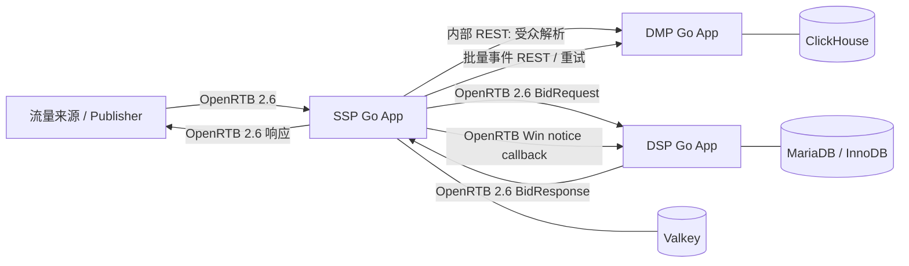

# Open Ads 系统概要设计

状态：设计提案，尚未进入开发。本文用于评审边界、数据责任和关键风险；吞吐、地域、隐私法规和服务等级目标仍需业务确认。

## 1. 目标与约束

设计三个可独立构建、发布、扩缩容的 Go 应用：

- **SSP**：接入流量、执行竞价编排、对外返回 OpenRTB 响应。业务数据存储使用 Valkey。
- **DSP**：接收 OpenRTB BidRequest、做广告候选筛选和出价。业务数据存储使用 MariaDB。
- **DMP**：管理受众数据和快照，提供受众解析及事件写入 API。业务数据存储使用 ClickHouse。

三个应用各自拥有领域模型、数据库、迁移/发布流程和运行时配置。禁止共享领域实体、存储模型、数据库、Go `common` 业务包或跨库查询。服务间只通过有版本的 HTTP 契约交互。

开发语言为 Go；HTTP 使用标准库 `net/http`，业务层不依赖 Web 框架。数据库驱动和 OpenRTB wire DTO 属于基础设施依赖，不构成领域共享。

## 2. 标准与边界

- SSP 与 DSP 的竞价请求/响应遵守 **OpenRTB 2.6**。SSP 是 exchange，DSP 是 bidder；在每个应用内独立实现 wire DTO 到本地领域对象的映射。
- SSP 到 DMP 的受众解析是内部 REST API，不属于 OpenRTB。DMP 返回 provider/segment 标识后，SSP 将其映射到 OpenRTB 2.6 的 `user.data[].segment[]`，再发送给 DSP。
- 私有字段只放在明确约定的 `ext` 中；不得修改标准字段含义，也不得要求 DSP 理解 DMP 的内部模型。
- 每个应用维护自己的 OpenRTB 2.6 契约测试和支持能力清单。具体媒体格式及扩展范围在需求评审后确定。

## 3. 领域职责

| 应用 | 自己负责的业务事实 | 不负责 |
|---|---|---|
| SSP | Publisher、Property、Placement、SupplyEndpoint、AuctionPolicy、Deal、Auction 与竞价结果 | DSP 广告主/预算事实、DMP 用户画像事实 |
| DSP | Advertiser、Campaign、LineItem、Creative、Targeting、Budget、BidDecision、WinSettlement | SSP 库存和拍卖事实、DMP 原始用户画像 |
| DMP | DataProvider、IdentityNamespace、ConsentEvent、SegmentDefinition、MembershipSnapshot、AudienceResolution | SSP/DSP 的账号、广告投放、竞价和预算事实 |

跨服务标识符在接收方是外部引用值，不是共享实体或数据库外键。每个 bounded context 自己校验外部引用并处理其不存在/过期情况。

## 4. 关键设计决定

1. **实时边界**：SSP 并发调用 DMP 与多个 DSP，并以 OpenRTB `tmax` 为总截止时间；DMP 查询和 DSP 调用各自有更短的可配置超时。预算耗尽时不等待完整超时，立即按配置降级。
2. **DMP 降级**：无标识、无授权、缓存未命中且 DMP 超时等情况下，不发送受众数据；SSP 是否继续竞价由 Placement 的隐私/受众策略决定，默认继续无受众竞价。任何策略都不得绕过 consent。
3. **DSP 热路径**：竞价决策读取已校验的内存快照，不在每个 bid request 上读取 MariaDB；预算以有界额度租约分配给 DSP 实例，并由 MariaDB 事务结算，避免多实例各自超支。
4. **DMP 查询模型**：ClickHouse 保存追加式事件和不可变受众快照。先完整写入并校验快照，再追加发布标记；解析只读已发布版本，不依赖跨表事务或 `FINAL`。
5. **SSP 存储模型**：Valkey 存 SSP 管理配置、短期受众结果缓存和事件 outbox。竞价过程中的临时对象留在进程内；不把每个请求/完整 OpenRTB payload 长期存入 Valkey。
6. **投放审计**：实时接口只保留必要的去敏事件字段。敏感标识使用受控的伪名化 token；原始 IP、完整 user ID、consent string 和完整 BidRequest 不写普通日志。

## 5. 组件视图

## 6. 设计验收门槛

开发前必须确认：峰值 QPS、请求体大小、调用地域/网络拓扑、OpenRTB 媒体格式、拍卖类型、预算精度与超支容忍度、DMP 数据新鲜度、隐私法规和数据保留期限。随后用目标规模压测验证 SSP 总延迟分配、Valkey 内存/持久性、DSP 热更新与预算租约、ClickHouse 受众查询 P95/P99。

特别注意：ClickHouse 面向分析和批量写入，不是传统 OLTP。若 DMP 逐用户查询的吞吐/尾延迟无法通过快照布局、SSP 短 TTL 缓存和压测目标，需在开发前重新评估“DMP 仅使用 ClickHouse”这一约束，不能通过掩盖查询延迟来宣称满足在线服务等级。

详细内容见 [HLD](HLD.md) 与 [LLD](LLD.md)。