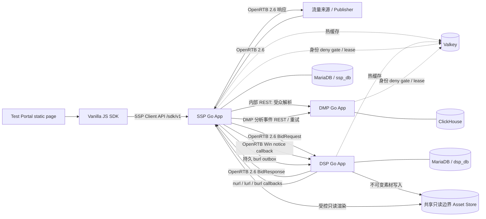

# Open Ads 系统概要设计

状态：设计提案，尚未进入开发。本文为跨职能评审总览，用于定义系统边界、数据责任、关键决策、验收门槛和落地要求；本轮已确认的性能与目标市场基线见 §6，其余部署拓扑和服务等级目标仍需确认。本轮不评审适用法规及法律依据。

## 0. 文档职责与阅读顺序

本目录下的设计文档按“职责分层”组织，目标是让架构师、开发人员和接口集成方以从总体到细节的方式阅读设计，避免职责混淆：

| 文档 | 主要职责 | 读者关注点 | 适合场景 |
|---|---|---|---|
| README | 系统级总览、边界、关键决策、风险、验收门槛和审查项 | 业务边界、数据责任、开放问题、启动条件 | 架构评审、需求确认、开发前门槛审核 |
| HLD.md | 高层架构、服务职责、部署边界、跨服务交互、非功能要求 | 服务边界、时序、故障域、隐私与安全、容量与可观测性 | 架构设计讨论、跨团队协作 |
| LLD.md | 低层结构、模块划分、存储布局、算法约束、数据约束、实现门槛 | 实现方式、表结构、状态机、幂等和一致性规则 | 实施设计、代码结构、数据库与接口落地 |
| API.md | 协议契约、HTTP 路径、字段、版本、错误语义 | 请求/响应结构、版本策略、契约兼容性 | 接口开发与集成测试 |

设计文档的阅读顺序建议为：
1. 先阅读 README，掌握系统边界、职责和验收门槛。
2. 再阅读 HLD，理解服务关系、时序和关键安全/容量问题。
3. 再阅读 LLD，确认实现结构、状态和数据层约束。
4. 最后查看 API，作为协议实施和集成测试依据。

开发任务拆解、建议迭代顺序及验收/测试矩阵见[首期开发计划](../plan/implementation-plan.md)。该计划是基于本设计提案的执行草案，不代表提案已经批准或允许生产上线。

> 说明：README 负责定义“什么是应该做的事情”和“什么不能做”；HLD 负责定义“系统怎么拆”；LLD 负责定义“实现要怎么做”；API 负责定义“对外怎么交互”。

### 0.1 提交版结构说明

本设计文档按以下结构组织，便于从整体架构到实现细节逐步展开：

1. 目标与约束、标准与系统边界（§1-2）。
2. 领域职责与关键设计决策（§3-4）。
3. 组件视图与首期 MVP 范围（§4.1-5）。
4. 设计验收门槛与实施前一致性要求（§6-7）。

可观测性、部署与容量/SLA 输入项由 [HLD.md](HLD.md) §7-8 展开定义；接口契约由 [API.md](API.md) 定义。

此结构适用于提交给架构师和开发团队审阅，能够直接支撑后续开发、接口设计和测试设计。

### 0.2 提交版术语表

为保证 README、HLD、LLD 与 API 在口径上保持一致，本设计采用统一术语，并以本表为主语义表：

| 术语 | 定义 | 适用文档 |
|---|---|---|
| SSP | 供给侧拍卖与广告投放入口，负责接入流量、OpenRTB 竞价编排和 publisher payable 逻辑 | README / HLD / LLD / API |
| DSP | 广告主侧出价与投放决策服务，负责 campaign/line item/creative/targeting/budget 相关决策 | README / HLD / LLD / API |
| DMP | 受众管理与成员快照服务，负责身份/受众解析、撤回门禁和快照发布 | README / HLD / LLD |
| Valkey | 热配置缓存、有界事件缓冲及有持久权威记录支撑的安全协调状态（identity deny gate、admission lease）；不是财务或广告投放事实源 | README / HLD / LLD |
| fact source | 业务事实的权威持久化来源，SSP/DSP 为 MariaDB，DMP 为 ClickHouse | README / HLD / LLD |
| reservation | 单次出价从租约额度中扣留的最大计费风险；与 account/lease 状态分开管理，不等同于租约本身 | HLD / LLD |
| billable event | 影响收入、支出或对账结算的有效计费事件；必须进入账务账本和幂等结算流程 | HLD / LLD |
| bearer token | AEAD 加密并认证的短期凭据；claims 不可由客户端读取，按用途、audience 和期限限制，且不得记入日志 | README / HLD / LLD / API |
| deny gate | 用于阻止无授权、无同意或已撤回主体进入受众解析/启用的安全门禁 | HLD / LLD |
| outbox | 与源事务绑定的可靠事件投递通道，保证必须可靠传播的业务事实不丢失 | HLD / LLD |
| no-bid | 由于超时、预算、策略或隐私条件而拒绝参与竞价；不等同于失败并发或系统错误 | README / HLD / API |

本设计中，只有在 README 中给出“总览定义”的概念才作为统一语义，HLD 与 LLD 对同一术语的解释必须与 README 保持一致；如需扩展术语，仅在相关章节中进行限定说明，不得改变总览中已定义的语义。

## 1. 目标与约束

设计三个可独立构建、发布、扩缩容的 Go 应用：

- **SSP**：接入流量、执行竞价编排、对外返回 OpenRTB 响应。业务事实存储在 MariaDB 独立数据库 `ssp_db`，Valkey 仅缓存热数据。
- **DSP**：接收 OpenRTB BidRequest、做广告候选筛选和出价。业务事实存储在 MariaDB 独立数据库 `dsp_db`，Valkey 仅缓存热数据。
- **DMP**：管理受众数据和快照，提供受众解析及事件写入 API。业务数据存储使用 ClickHouse。

三个应用各自拥有领域模型、数据库所有权、迁移/发布流程和运行时配置。SSP 与 DSP 可部署在同一 MariaDB 集群，但必须使用不同数据库、账号、迁移流程和最小权限授权；不能跨库查询或共享表。DMP 独立使用 ClickHouse。Valkey keyspace 按应用和 ACL 隔离：SSP/DSP 用于可重建缓存/短期缓冲；SSP/DMP identity deny gate 与短期 admission lease 是有持久撤回记录支撑的安全协调状态，必须可恢复，不能承载财务或广告投放事实。服务间不得共享领域存储；Creative Asset Store 是明确例外的无领域模型对象存储基础设施，DSP 以写权限上传不可变素材，SSP 以只读权限渲染，双方只交换受版本控制的 asset_ref/元数据和 HTTP 契约。禁止共享领域实体、存储模型、Go `common` 业务包或跨库查询。

开发语言为 Go；HTTP 使用标准库 `net/http`，业务层不依赖 Web 框架。数据库驱动和 OpenRTB wire DTO 属于基础设施依赖，不构成领域共享。

另提供独立静态 **Test Portal** 和轻量原生 JavaScript SDK 作为测试工具，不构成第四个广告业务 bounded context。SDK 浏览器 API 是 SSP 自有的版本化 client contract，不是 OpenRTB；SSP 将其映射为 OpenRTB 2.6 再请求 DSP。

## 2. 标准与边界

- SSP 与 DSP 的竞价请求/响应遵守 **OpenRTB 2.6**。SSP 是 exchange，DSP 是 bidder；在每个应用内独立实现 wire DTO 到本地领域对象的映射。
- SSP 到 DMP 的受众解析是内部 REST API，不属于 OpenRTB。DMP 返回 provider/segment 标识后，SSP 将其映射到 OpenRTB 2.6 的 `user.data[].segment[]`，再发送给 DSP。
- 私有字段只放在明确约定的 `ext` 中；不得修改标准字段含义，也不得要求 DSP 理解 DMP 的内部模型。
- 每个应用维护自己的 OpenRTB 2.6 契约测试和支持能力清单。首期仅支持 image banner；其他媒体格式及扩展范围在后续需求评审后确定。
- 首期 sandbox MVP 固定为单一 image banner、单币种 placement、OpenRTB `at=1` first-price CPM；不支持 video/native、Deal、频控、pacing 或生产结算。DSP 的 daily/lifetime LineItem 预算仍生效；daily budget 使用 UTC 自然日，按 `00:00 UTC` 切换，不使用租户本地时区或夏令时。
- 首期 targeting 只支持 `site.domain` 精确匹配、`site.page` 路径前缀匹配和 banner 宽高精确匹配；指定维度间 AND，同维度列表内 OR。没有规则的维度不限制投放。**DMP audience segment（OpenRTB `user.data[].segment[]`）在首期 MVP 仅作为 SSP→DSP 的透明透传字段，DSP 出价与 Targeting 不读取、不匹配、不依赖 segments；DMP 子系统完整可独立验收（快照发布、受众解析、撤回屏障），但该能力对竞价候选结果不产生差异化影响。生产启用 segment-level targeting 前需评审新的 Targeting 维度、编译快照字段与压测。**
- Sandbox 的有效、签名 impression tracker event 是演示账本的 billable trigger；同一 bid 最多计一次，click 只记录测量事件。此规则不构成生产反作弊或付款依据；启用生产结算前必须批准 IVT/可见性规则、publisher 合同和账务对账策略。
- MVP publisher payable 暂按有效 DSP billable 金额的 100% 记账，不计税费或 SSP fee；收入分成、付款/打款和多币种换汇不在首期范围。SDK/管理控制面只用于 sandbox。
- DMP audience 可选，MVP 默认不传用户身份；只有有授权且 deny gate 可用时才解析受众。DMP 撤回完成语义由 ClickHouse 持久 tombstone 与 DMP 专用 Valkey deny gate 共同保证。
- 生产供给接入还须定义 `ads.txt`/`app-ads.txt` 授权校验、`sellers.json` seller 映射和 OpenRTB `source.schain` 的生成/透传策略。仅 sandbox 流量可暂缓。
- Test Portal/JavaScript SDK 到 SSP 使用 `/sdk/v1` client API；该 API 只返回浏览器渲染所需的安全字段，禁止让浏览器直接访问 DSP、DMP 或 MariaDB。
- OpenRTB `user.id`、`buyeruid`、`eids` 按各自标准语义使用；不创建在三个应用间共享的全局 user ID。

## 3. 领域职责

| 应用 | 自己负责的业务事实 | 不负责 |
|---|---|---|
| SSP | Publisher、Property、Placement、SupplyEndpoint、AuctionPolicy、Deal、Auction、PublisherScopedSubject、PartnerIdentityLink、DeliveryLog、PublisherPayableLedger | DSP 广告主/预算事实、DMP 用户画像事实 |
| DSP | Advertiser、Campaign、LineItem、Creative、Targeting、Budget、BidDecision、DeliveryLog、AdvertiserSpendLedger | SSP 库存和拍卖事实、DMP 原始用户画像 |
| DMP | DataProvider、IdentityNamespace、ConsentEvent、SegmentDefinition、MembershipSnapshot、AudienceResolution | SSP/DSP 的账号、广告投放、竞价和预算事实 |

跨服务标识符在接收方是外部引用值，不是共享实体或数据库外键。每个 bounded context 自己校验外部引用并处理其不存在/过期情况。

## 4. 关键设计决定

1. **实时边界**：SSP 并发调用 DMP 与多个 DSP，并以 OpenRTB `tmax` 为总截止时间；DMP 查询和 DSP 调用各自有更短的可配置超时。预算耗尽时不等待完整超时，立即按配置降级。
2. **DMP 降级**：无标识、无授权、缓存未命中且 DMP 超时等情况下，不发送受众数据；SSP 是否继续竞价由 Placement 的隐私/受众策略决定，默认继续无受众竞价。任何策略都不得绕过 consent。
3. **SSP/DSP 热路径**：MariaDB 是各自业务事实源；配置变更经版本化刷新到 Valkey 和进程内只读快照。RTB 请求只读缓存/内存，不回源 MariaDB；缓存未预热或超过新鲜度上限时，实例不就绪或对受影响业务 no-bid。
4. **DSP 预算**：第一期仅支持 LineItem 的 daily/lifetime 预算，不设独立 Campaign 总预算。竞价决策不在每个 bid request 上读取 MariaDB；预算以后台预分配的有界额度租约供实例使用。节点发送 bid 前在本地从租约可用额扣留最大计费风险，DSP 在 notice URL 中携带 AEAD 加密认证的 reservation reference。loss 与 billable notice 都通过 MariaDB 事务按 reservation ID 幂等结算：loss 释放全局预留，billable 将预留转为实际 spend 并释放差额；已释放额度只进入全局可用池，不补回旧实例租约。实例失联时，未结算额度继续占用预算到结算宽限期结束；迟到 notice 隔离对账。
5. **DMP 查询模型**：ClickHouse 保存追加式事件和不可变受众快照。先完整写入并校验快照，再追加发布标记；解析只读已发布版本，不依赖跨表事务或 `FINAL`。
6. **缓存职责**：Valkey 存 SSP/DSP 热配置快照、短期受众解析结果和有明确保留策略的短期缓冲数据；MariaDB 才是 SSP/DSP 持久业务事实源。Valkey Stream 是有界事件缓冲，不称为事务 outbox，也不承诺超出其持久化/保留配置的零丢失。
7. **事件与财务分层**：账务事实及必须可靠传播的领域事件在各自 MariaDB 事务中写入账本/outbox；普通竞价诊断和 DMP 分析事件可经 Valkey Stream at-least-once 批量投递，必须定义保留、积压、丢弃和允许丢失目标。SSP 账本表达 publisher 应付，DSP 账本表达 advertiser 消耗；不跨库共享账务模型。
8. **计费语义**：OpenRTB `nurl` 是赢标通知，不代表已展示或可计费；DSP spend 以经验证的 `burl`/双方约定 billable event 入账。Publisher payable 由 SSP 的 publisher 合同计费策略计算。
9. **投放审计**：实时接口只保留必要的去敏事件字段。敏感标识使用受控的伪名化 token；原始 IP、完整 user ID、consent string 和完整 BidRequest 不写普通日志。
10. **测试入口**：门户使用独立的测试租户/fixture；测试环境与生产环境隔离。
11. **身份隔离**：SSP 是 exchange identity mapping 的拥有者；为每个 publisher/partner 建 pairwise alias。DMP 只用 tenant/namespace-scoped HMAC token 查受众，DSP 只接收自身 `buyeruid` 和明确授权的 `eids`；无同意/无映射时不传身份，不做 fingerprinting。
12. **投放控制范围**：频次上限和 pacing 属于 DSP 投放策略，不等同于竞价预算租约，且明确不在首期 MVP 支持范围。首期 daily budget 按 UTC 自然日重置；后续若增加频控/pacing，必须先定义维度、窗口/时区、状态存储和跨实例一致性。

### 4.1 首期 MVP 范围

首期以可完整演示的 sandbox 闭环为验收目标：管理员配置 Supply/Placement 和 DSP advertiser/campaign/line item/creative；Supply 或 SDK 发起请求；SSP 并发调用 DSP；DSP 按已发布 targeting 与预算快照出价；SSP 返回受控图片 render URL；有效 impression 经 SSP tracker 去重后写 SSP payable ledger，并通过持久 outbox 通知 DSP 写 spend ledger。Click 只产生非账务测量事件。Test Portal 能查看 no-fill、request ID、阶段耗时和脱敏诊断。

首期不接受真实 publisher payout 或 advertiser invoice；投放到生产流量前，必须完成本文件验收门槛中的业务、容量、隐私和供给授权确认，并补齐生产反作弊/结算策略。DMP 可单独验证快照解析与撤回屏障，不是无身份 contextual auction 的前置依赖。

## 5. 组件视图

## 6. 设计验收门槛

本轮评审已确认以下首期基线：仅做 sandbox 闭环，不接生产流量或真实结算；目标市场为日本；SSP 对外广告请求入口峰值目标为 3,000 QPS，DSP fan-out 与 DMP 查询按该入口负载派生；sandbox SSP 广告请求端到端延迟 P95、P99 均不超过 100 ms；subject/身份映射与 DMP membership snapshot 最长保留 3 个月，DMP 分析事件保留 12 个月，期限从数据创建/入库时间起算且不无限续期；到期或撤回时立即关闭在线 deny-gate admission，ClickHouse 主存储在触发后 30 天内完成物理删除，备份按 90 天滚动到期。撤回 tombstone 保留至关联快照物理删除完成，之后最多再保留 90 天用于审计。DMP 在首期可独立验收，不影响竞价，segment 仅透传。

以上是本轮确认的产品/工程目标，不代表法律合规评审结论（本轮不评审该事项）。开发前仍须确认请求体大小、具体部署地域与网络拓扑、未列明数据（包括 SSP/DSP delivery event 与账本）的技术保留规则、撤回完成 SLA、OpenRTB profile、超支容忍度及预算舍入/结算策略、reservation 最大有效窗口、publisher payable 与 advertiser billable 的业务依据、生产供给授权/透明度范围、缓存最大陈旧时间、DMP 数据新鲜度，以及非账务事件允许丢失目标。MariaDB 首期最低版本为 10.6，以满足 `SELECT ... FOR UPDATE SKIP LOCKED` 的实现约束。所有 `*_micros` 金额字段固定表示百万分之一主币单位；预算和账本按币种分别记账，最终结算到 ISO-4217 最小单位时按已约定规则舍入。随后用目标规模压测验证 SSP 总延迟分配、Valkey 缓存命中/内存、MariaDB 控制面/账务写入与后台预算租约、ClickHouse 受众查询 P95/P99；另验证重复/冲突 notice、迟到 billable notice 与租约回收竞争、跨节点撤回屏障、事件积压/丢失目标、缓存冷启动和 MariaDB 故障期间的行为。

特别注意：ClickHouse 面向分析和批量写入，不是传统 OLTP。若 DMP 逐用户查询的吞吐/尾延迟无法通过快照布局、SSP 短 TTL 缓存和压测目标，需在开发前重新评估“DMP 仅使用 ClickHouse”这一约束，不能通过掩盖查询延迟来宣称满足在线服务等级。

## 7. 实施前一致性要求

为保证系统能够从设计走到真实开发，以下要求必须在实现前形成统一理解，并在后续实现和测试中持续遵守：

### 7.1 预算与结算一致性

- 预算账户/租约与单次 reservation 是不同粒度：账户额度由全局可租、已租额度及已花费额度约束；租约到期停止新出价，未结算额度保留至 grace 结束。
- 单次 reservation 在出价前从本地租约可用额中原子扣留最大计费风险。收到 `nurl` 只记录非计费 win，不改变 reservation 或 held 额度。
- 同一 reservation 的 `lurl` loss 与 `burl` billable 是互斥终态：loss 释放全部预留额；billable 将实际金额转为 spend 并释放差额。grace 后未结算 reservation 才可回收；迟到或冲突结果隔离对账。
- 预算租约首期参数：每实例/LineItem/预算范围初始最多租取该范围可租余额的 10%，单次租额上限为预算限额的 5%；租约 TTL 为 30 秒，剩余可用额度低于租额的 25% 或租约剩余 TTL 低于 10 秒时异步续租。续租只能从全局可租余额分配；失联租额在 held 风险结算/宽限后回收。运营压测可调小但不得扩大配置定义的上限。
- 租约按 `daily` 与 `lifetime` scope 分别建立 `budget_account`；daily 账户在 UTC 日期首次租额申请时以唯一键惰性创建。lifetime 的 `period_start` 是 LineItem 生效起点 UTC 日期（LineItem 可继承 Campaign 起止时间，也可定义更窄的起止时间）。下调限额若低于已花费金额则拒绝；若 `spent + leased` 高于新限额，提交后暂停新租额/出价，已持有 reservation 仍按原状态结算，直至余额回到限额内。
- 通知去重与账务幂等使用不同标识：`notice_id` 去重 notice 投递/记录，`reservation_id` 标识预算预留，`source_event_key` 标识账务事件。各自必须跨重试稳定，但不得混作同一个幂等键；账务事务按 reservation 与 source event 规则共同校验。
- 账务冲正必须以新分录记录，不允许直接更新历史金额。
- 授权的部分冲正必须关联原分录；同一原分录累计冲正绝对值不得超过原金额，币种相同且方向相反，并在锁定原分录的事务中校验。

### 7.2 数据与隐私边界

- DMP 的 segment 在首期 MVP 中仅用于 SSP→DSP 透传，不参与 DSP 投放筛选和出价决策。
- DSP 首期仅消费 `site.domain`、`site.page`、banner 尺寸和预算快照，不读取 `user.data[].segment[]`。
- `targeting.segments` 必须在发布校验阶段拒绝，避免业务误以为 segment targeting 已启用。
- consent、deny gate、identity revocation 与 subject lease 必须 fail-closed，不能在状态不确定时继续投放。

### 7.3 缓存与事件边界

- Valkey 承担热配置缓存、短期可重建缓存、有界事件缓冲及安全协调状态；不作为财务或广告投放事实源。deny gate/lease 的持久权威记录必须在 SSP/DMP 各自事实源中，Valkey 使用 no-eviction 策略并可按 epoch 重建。
- 缓存丢失必须可恢复，不能造成业务事实丢失。
- 账务事实必须写入事务账本或事务 outbox；非账务事件可使用有界缓冲并允许在积压时丢弃或裁剪。

### 7.4 实施顺序

设计与开发应按风险优先级推进：
1. 基础 RTB 协议与请求流
2. 预算状态机与结算闭环
3. DMP 透传与隐私门禁
4. 账务 outbox 与事件投递
5. Portal/SDK 与 sandbox 渲染链路
6. 生产增强项（延期实现）

### 7.5 验收要求

实现前必须完成测试设计，至少覆盖以下场景：
- budget lease workflow
- duplicate notice handling
- loss vs billable precedence
- DMP deny gate fail-closed
- cache miss behavior
- outbox replay behavior
- 多 scope 预算扣留的全有或全无及失败回滚
- 被 floor/币种/creative/deadline 校验丢弃的已收到 bid 的 loss notice 与 reservation 回收；未收到响应的 reservation grace 回收
- 多实例配置发布/manifest 轮询、版本加载报告和 readiness 陈旧摘除
- key rotation 时撤回覆盖所有有效/历史 key version，并以全版本 deny 确认后才标记 completed
- 清空 Valkey 后仅凭 AEAD event token 从 impression 可靠恢复财务上下文并入账
- 篡改、跨用途、错误 audience、过期和未知 key version 的 AEAD token 必须 fail closed；轮换旧 key 前验证其 token 与关联 reservation 全部过期
- 部分/全额冲正、重复冲正、并发冲正、超原金额和币种不匹配均按 ledger 规则处理
- `site.page` 完整 URL 保留及 `site.ext.openads.normalized_page_path` 的编码斜杠、尾点、IDN、端口规范化向量
- version conflict handling

本节要求与 [HLD](HLD.md) 与 [LLD](LLD.md) 的实现门槛保持一致，确保设计、实现和验证用同一套边界和语义。

详细内容见 [HLD](HLD.md)、[LLD](LLD.md) 与 [API 设计](API.md)。
