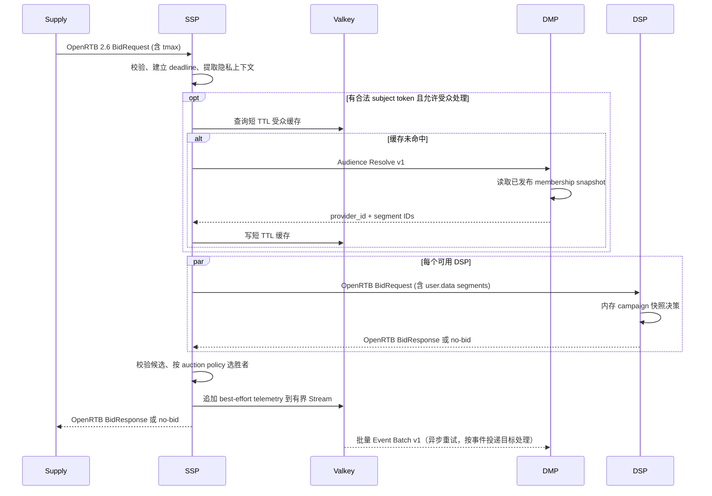
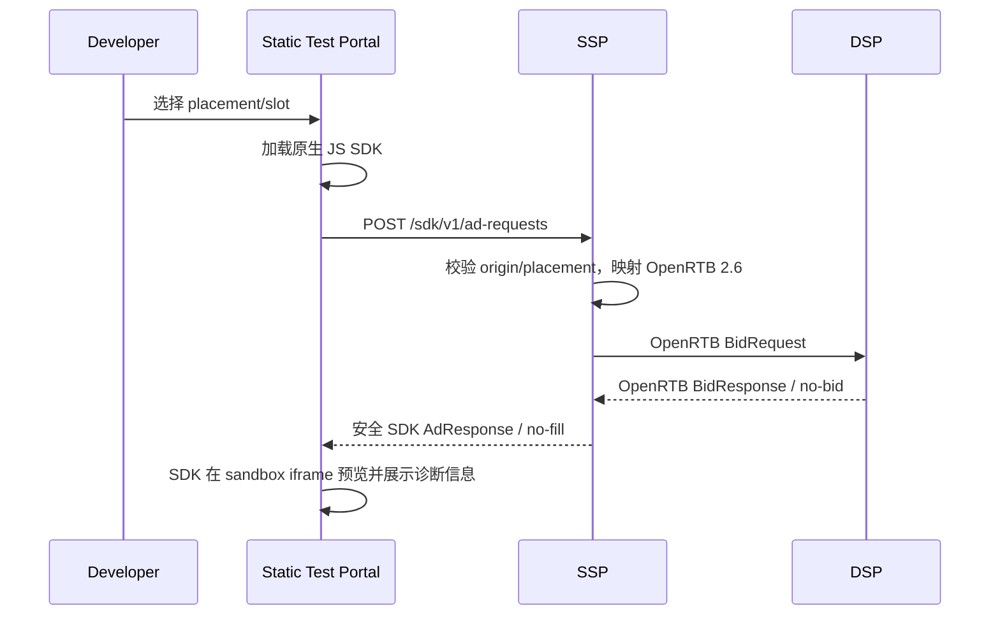
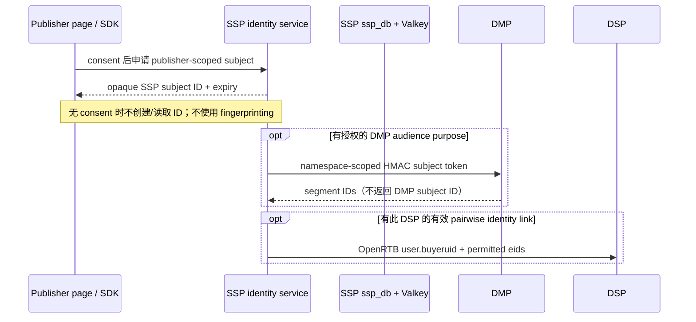
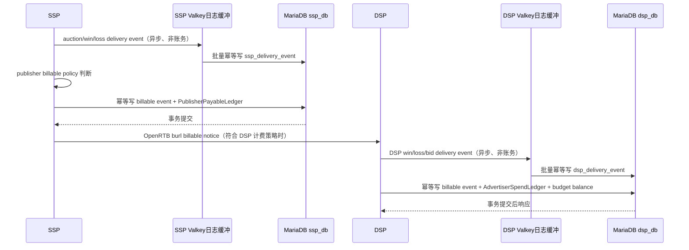

# Open Ads 高层设计（HLD）

状态：提交版设计，供架构评审、跨团队协作和开发实施使用。本文档与 [README.md](README.md) 和 [LLD.md](LLD.md) 保持统一术语、统一边界与统一验收门槛，采用同一套提交口径描述系统设计。

## 1. 设计目标与范围

本章定义高层架构目标、系统边界和设计范围，聚焦于：

- 三个核心应用的职责边界：SSP、DSP、DMP
- 交互模型：OpenRTB、内部 REST、事件投递和审计链路
- 数据归属：各自数据库所有权、缓存边界和事实来源
- 非功能要求：性能、隐私、撤回、可观测性和扩展性

本设计面向实现阶段的工程落地，不包含具体代码结构细节；代码级组织、数据表设计和接口契约在 [LLD.md](LLD.md) 与 [API.md](API.md) 中定义。

### 1.1 统一术语

共享术语以 [README.md](README.md) §0.2 为准。本文件只在需要时定义架构专用名称，不另行复制或改写全局定义。

## 2. 系统上下文

三个服务独立部署、独立故障域、独立数据所有权。服务发现、TLS、密钥分发和部署平台暂不绑定特定云或编排系统。内网 API 使用加密传输；公网 SSP 入口另有流量清洗、限流和请求体上限。

SSP 与 DSP 的业务事实分别存放在 MariaDB 的 `ssp_db`、`dsp_db`，使用独立数据库账号、授权、迁移和连接池；可先共用 MariaDB 集群，但应用没有跨库查询权限。Valkey 的 SSP/DSP keyspace 是热缓存，不是事实源；DMP 另有隔离 ACL/keyspace 的在线撤回 deny gate，其持久权威记录仍是 ClickHouse tombstone。RTB 竞价路径不得因缓存 miss 同步回源 MariaDB。

Test Portal 是独立静态测试客户端，不增加第四个广告业务域或数据库。原生 JS SDK 调用 SSP Client API；SSP 将 client request 映射成 OpenRTB 2.6 BidRequest，DSP 仍只接收标准 OpenRTB。Portal 仅连接 sandbox/test 环境。

| 调用方 | 被调用方 | 契约 | 同步性 | 超时/失败行为 |
|---|---|---|---|---|
| Supply | SSP | OpenRTB 2.6 BidRequest/BidResponse | 同步 | 总预算受 `tmax` 和供给方约定约束；生产供给另校验 ads.txt/app-ads.txt 授权并生成/透传 schain |
| Test Portal / JS SDK | SSP | SSP Client API v1 (`/sdk/v1/ad-requests`) | 同步 | 精确 CORS allowlist 与 rate limit；返回安全渲染 DTO |
| SSP | DSP | OpenRTB 2.6 BidRequest/BidResponse | 同步、并发 fan-out | 单 DSP 超时视为 no-bid；其余 DSP 继续 |
| SSP | DMP | 内部 `Audience Resolve v1` | 同步，可短 TTL 缓存 | 超时不阻塞整个拍卖；按 Placement 策略无受众继续或 no-bid |
| SSP | DMP | 内部 `Event Batch v1` | 异步重试，经有界 Valkey Stream | 分析事件按 at-least-once 投递；最大积压、保留期和允许丢失目标必须配置并告警；若某事件必须可靠传播，改用与源事务绑定的 MariaDB outbox |
| SSP | DSP | OpenRTB `nurl`/`lurl`/`burl` notice URL | 异步回调，按双方 profile | `nurl` 只记 win 且不释放 reservation；`lurl` 与 `burl` 是互斥结算终态；方法、宏和重试策略由接入 profile 确定 |
| Browser render iframe | SSP | `POST /sdk/v1/impressions`、`POST /sdk/v1/events` | 异步 | 校验签名 event token、期限、auction/bid/imp 绑定及唯一 event key；MVP impression 最多 billable 一次，click 永不触发财务 |
| SSP tracker | DSP | bidder 返回的 `burl`（双方约定 JSON POST profile） | 持久 outbox 异步重试 | 仅在 impression/payable 事务提交后发送；DSP 按 reservation/event ID 幂等结算，重试不重复扣预算 |

OpenRTB 的 no-bid 语义和 HTTP 表达按 2.6 契约实现；不得把内部 DMP API 包装成 OpenRTB endpoint。

实施顺序、隐私/缓存/账务边界和验收门槛统一见 [README.md](README.md) §7；HLD 负责展开跨服务拓扑、时序、故障语义和非功能要求，不重复维护门槛清单。

### 2.1 核心时序

实际实现可让 DMP 查询与 DSP fan-out 并行；只有需要受众数据的 DSP 请求必须等待解析，未配置受众依赖的 DSP 可以先并发发起。实现不得越过总 deadline。

#### 2.1.1 Test Portal 与 JS SDK 请求流

Portal 的诊断视图默认去敏，不显示完整 OpenRTB 用户对象或身份 token；提供 request/response 的结构化脱敏摘要及各阶段 latency。

#### 2.1.2 User ID sync 时序

SSP `user.id` 是 exchange-scoped；对每个 DSP 生成/保存独立 pairwise `buyeruid`。DMP 使用按 tenant/publisher namespace 派生的伪名 token，不保存或回传 DSP buyer ID。没有 mapping 时省略 `buyeruid`；是否发送 exchange ID/EID 由 consent、provider agreement 和 DSP profile 决定。不得为弥补第三方 cookie 限制而 fingerprint 用户。

## 3. 配信日志与结算时序

竞价诊断和分析 delivery event 通过各自有界 Valkey Stream 缓冲，以 at-least-once 消费者批量写入对应 MariaDB 的 `ssp_delivery_event`/`dsp_delivery_event` 或 DMP；仅在下游确认后 ack，并以稳定 source event key 去重。该路径不是事务 outbox，必须公布允许丢失量/RPO、最大积压、保留期、trim 策略和故障恢复办法；达到丢弃阈值时告警。若某领域事件属于必须可靠传播的业务事实，应在产生该事实的 MariaDB 事务中写入 outbox，再异步投递。Valkey 不替代 MariaDB 账本。账务事件不得只存在缓存队列：publisher payable 触发事件在 `ssp_db` 原子落账，DSP 的 billable notice 在 `dsp_db` 原子落账。账务 endpoint 是独立回调，不阻塞原始 RTB BidRequest 的响应时限。

OpenRTB `nurl` 只表示赢标，不能单独产生 advertiser spend；`burl` 是 exchange 按约定 billable policy 调用的账单通知。publisher 应付金额按 SSP 与 publisher 的合同策略计算，可能基于有效展示或其他约定事件，不直接等同 DSP 的 bid price 或 advertiser spend。SSP gross revenue、publisher payable 和 SSP margin 是不同指标；本设计的 PublisherPayableLedger 只记录应付负债。

### 3.1 Sandbox billable event 顺序

首期 sandbox 的受控 render endpoint 返回 SSP 托管的静态图片 iframe 文档和短期 event token。图片加载后 iframe POST impression signal；SSP 校验 token 签名/期限、tenant/placement/auction/bid/imp 绑定和一次性 event key，在同一 MariaDB 事务中插入唯一 billable delivery event、PublisherPayableLedger 分录及 DSP billable outbox 记录。事务提交后异步向 DSP `burl` 发送稳定 `event_id`、reservation reference、金额和币种；DSP 验证后在原子结算事务中记 AdvertiserSpendLedger 和预算。点击通过 SSP redirect 记录非账务事件后跳转 allowlisted landing URL。过期、重放或绑定不匹配的事件不得记账。该规则只供 sandbox 账本验收，不代表生产 IVT/可见性保证；生产付款必须另行批准验证、争议和对账规则。

### 3.2 DSP 预算风险生命周期

预算总额按币种、LineItem 和预算周期维护 `spent + leased_total <= limit`。`leased_total` 包含实例本地可用额度及已扣留的在途风险，不重复相加。后台把额度租给唯一进程 incarnation；实例发 bid 前以稳定 reservation ID 在本地原子扣留该 bid 的最大 billable 金额，并在 DSP 返回的 notice URL 中放入签名 reservation reference。reference 至少绑定 tenant、line item、所有适用预算 lease/scope、auction/bid/imp、最大金额、币种、expiry 和 key version，不含用户标识。RTB 热路径不写 MariaDB。

收到合法 `lurl` 或 `burl` 后，DSP 在 MariaDB 单事务内插入唯一 reservation settlement，并校验租约状态/宽限期、币种和上限；事务先查询 reservation 的既有终态，重复同结果即使迟到也返回幂等成功，reservation ID 对应不同结果则隔离冲突。只有未结算且超过 grace 的 reservation 才隔离。loss 从各适用账户和 lease 的 `leased/held` 中扣除最大预留额，将额度退回全局池；billable 扣除同一预留额并增加实际 spend，预留与实际金额的差额回到全局池。已释放金额不补回原实例租约，因此重复 loss 不能恢复本地出价额度。一个 reservation 覆盖的所有预算范围须在同一事务成功，否则整体回滚。租约到期停止新 bid，但未结算的 held 额度保留到宽限期；`settlement_grace_until` 至少为 `expires_at + reservation 最大有效期 + render token 最大有效期 + 最大展示延迟 + 接入 profile 最大通知延迟 + 最大重试窗口 + 时钟偏差余量`。期满仍未收到终态 notice 的余额才回收。SSP 须对所有已收到但未胜出的 bid（含校验阶段被丢弃且可关联的 bid）发送 lurl；对无法关联、响应超时或胜出后未展示的 bid，额度只能挂起至 grace，须通过“未结算 held 额度占比”指标与阈值治理（见 LLD §3.3 第 7 条）。超出窗口的未结算 notice 隔离对账，不得使预算账户超限。

## 4. 服务与领域边界

### 4.1 SSP

- OpenRTB ingress/egress 适配器只负责协议验证、映射和响应序列化。
- Auction application service 协调 Placement 策略、DMP 解析、DSP 并发调用、响应校验、拍卖和 outbox。
- SSP domain 拥有供给库存和 auction policy；不持有 DSP campaign/creative/budget 或 DMP profile 对象。
- MariaDB adapter 实现 SSP 配置/供给领域的持久仓储；Valkey adapter 只实现版本化热配置缓存、短期受众缓存和短期事件缓冲。
- 配置控制面事务提交后，由后台 publisher 消费 outbox 构建快照并写入 Valkey，各实例的 syncer 再按版本号把变更同步到本实例进程快照（见 LLD §2.4.1）。auction handler 只读进程内快照或 Valkey，不在 RTB 路径回源 `ssp_db`。
- SSP 自己定义 `DeliveryLog` 与 `PublisherPayableLedger`；publisher 账务依据 publisher contract policy 和有效 billable event，在 `ssp_db` 原子记录。
- SSP 拥有 publisher-scoped subject 和 partner-specific identity link；pairwise mapping 在 `ssp_db` 持久化、Valkey/进程快照缓存。每个 OpenRTB outbound request 只取目标 DSP 对应 link。

### 4.2 DSP

- OpenRTB bidder adapter 校验版本、request ID、impression 和预算 deadline。
- Bid application service 使用 DSP 自己的 campaign/line item/creative/targeting/budget 领域快照生成候选。**首期 MVP Targeting 只消费 `site.domain` / `site.page` 的路径（取自 SSP 规范化写入的 `site.ext.openads.page_path`）/ banner size，不读取 OpenRTB `user.data[].segment[]`（DMP segment）；SSP 把 DMP 结果原样透传，但 DSP Bid Selection 对 segments 透明、不对其做过滤或加权。这一限制必须在 DSP publish 校验阶段明确拒绝 `targeting.segments` 字段，防止管理员误认为 segment targeting 已生效。**
- DSP 使用独立的 `dsp_db` 存配置、预算账本、预算租约和 win settlement；Valkey/进程内保存版本化候选与投放快照。
- 热路径只读已预热的本地快照（可由 Valkey 分发/恢复），不在每个 bid request 上读取 MariaDB。后台刷新器消费配置版本变更；预算租约在后台预分配，热路径仅在租约内原子地把可用额度转成在途风险额。
- 频控与 pacing 是独立于 lease 的投放控制策略；上线前需确定 line item 维度、时间窗口/时区、重置和多实例计数一致性。没有相应策略定义与状态存储的版本不得声称支持该策略。
- DSP 自己定义 `DeliveryLog` 与 `AdvertiserSpendLedger`；只对验证通过且符合计费策略的 billable event 入账。`nurl` win notice 只更新竞价状态，不自动扣 advertiser budget。
- DSP 只接收其自己的 OpenRTB `buyeruid`/获准 `eids`，不读取 SSP identity link 或 DMP 身份映射；DSP 不因竞价要求反向索取全局 user ID。
- 不调用 SSP/DMP 数据库。OpenRTB Win Notice 记为非计费赢标事件；DSP 只在 billable notice 到达后按内部唯一事件 ID 幂等扣减 advertiser spend。

### 4.3 DMP

- DMP API adapter 实现受众解析、快照发布和批量事件接入；只暴露 provider/segment 公开标识，不暴露 ClickHouse 行结构。
- Audience application service 负责授权检查、快照选择和结果限制。
- ClickHouse 保存不可变的 segment definition、membership snapshot、snapshot publication 及分析事件。
- SSP 与 DMP 都以共享 identity gate 管理 subject admission。SSP auction lease 覆盖 DMP 解析及所有 DSP fan-out 的完成/取消；撤回阻止新 lease 并等待旧 auction drain。DMP 另以 Valkey 原子 admission/in-flight lease 管理解析；撤回阻止新查询、持久化 tombstone 并等待旧查询 drain。SSP 持久禁用 subject/link，迟到结果不得进入 DSP bid request；双方 gate 状态不确定时 fail closed，撤回保持 `pending`。
- DMP 不读取 SSP Valkey 或 DSP MariaDB；SSP/DSP 也不直接查 ClickHouse。

## 5. 数据与一致性

- **SSP / MariaDB + Valkey**：`ssp_db` 是 SSP 配置/供给数据事实源，InnoDB 事务提交后由后台刷新器更新版本化 Valkey 缓存和进程内快照。Valkey 丢失可重建；RTB 缓存 miss 不允许直接读 DB，实例需使用仍在有效期的本地快照，否则对受影响 placement no-bid/不就绪。
- **DSP / MariaDB + Valkey**：`dsp_db` 是 DSP 配置、预算和 advertiser spend 结算事实源；daily budget scope 按 UTC 自然日、`00:00 UTC` 切换。独立事务保证预算账本和 billable settlement 一致性。Campaign 发布以版本号刷新 Valkey/内存快照；预算租约由后台预分配，实例报告已加载版本，发布控制面等待或告警未跟上的实例。
- **SSP 财务事件**：同一 MariaDB 事务插入去重后的 billable delivery event、追加 PublisherPayableLedger 分录并更新可重建的余额/日报汇总。应付分录不可覆盖；冲正以带原分录引用的新负分录表达。
- **DSP 财务事件**：同一 MariaDB 事务按 reservation ID 去重并核验终态，插入 delivery event、追加 AdvertiserSpendLedger 分录，并同步更新所有适用的 lease 与 BudgetAccount；重复 notice 幂等成功，冲正使用新分录。
- **日志语义**：delivery event 是追加式事件，至少一次投递，以稳定 event ID 去重；财务账本是可审计权威记录。运营报表可由日志/账本生成，汇总表可重建，不得反向覆盖账本。
- **跨系统对账**：SSP 与 DSP 通过 exchange/auction/bid/imp 标识和双方确认的计费事件做定期文件/API 对账；各服务只读写自己的库，不执行跨库 join。SSP publisher payable 与 DSP advertiser spend 金额允许按合同不同，差额应拆解为 fee/revenue share/tax/rounding 等显式项目。
- **身份映射**：身份 link 只由 SSP 持有且按 publisher/partner 隔离；DMP 收到 HMAC namespace token，DSP 收到自己的 buyeruid。不是三边复制同一个 user ID，也不创建跨库 user table。
- **数据库隔离**：`ssp_db` 与 `dsp_db` 分离账号、grant、连接池、schema migration 和备份恢复策略；同一 MariaDB 集群不等于共享领域数据库。任何服务禁止跨库读取另一个 bounded context 的表。
- **DMP / ClickHouse**：事件至少一次送达，报表和导出按 `event_id` 去重/唯一计数；不承诺恰好一次。受众快照全量装载、校验后再发布，查询固定 `snapshot_id`，避免读到半成品。
- 不做跨服务分布式事务。每个动作采用幂等键、重试和可观测的补偿/重放机制。

## 6. 容错、隐私与安全

- SSP 对 DSP 使用每目标独立连接池/并发限制；失败、熔断或超过 deadline 均视为 no-bid，不能拖住其他 DSP。
- DMP 查询必须有 SSP 端 Valkey 短 TTL 缓存、最大结果数、独立 timeout 和熔断。对无同意/无合法标识的请求不进行解析，也不将可识别原值作为缓存 key。
- Valkey telemetry Stream 需有最大容量、保留期、重试退避、允许丢失量和积压告警；只有已批准的非账务分析/诊断事件可按策略丢弃。MariaDB 事务 outbox 不得静默丢弃；容量不足时阻止/回滚对应的控制面变更并告警，RTB 热路径 telemetry 则按其独立 loss budget 处理，不延长响应 deadline。
- DSP 预算租约有额度、实例 owner、过期时间和回收规则；租约暂不可用时停止对相关 line item 出价，不得绕过预算限制。
- DSP 租约回收不得释放未结算的 bid 风险；loss/billing 必须按 reservation ID 在事务内结算。结算与宽限期回收必须锁定相同 lease/account 行；迟到或冲突 notice 隔离，不得重复增加全局可用额度。
- 账务通知先校验 auction/bid/imp 关联和币种/金额范围，再执行幂等落账；数据不匹配的 notice 隔离并告警，不计入 publisher payable 或 advertiser spend。
- 日志采集与财务入账使用不同队列/限流池，防止高流量诊断事件挤占账务写入容量；ledger 写失败必须重试/告警，不可静默丢弃。
- identity sync 必须有可审计的 consent purpose/version、partner allowlist、link TTL 与撤回/删除流程；原始 ID 使用 envelope encryption，仅用 keyed hash 做匹配索引。SSP 收到撤回先立即禁用本地 subject/link 并清缓存；DMP 先写共享 deny gate，再持久化撤回 tombstone，且两者确认后才返回完成；撤回覆盖当前所有生效（含双读窗口）key version 派生的 token。gate 不可用或状态不确定时，受众查询 fail closed；请求方在完成确认前不得重新发送该身份。
- DMP 的快照/API 响应只返回最小 segment 标识；事件和身份 token 的保留期、删除流程以及 ClickHouse 分区 TTL 需按法规与合同确定。
- 内部 API 实施每租户限流；错误响应不回显原始身份或完整请求体。

## 7. 可观测性和部署

每个服务拥有独立配置、健康检查、版本、指标和发布回滚。标准库 `net/http` 配合轻量中间件函数实现 request ID、deadline、结构化日志和 metrics/tracing 接口，不要求采用 Web 框架。

最低指标：入口 QPS/错误率/延迟分位数；SSP 各 DSP 响应时延、no-bid、超时和清算差异；SSP/DSP delivery event 接收/积压/去重数；publisher payable 与 DSP spend 入账金额、冲正金额、ledger 写入失败/延迟、DSP budget ledger reconciliation 差异；SSP/DSP Valkey 命中率、缓存版本与陈旧度；DMP cache hit、ClickHouse lookup 延迟、快照版本/新鲜度；DSP 预算租约余量、settlement 重复率、未结算 held 额度占比与最长挂起时长；Valkey 内存/淘汰率；分别按 `ssp_db`、`dsp_db` 观测 MariaDB 连接池、事务冲突和慢查询；ClickHouse insert/query 延迟及 parts/磁盘水位。

## 8. 容量参数与 SLA 输入项

数值型 SLA、合规与保留策略需要业务输入后才能量化。设计验收门槛（SLA 输入项检查清单、是否允许进入实现的判定）统一见 [设计 README](README.md) §6，本节不重复列出。生产流量还须额外确定 ads.txt/app-ads.txt、sellers.json 和 schain 的接入责任与校验策略。

按服务划分的完整 API 路由、请求/响应见 [API 设计](API.md)。
